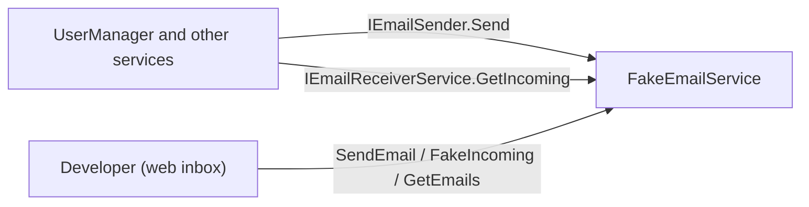

# SysWeaver.Email.Fake

[⬆ SysWeaver overview](../../README.md)

> A fake email provider for development and testing: "sent" emails are kept in memory and shown in a web inbox, failures and incoming emails can be simulated.

| | |
|---|---|
| **Layer** | Networking |
| **Kind** | Micro service |

## Purpose

Exercise sign up, password reset and other email flows (sending and receiving) without a real email provider or mailbox.

## How it fits into SysWeaver



Stands in for the senders ([SysWeaver.Email.Smtp](../SysWeaver.Email.Smtp/README.md), [SysWeaver.Email.AmazonSes](../SysWeaver.Email.AmazonSes/README.md), [SysWeaver.Email.MicrosoftAcs](../SysWeaver.Email.MicrosoftAcs/README.md)) and the readers ([SysWeaver.EmailReader.Imap](../SysWeaver.EmailReader.Imap/README.md), [SysWeaver.EmailReader.Pop3](../SysWeaver.EmailReader.Pop3/README.md)) at the same time.

## Key features

- Implements both `IEmailSender` and `IEmailReceiverService`
- Plain text and html emails
- Simulated failures: emails sent to addresses in `FailDomains` (sub domains included) fail (`Send` throws), the email is still listed as failed
- `FakeIncoming` simulates an email from a user to the system (returned by `GetIncoming`), `SendEmail` sends one as the system
- A standalone web inbox at `fakeEmail/index.html` (menu *Debug / Fake email*): live updates, search, html rendered in a sandboxed iframe or as source, compose, reply and delete, no external libraries
- `MessageTable` lists every email

## Key components

- [`FakeEmailService`](FakeEmailService.cs) - the fake sender / receiver and its web API
- [`FakeEmailParams`](FakeEmailParams.cs) - sender address, fail domains and queue sizes
- [`srcWeb/fakeEmail`](srcWeb/fakeEmail/index.html) - the web inbox (compressed and embedded at build time)

## Using it

```json
{ "Type": "SysWeaver.Email.FakeEmailService, SysWeaver.Email.Fake",
  "Params": {
    "From": "noreply@example.com",
    "FailDomains": [ "fail.example.com" ] } }
```

## Limitations and considerations

- Development only: its endpoints declare no authentication of their own, so on a server with anonymous API defaults email contents would be public
- The API is placed at `Api/fakeEmail/`, so only one instance per server is supported
- Emails are kept in memory only, and nothing is actually delivered

## Relationships

- **Project:** [`SysWeaver.Email.Fake.csproj`](SysWeaver.Email.Fake.csproj)
- **Builds on:** [SysWeaver.Common](../../SysWeaver.Common/README.md), [SysWeaver.MicroServices](../../SysWeaver.MicroServices/README.md), [SysWeaver.MicroServices.ServiceManager](../../SysWeaver.MicroServices.ServiceManager/README.md), [SysWeaver.TableData](../../SysWeaver.TableData/README.md)
- **Used by:** [FakeEmailService](https://github.com/dosh1974/SysWeaver.Services/blob/main/FakeEmailService/README.md) (SysWeaver.Services)
