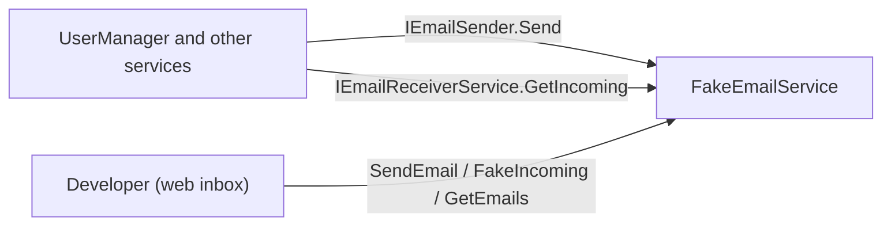

# SysWeaver.Email.Fake

[⬆ SysWeaver overview](../../README.md)

> A fake email provider for development and testing: "sent" emails are kept in memory and shown in a web inbox, failures and incoming emails can be simulated.

| | |
|---|---|
| **Layer** | Networking |
| **Kind** | Micro service |

## Purpose

Exercise sign up, password reset and other email flows (sending and receiving) without a real email provider or mailbox.

## How it fits into SysWeaver



Stands in for the senders ([SysWeaver.Email.Smtp](../SysWeaver.Email.Smtp/README.md), [SysWeaver.Email.AmazonSes](../SysWeaver.Email.AmazonSes/README.md), [SysWeaver.Email.MicrosoftAcs](../SysWeaver.Email.MicrosoftAcs/README.md)) and the readers ([SysWeaver.EmailReader.Imap](../SysWeaver.EmailReader.Imap/README.md), [SysWeaver.EmailReader.Pop3](../SysWeaver.EmailReader.Pop3/README.md)) at the same time.

## Key features

- Implements both `IEmailSender` and `IEmailReceiverService`
- Plain text and html emails
- Simulated failures: emails sent to addresses in `FailDomains` (sub domains included) fail (`SendEmail` throws), the email is still listed as failed
- `FakeIncoming` simulates an email from a user to the system (returned by `GetIncoming`), `SendEmail` sends one as the system (it keeps the `System` of the message, as the fake text service; the user manager sends its own system)
- A web inbox at `fakeEmail/index.html` (embedded menu item *Debug / FakeEmail* "Fake email inbox", it also works stand alone): live updates, search, html rendered in a sandboxed iframe or as source, compose, reply and delete; built on the Sw core / ui library, no third-party libraries
- `MessageTable` lists every email (table menu item "Emails", card template in [`srcWeb/fakeEmail/cards.html`](srcWeb/fakeEmail/cards.html))
- Access: `Auth` (FakeEmailParams) protects the APIs and the menu items. The default `null` leaves them open: the services that send through it and the testers call it without signing in. Set it (ex: `"Ops,Dev,Debug"`, or `""` = any signed in user) when others can reach the service: the fake emails can hold sign in codes and password reset links

## Key components

- [`FakeEmailService`](FakeEmailService.cs) - the fake sender / receiver and its web API
- [`FakeEmailParams`](FakeEmailParams.cs) - sender address, fail domains, queue size, poll time out and the `Auth` of the APIs
- [`FakeEmailTypes`](FakeEmailTypes.cs), [`AnyEmail`](AnyEmail.cs) - the request / response types of the web API and the stored email
- [`srcWeb/fakeEmail`](srcWeb/fakeEmail/index.html) - the web inbox (compressed and embedded at build time)

## Using it

```json
{ "Type": "SysWeaver.Email.FakeEmailService, SysWeaver.Email.Fake",
  "Params": {
    "From": "noreply@example.com",
    "FailDomains": [ "fail.example.com" ] } }
```

## Limitations and considerations

- Development only; open by default, protect it with `Auth` (above) when others can reach it
- The API is placed at `Api/fakeEmail/`, so only one instance per server is supported
- Emails are kept in memory only, and nothing is actually delivered

## Folder layout

| Folder | Content |
|---|---|
| [`srcWeb/`](srcWeb/README.md) | Source of the embedded web inbox (Brotli-compressed into `web/` at build time) |

## Relationships

- **Project:** [`SysWeaver.Email.Fake.csproj`](SysWeaver.Email.Fake.csproj)
- **Builds on:** [SysWeaver.Common](../../SysWeaver.Common/README.md), [SysWeaver.MicroServices](../../SysWeaver.MicroServices/README.md), [SysWeaver.MicroServices.ServiceManager](../../SysWeaver.MicroServices.ServiceManager/README.md), [SysWeaver.TableData](../../SysWeaver.TableData/README.md)
- **Used by:** [FakeEmailService](https://github.com/dosh1974/SysWeaver.Services/blob/main/FakeEmailService/README.md) (SysWeaver.Services)
