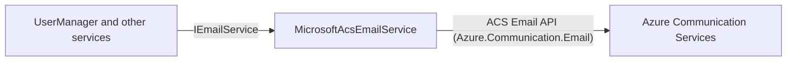

# SysWeaver.Email.MicrosoftAcs

[⬆ SysWeaver overview](../../README.md)

> Azure Communication Services (ACS) e-mail sending service implementing the framework's e-mail contract.

| | |
|---|---|
| **Layer** | Networking |
| **Kind** | Micro service |

## Purpose

Provide `IEmailService` backed by [Azure Communication Services Email](https://learn.microsoft.com/azure/communication-services/concepts/email/email-overview), as an alternative to [SysWeaver.Email.Smtp](../SysWeaver.Email.Smtp/README.md)'s SMTP service, so that features such as account verification, password reset and invitations can send e-mail through Azure.

## How it fits into SysWeaver



## Key features

- Uses the official Azure SDK (`Azure.Communication.Email`).
- Authenticates with an ACS connection string, or an access key plus `Endpoint` (inline or from a credentials file).
- Optionally waits for the send operation to complete (`WaitForCompletion`), else returns as soon as ACS accepted the message.
- Retries with tracking; requests rejected by ACS (4xx, except 408 / 429) are not retried.

## Limitations and considerations

- One recipient per call (as defined by `IEmailService`); no templates, attachments or bulk sending.
- The sender display name can't be set per message, it's configured on the MailFrom address in Azure.
- Microsoft Entra ID (managed identity) authentication is not supported, it would require the `Azure.Identity` package.
- Default sending quotas are low (especially for Azure managed domains), see below.

## Using it

```json
{ "Type": "SysWeaver.Email.MicrosoftAcsEmailService, SysWeaver.Email.MicrosoftAcs",
  "Params": {
    "From": "noreply@example.com",
    "CredFile": "$(KeyFolder)/MicrosoftAcs.txt" } }
```

`MicrosoftAcs.txt` contains a single line, the connection string: `endpoint=https://my-acs.europe.communication.azure.com/;accesskey=...`.

## Setting up an Azure account for testing

1. **Azure account** - sign up at <https://azure.microsoft.com/free/> (requires a credit card) and make sure you have a subscription (free trial or pay-as-you-go). Create a resource group, ex: `rg-email`.
2. **Create an Email Communication Services resource** - portal: *Create a resource → "Email Communication Services"*. Pick the resource group and a *data location* (ex: Europe).
3. **Add a domain** to it (*Provision domains*):
   - *Azure managed domain*: one click, gives a sender like `DoNotReply@<guid>.azurecomm.net`. Fine for testing, but has very low sending limits and can't be raised.
   - *Custom domain*: add your domain, create the TXT record shown to verify ownership, then add the SPF and the two DKIM (CNAME) records and verify them. Also add a DMARC record (ex: `_dmarc.example.com TXT "v=DMARC1; p=none;"`). Under *MailFrom addresses* you can add sender addresses and set their display names.
4. **Create a Communication Services resource** - *Create a resource → "Communication Services"*, same data location. Then *Email → Domains → Connect domain* and select the domain from step 3 (the domain and the ACS resource must share the data location).
5. **Get the credentials** - Communication Services resource → *Settings → Keys*: copy the *Connection string* (primary) into the credentials file.
6. **Test** - configure the service with `From` = a MailFrom address of the connected domain (ex: `DoNotReply@<guid>.azurecomm.net`). There is no sandbox, any recipient works. Set `WaitForCompletion` to true while testing to get delivery failures as exceptions.
7. **Production** - use a custom domain and request a sending quota increase through an Azure support request (*Help + support → Create a support request*, service "Communication Services"). Microsoft wants the domain to have a sending history with a low failure rate first. Keep bounces low; ACS maintains a suppression list and can publish delivery reports through Event Grid.

## Pricing

List prices (pay-as-you-go, no subscription or minimum fee) as of October 2026, see [Azure Communication Services email pricing](https://learn.microsoft.com/azure/communication-services/concepts/email-pricing) for current prices.

| | |
|---|---|
| Per email | $0.00025 ($0.25 / 1,000) |
| Per data | $0.00012 / MB |
| **1M emails @ 1 KB** | 1,000,000 × $0.00025 = $250.00<br/>+ 977 MB × $0.00012 = $0.12<br/>**≈ $250.12** |

- 1M × 1 KB = 1,000,000 KB ≈ 977 MB. Headers count as data too, but at these sizes the data part is insignificant, the cost is ~all per message.
- Not included: Event Grid usage for delivery reports, and outbound network transfer from your own servers.

## Relationships

- **Project:** [`SysWeaver.Email.MicrosoftAcs.csproj`](SysWeaver.Email.MicrosoftAcs.csproj)
- **Builds on:** [SysWeaver.Common](../../SysWeaver.Common/README.md), [SysWeaver.MicroServices](../../SysWeaver.MicroServices/README.md)
- **Alternative to:** [SysWeaver.Email.Smtp](../SysWeaver.Email.Smtp/README.md) (SMTP), [SysWeaver.Email.AmazonSes](../SysWeaver.Email.AmazonSes/README.md) (Amazon SES)
