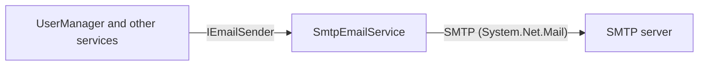

# SysWeaver.Email.Smtp

[⬆ SysWeaver overview](../../README.md)

> Sends email through any SMTP server, implementing the framework's `IEmailSender` contract.

| | |
|---|---|
| **Layer** | Networking |
| **Kind** | Micro service |

## Purpose

Provide `IEmailSender` so that features such as account verification, password reset and invitations (see [SysWeaver.MicroService.UserManager](../../SysWeaver.MicroService.UserManager/README.md)) can send email without knowing how, using any mail server or relay that accepts SMTP.

## How it fits into SysWeaver



Alternatives implementing the same contract: [SysWeaver.Email.AmazonSes](../SysWeaver.Email.AmazonSes/README.md) (Amazon SES), [SysWeaver.Email.MicrosoftAcs](../SysWeaver.Email.MicrosoftAcs/README.md) (Azure Communication Services) and [SysWeaver.Email.Fake](../SysWeaver.Email.Fake/README.md) (development and testing).

## Key features

- Uses `System.Net.Mail.SmtpClient`, no third-party packages
- Authenticates with a user name and password (inline or from a credentials file); the user name is also used as the sender (From) address
- TLS using STARTTLS (`EnableSSL`, default on), port 587 by default
- Plain text or html body
- Retries failed sends (`RetryCount`), retry and send failures are tracked in stats; perf monitoring

## Key components

- [`SmtpEmailService`](SmtpEmailService.cs) - the `IEmailSender` implementation
- [`SmtpEmailParams`](SmtpEmailParams.cs) - server, port, TLS, retries and credentials

## Using it

```json
{ "Type": "SysWeaver.MicroService.SmtpEmailService, SysWeaver.Email.Smtp",
  "Params": {
    "Server": "smtp.example.com",
    "CredFile": "$(KeyFolder)/Smtp.txt" } }
```

`Smtp.txt` contains a single line: `noreply@example.com:the-password`.

## Limitations and considerations

- One recipient per call (as defined by `IEmailSender`); no queueing, templates, attachments or delivery tracking (templates live in the services that send mail)
- The sender address is the SMTP user name, there is no separate From address or display name
- `SmtpClient` only supports STARTTLS (not implicit TLS on port 465) and user name / password authentication (no OAuth2)
- All failures are retried immediately, including permanent rejections

## Relationships

- **Project:** [`SysWeaver.Email.Smtp.csproj`](SysWeaver.Email.Smtp.csproj)
- **Builds on:** [SysWeaver.Common](../../SysWeaver.Common/README.md), [SysWeaver.MicroServices](../../SysWeaver.MicroServices/README.md)
