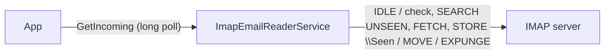

# SysWeaver.EmailReader.Imap

[⬆ SysWeaver overview](../../README.md)

> Receive emails from a mailbox using IMAP, with IDLE for instant delivery (implements `IEmailReceiverService`).

| | |
|---|---|
| **Layer** | Users |
| **Kind** | Micro service |

## Purpose

Let a system receive emails (support requests, replies to sent emails etc) from any mailbox that supports IMAP, without a public endpoint.

## How it fits into SysWeaver



## Key features

- Uses [MailKit](https://github.com/jstedfast/MailKit) (IMAP client and MIME parsing): TLS (`SslOnConnect`, `StartTls`, `StartTlsWhenAvailable`), multipart, encodings and charsets are handled.
- Keeps a connection open: with `UseIdle` (default, if the server supports IDLE) new emails are read as soon as they arrive, else the folder is checked every `PollInterval` seconds. Reconnects after `PollRetryDelay` seconds on failures.
- Reads unread (unseen) emails in `Folder` (default the inbox), without marking them as read while downloading. The state is kept on the server, so nothing is read twice after a restart.
- `AfterRead`: `MarkSeen` (default), `Delete` (only the processed emails are expunged if the server supports UIDPLUS), `Move` (to the `MoveTo` folder) or `Nothing` (testing only).
- The plain text body is used if an email have one (else the html body), set `PreferHtml` to use the html body when an email have both.
- `Addresses` maps receiver addresses (ex: aliases delivered to the same mailbox) to systems, matched against `Delivered-To`, `X-Original-To`, `Envelope-To`, `To` and `Cc`. Unmatched emails gets `System`.
- The `Message-Id` is used as the id (duplicates are ignored), `In-Reply-To` is kept.
- Emails that fails to process are left as unread (and not retried until the service restarts).
- Message table, stats and perf monitoring.

## Limitations and considerations

- Emails marked as read by someone else (ex: a person reading the mailbox in a mail client) are never seen by the service, use a dedicated mailbox (or folder).
- Without UIDPLUS, `Delete` expunges all emails flagged as deleted in the folder.
- Gmail archives emails instead of deleting them (unless configured otherwise).
- Attachments are ignored, only the body is used.
- `GetIncoming` and `MessageTable` require the `Admin` or `Ops` role when called over http.
- Many providers require an app password, or OAuth2 (not supported, ex: Microsoft 365).

## Using it

```json
{ "Type": "SysWeaver.EmailReader.ImapEmailReaderService, SysWeaver.EmailReader.Imap",
  "Name": "SupportMail",
  "Params": {
    "CredFile": "$(KeyFolder)/SupportImap.txt",
    "Server": "imap.example.com",
    "AfterRead": "Move",
    "MoveTo": "Processed",
    "System": "support",
    "Addresses": [
      { "Address": "sales@example.com", "System": "sales" }
    ] } }
```

`SupportImap.txt` contains a single line: `support@example.com:the-password`.

## Relationships

- **Project:** [`SysWeaver.EmailReader.Imap.csproj`](SysWeaver.EmailReader.Imap.csproj)
- **Builds on:** [SysWeaver.Common](../../SysWeaver.Common/README.md), [SysWeaver.MicroServices.ServiceManager](../../SysWeaver.MicroServices.ServiceManager/README.md), [SysWeaver.TableData](../../SysWeaver.TableData/README.md)
- **Alternative to:** [SysWeaver.EmailReader.Pop3](../SysWeaver.EmailReader.Pop3/README.md), [SysWeaver.Email.Fake](../SysWeaver.Email.Fake/README.md)
