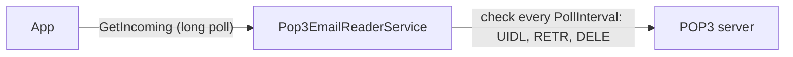

# SysWeaver.EmailReader.Pop3

[⬆ SysWeaver overview](../../README.md)

> Receives email from a mailbox using POP3, implementing the framework's `IEmailReceiverService` contract.

| | |
|---|---|
| **Layer** | Networking |
| **Kind** | Micro service |

## Purpose

Let a system receive emails (support requests, replies to sent emails etc) from any mailbox that supports POP3, without a public endpoint.

## How it fits into SysWeaver



Alternatives implementing the same contract: [SysWeaver.EmailReader.Imap](../SysWeaver.EmailReader.Imap/README.md) (IMAP, with push) and [SysWeaver.Email.Fake](../SysWeaver.Email.Fake/README.md) (development and testing).

## Key features

- Uses [MailKit](https://github.com/jstedfast/MailKit) (POP3 client and MIME parsing): TLS (`SslOnConnect`, `StartTls`, `StartTlsWhenAvailable`), multipart, encodings and charsets are handled.
- The mailbox is checked every `PollInterval` seconds, new emails are queued for `GetIncoming`. Reconnects after `PollRetryDelay` seconds on failures.
- `DeleteAfterRead` (default true) deletes emails once they have been processed. The deletes are committed when the session ends, if that fails the emails are deleted (not processed again) on the next check. With `DeleteAfterRead` false, emails are left on the server and the unique ids (UIDL) of read emails are remembered in memory.
- The plain text body is used if an email has one (else the html body), set `PreferHtml` to use the html body when an email has both.
- `Addresses` maps receiver addresses (ex: aliases delivered to the same mailbox) to systems, matched against `Delivered-To`, `X-Original-To`, `Envelope-To`, `To` and `Cc`. Unmatched emails get `System`.
- The `Message-Id` is used as the id (duplicates are ignored), `In-Reply-To` is kept.
- Emails that fail to process are left on the server (and not retried until the service restarts).
- Message table, stats and perf monitoring.

## Key components

- [`Pop3EmailReaderService`](Pop3EmailReaderService.cs) - the polling loop, processing and the `IEmailReceiverService` implementation
- [`Pop3EmailReaderParams`](Pop3EmailReaderParams.cs) - server, security, delete after read and address to system mapping

## Using it

```json
{ "Type": "SysWeaver.EmailReader.Pop3EmailReaderService, SysWeaver.EmailReader.Pop3",
  "Name": "SupportMail",
  "Params": {
    "CredFile": "$(KeyFolder)/SupportPop3.txt",
    "Server": "pop.example.com",
    "System": "support",
    "Addresses": [
      { "Address": "sales@example.com", "System": "sales" }
    ] } }
```

`SupportPop3.txt` contains a single line: `support@example.com:the-password`.

## Limitations and considerations

- POP3 only reads the inbox, and has no push: new emails are seen after up to `PollInterval` seconds.
- With `DeleteAfterRead` false, all emails on the server are read again after a restart (and on every check if the server doesn't support UIDL).
- Attachments are ignored, only the body is used.
- Received emails are queued in memory only: with `DeleteAfterRead`, emails that were deleted but not yet fetched using `GetIncoming` are lost if the service restarts.
- `GetIncoming` and `MessageTable` require the `Admin` or `Ops` role when called over http.
- Many providers require an app password, or have POP3 disabled by default (ex: Gmail, Outlook.com).

## Relationships

- **Project:** [`SysWeaver.EmailReader.Pop3.csproj`](SysWeaver.EmailReader.Pop3.csproj)
- **Builds on:** [SysWeaver.Common](../../SysWeaver.Common/README.md), [SysWeaver.MicroServices.ServiceManager](../../SysWeaver.MicroServices.ServiceManager/README.md), [SysWeaver.TableData](../../SysWeaver.TableData/README.md)
- **Third-party:** [MailKit](https://github.com/jstedfast/MailKit)
