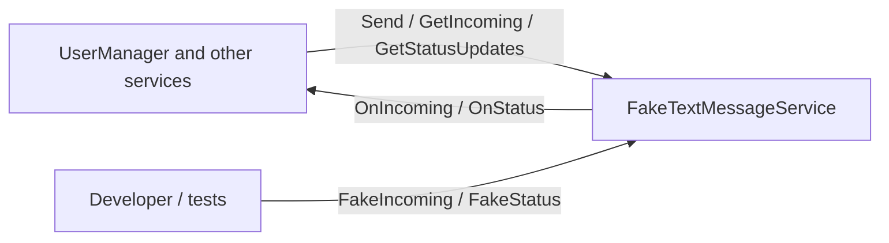

# SysWeaver.TextMessage.Fake

[⬆ SysWeaver overview](../../README.md)

> A fake text message provider for development and testing: "sent" messages are kept in memory, delivery, failures and incoming messages can be simulated.

| | |
|---|---|
| **Layer** | Networking |
| **Kind** | Micro service |

## Purpose

Exercise phone verification and other SMS / WhatsApp flows without a real text message provider.

## How it fits into SysWeaver



Stands in for [SysWeaver.TextMessage.Twilio](../SysWeaver.TextMessage.Twilio/README.md), [SysWeaver.TextMessage.WhatsApp](../SysWeaver.TextMessage.WhatsApp/README.md) and [SysWeaver.TextMessage.AmazonEndUserMessaging](../SysWeaver.TextMessage.AmazonEndUserMessaging/README.md), alone or behind the [router](../SysWeaver.TextMessage.Router/README.md).

## Key features

- Implements the full text message contract: `ITextMessageSender`, `ITextMessageReceiverService`, `ITextMessageStatusService` and `ITextMessageEvents`.
- Simulates any channel (`Channel`, default SMS), so two instances can stand in for WhatsApp + SMS behind the [router](../SysWeaver.TextMessage.Router/README.md).
- Simulated delivery: sent messages get `Sent` and `Delivered` status updates (`AutoDeliver`, `StatusDelay`).
- Simulated failures: numbers starting with `NotOnChannelPrefixes` fail with `NotOnChannel`, either in the send result or as a later status update (`FailAsync`, like WhatsApp does).
- `FakeIncoming` simulates a received message, `FakeStatus` a status update, `MessageTable` lists everything.

## Key components

- [`FakeTextMessageService`](FakeTextMessageService.cs) - the fake provider and its web API
- [`FakeTextMessageParams`](FakeTextMessageParams.cs) - channel, sender number, simulated failures and delivery

## Using it

```json
{ "Type": "SysWeaver.TextMessage.FakeTextMessageService, SysWeaver.TextMessage.Fake",
  "Name": "Sms",
  "Params": {
    "Channel": "Sms",
    "NotOnChannelPrefixes": [ "4670" ] } }
```

## Limitations and considerations

- Development only: its endpoints declare no authentication of their own, so on a server with anonymous API defaults message contents would be public.
- Messages are kept in memory only, and nothing is actually delivered.
- No web UI of its own (use the message table, or the [FakeTextService](https://github.com/dosh1974/SysWeaver.Services/blob/main/FakeTextService/README.md) application).

## Relationships

- **Project:** [`SysWeaver.TextMessage.Fake.csproj`](SysWeaver.TextMessage.Fake.csproj)
- **Builds on:** [SysWeaver.Common](../../SysWeaver.Common/README.md), [SysWeaver.IsoData](../../SysWeaver.IsoData/README.md), [SysWeaver.MicroServices.ServiceManager](../../SysWeaver.MicroServices.ServiceManager/README.md), [SysWeaver.TableData](../../SysWeaver.TableData/README.md)
- **Used by:** [FakeTextService](https://github.com/dosh1974/SysWeaver.Services/blob/main/FakeTextService/README.md) (SysWeaver.Services)
