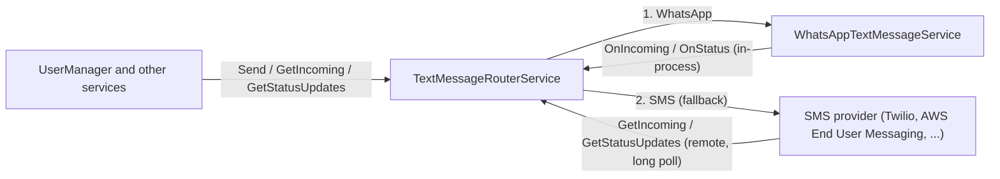

# SysWeaver.TextMessage.Router

[⬆ SysWeaver overview](../../README.md)

> Combines several text message providers (ex: WhatsApp and SMS) behind one sender / receiver: routing by channel, country and system, fallback when a provider can't deliver, and one merged stream of incoming messages and status updates.

| | |
|---|---|
| **Layer** | Users |
| **Kind** | Micro service |

## Purpose

Applications (ex: the [user manager](../../SysWeaver.MicroService.UserManager/README.md)) use a single `ITextMessageSender` / `ITextMessageReceiverService`. The router decides which provider to use, and falls back to the next one when a message fails for a reason that another channel can solve (the recipient isn't on WhatsApp, the WhatsApp customer service window is closed etc).

## How it fits into SysWeaver



## Key features

- Routes are tried in order; a route matches a message by its `Channels` (vs `OutgoingTextMessage.Channels`), `Countries` / `ExcludeCountries` (of the recipient) and `Systems`. The message passed to a provider only allows the channels of the route, so one multi channel provider (ex: Twilio) can be used as several routes (ex: WhatsApp first, then SMS).
- Falls back to the next matching route when the send result fails with a reason in `FallbackOn` (default `NotOnChannel`, `OutsideWindow`), or the provider throws (`FallbackOnError`).
- Asynchronous fallback: when a provider later reports a failed status (WhatsApp reports non-WhatsApp numbers this way), the message is sent using the next route, and the new attempt is published as a status update (same `Reference`, new `MessageId` and `Provider`).
- Remembers numbers that failed with `NotOnChannel` per route (`NotOnChannelHours`) and skips that route for them.
- Merges incoming messages and status updates of all providers: in-process providers using `ITextMessageEvents`, others (remote instances) by long polling `GetIncoming` / `GetStatusUpdates`. A provider used by several routes is received from once (using its first route). Providers can be added / removed at runtime.
- Replies: incoming messages get a response token prefixed with the route name, so `Reply` (or `Send` with the `ResponseToken`) uses the provider (and number) that received the message.
- `GetRoutes` shows each route, if the provider was found and how it's received from.

## Limitations and considerations

- A fallback after an asynchronous failure happens after `Send` returned; track the message using `Reference` in the status updates.
- A status update that arrives before the provider's `Send` call returned can't trigger a fallback (not a problem for real providers, they report delivery much later).
- Pending messages and the NotOnChannel cache are in memory only.

## Using it

```json
[
  { "Type": "SysWeaver.TextMessage.WhatsAppTextMessageService, SysWeaver.TextMessage.WhatsApp", "Name": "WhatsApp", "Params": { } },
  { "Type": "SysWeaver.TextMessage.FakeTextMessageService, SysWeaver.TextMessage.Fake", "Name": "Sms", "Params": { "Channel": "Sms" } },
  { "Type": "SysWeaver.TextMessage.TextMessageRouterService, SysWeaver.TextMessage.Router", "Name": "useradmin",
    "Params": { "Routes": [
      { "Instance": "WhatsApp", "Channels": "WhatsApp", "ExcludeCountries": ["US"] },
      { "Instance": "Sms", "Channels": "Sms" } ] } }
]
```

## Writing a provider

A provider implements `ITextMessageSender`, and preferably `ITextMessageReceiverService`, `ITextMessageStatusService` and `ITextMessageEvents` (use `TextMessageQueue<T>` for the polling methods). The contract:

| Concern | What the provider does |
|---|---|
| **Send** | Return `Accepted` with the provider message id (or `Failed` with a `TextMessageFailures` reason for recipient related errors known up front). Throw for configuration, authentication and connection errors. Respect `Channels` (return `NotOnChannel` if none of the provider's channels are allowed), `From`, `ResponseToken`, `Template`, `Purpose`, `TimeToLive` and echo `Reference`. |
| **Delivery** | Map the provider's delivery callbacks / events to `TextMessageStatusUpdate` (same `MessageId`, normalized `Status` and `Failure`, raw `ErrorCode`), publish with `OnStatus` and queue for `GetStatusUpdates`. |
| **Incoming** | Map incoming messages to `IncomingTextMessage` with `Channel`, `To`, `SenderName` (if known) and a provider specific `ResponseToken`, publish with `OnIncoming` and queue for `GetIncoming`. |
| **Push** | Webhooks are served by implementing `IHttpServerModule` (see the WhatsApp provider); queue based providers poll their queue in the background. |

How providers map to it (implemented in [SysWeaver.TextMessage.Twilio](../SysWeaver.TextMessage.Twilio/README.md) and [SysWeaver.TextMessage.AmazonEndUserMessaging](../SysWeaver.TextMessage.AmazonEndUserMessaging/README.md)):

| | Twilio (Programmable Messaging) | AWS End User Messaging SMS |
|---|---|---|
| Channels | SMS, MMS, WhatsApp (`whatsapp:+...` addresses), RCS | SMS (`SendTextMessage`), MMS (`SendMediaMessage`), RCS (`SendRcsMessage`); WhatsApp through *AWS End User Messaging Social* (a separate API, `AWSSDK.SocialMessaging`) |
| Send | `POST /Messages` (`To`, `From` or `MessagingServiceSid`, `Body`, `ValidityPeriod` = `TimeToLive`, `ContentSid` + `ContentVariables` = `Template`) | `SendTextMessage` (`OriginationIdentity` = `From`, `MessageType` from `Purpose`, `TimeToLive`, `DestinationCountryParameters` for registered templates, `Context` for `Reference`). `CarrierLookup` can detect landlines up front (→ NotOnChannel) |
| Statuses | `StatusCallback` webhook (queued, sent, delivered, undelivered, failed, read) with `ErrorCode`, ex: 30003 unreachable → Unreachable, 30005 unknown number → InvalidNumber, 30006 landline → NotOnChannel, 30007 filtered → Rejected, 63003 not on WhatsApp → NotOnChannel | Event destinations (SNS, Firehose, CloudWatch): `TEXT_DELIVERED`, `TEXT_BLOCKED` → Blocked, `TEXT_INVALID` → InvalidNumber, `TEXT_UNREACHABLE` → Unreachable, `TEXT_TTL_EXPIRED` → Expired, `TEXT_SPAM` → Rejected, ... |
| Incoming | Incoming message webhook (`From`, `To`, `Body`, `ProfileName` for WhatsApp, `MessageSid`) | Two-way SMS to an SNS topic, read from an SQS queue subscribed to it |
| Webhook security | `X-Twilio-Signature` (HMAC-SHA1 of the url and parameters) | None needed: SQS is polled using IAM credentials (no public endpoint) |
| Library | `Twilio` NuGet | `AWSSDK.PinpointSMSVoiceV2` NuGet (+ `AWSSDK.SQS` for incoming messages and events) |

Note: the AWS End User Messaging SMS API (service `sms-voice`, API version 2) is still published as the `AWSSDK.PinpointSMSVoiceV2` package, the name is historical. The `AWSSDK.EndUserMessaging` package is a different API (brand profiles and Notify verification codes), it can't send general messages.

## Relationships

- **Project:** [`SysWeaver.TextMessage.Router.csproj`](SysWeaver.TextMessage.Router.csproj)
- **Builds on:** [SysWeaver.Common](../../SysWeaver.Common/README.md), [SysWeaver.IsoData](../../SysWeaver.IsoData/README.md), [SysWeaver.MicroServices.ServiceManager](../../SysWeaver.MicroServices.ServiceManager/README.md)
- **Routes to:** [SysWeaver.TextMessage.AmazonEndUserMessaging](../SysWeaver.TextMessage.AmazonEndUserMessaging/README.md), [SysWeaver.TextMessage.Twilio](../SysWeaver.TextMessage.Twilio/README.md), [SysWeaver.TextMessage.WhatsApp](../SysWeaver.TextMessage.WhatsApp/README.md), [SysWeaver.TextMessage.Fake](../SysWeaver.TextMessage.Fake/README.md)
