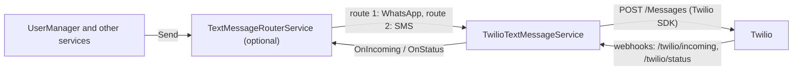

# SysWeaver.TextMessage.Twilio

[⬆ SysWeaver overview](../../README.md)

> Send and receive text messages (SMS, MMS, WhatsApp, RCS) using Twilio Programmable Messaging on multiple senders.

| | |
|---|---|
| **Layer** | Networking |
| **Kind** | Micro service |

## Purpose

Implement `ITextMessageSender`, `ITextMessageReceiverService`, `ITextMessageStatusService` and `ITextMessageEvents` using Twilio, so that phone verification, notifications and conversations can use SMS and WhatsApp through one provider.

## How it fits into SysWeaver



Alternatives implementing the same contract: [SysWeaver.TextMessage.WhatsApp](../SysWeaver.TextMessage.WhatsApp/README.md) (WhatsApp Cloud API), [SysWeaver.TextMessage.AmazonEndUserMessaging](../SysWeaver.TextMessage.AmazonEndUserMessaging/README.md) (AWS SMS) and [SysWeaver.TextMessage.Fake](../SysWeaver.TextMessage.Fake/README.md) (development and testing). Combine providers using the [router](../SysWeaver.TextMessage.Router/README.md).

## Key features

- Uses the official `Twilio` NuGet package (REST client, request signature validation).
- Multiple senders: phone numbers, WhatsApp senders (`whatsapp:+...`), alphanumeric sender ids, short codes and Messaging Services, each with a channel, an optional `System` and `Countries`. Sender selection: the sender that received the message being replied to (`ResponseToken`), the requested `From`, the `System`, a WhatsApp sender with an open customer service window, then the first allowed channel (the order of the senders is the channel priority) and the recipient's country within that channel.
- Respects `OutgoingTextMessage.Channels`, `Template` (Content API `ContentSid` + `ContentVariables`), `TimeToLive` (`ValidityPeriod`) and optionally `Purpose` (`MessageIntent`, enabled by `SendMessageIntent`). WhatsApp messages outside the 24 hour window use the configured `WhatsAppTemplate` (or the message template), and a text that fails with 63016 (outside the window) is retried using the template.
- Twilio error codes are mapped to `TextMessageFailures` (21614 / 30006 landline and 63003 not on WhatsApp → NotOnChannel, 21610 STOP → Blocked, 30003 → Unreachable, 30007 → Rejected, 63016 → OutsideWindow, ...). Recipient related failures are returned as a failed result (or a failed status update), other errors throw. Numbers that failed with NotOnChannel skip that channel for `NotOnChannelHours`.
- Incoming messages and status callbacks are received by webhooks (an `IHttpServerModule`), validated using the `X-Twilio-Signature` header, de-duplicated, published as events and queued for `GetIncoming` / `GetStatusUpdates`. The status callback url carries the message `Reference` and `System`, so status updates have them even after a restart.
- Retries on transient errors (5xx, 429), message table, stats and perf monitoring.

## Key components

- [`TwilioTextMessageService`](TwilioTextMessageService.cs) - sender selection, sending and the text message contract
- [`TwilioTextMessageService_Webhook`](TwilioTextMessageService_Webhook.cs) - the incoming message and status callback webhooks
- [`TwilioErrors`](TwilioErrors.cs) - maps Twilio error codes to `TextMessageFailures`
- [`TwilioTextMessageParams`](TwilioTextMessageParams.cs) - credentials, senders, public url and templates

## Using it

```json
{ "Type": "SysWeaver.TextMessage.TwilioTextMessageService, SysWeaver.TextMessage.Twilio",
  "Name": "twilio",
  "Params": {
    "CredFile": "$(KeyFolder)/Twilio.txt",
    "PublicUrl": "https://my.server.com/",
    "Senders": [
      { "From": "whatsapp:+14155238886" },
      { "From": "+46 8 123 456 78" },
      { "MessagingServiceSid": "MG00000000000000000000000000000000", "Countries": ["US", "CA"] }
    ],
    "WhatsAppTemplate": { "ContentSid": "HX00000000000000000000000000000000" } } }
```

`Twilio.txt` contains `AccountSid:AuthToken` (ex: `AC...:...`), or an API key `SK...:secret` (then also specify `AccountSid` and `AuthToken`).

To fall back from WhatsApp to SMS, use the [router](../SysWeaver.TextMessage.Router/README.md) with two routes on the same instance:

```json
{ "Routes": [
    { "Instance": "twilio", "Name": "twilio-wa", "Channels": "WhatsApp" },
    { "Instance": "twilio", "Name": "twilio-sms", "Channels": "Sms" } ] }
```

## Limitations and considerations

- Media (MMS, WhatsApp images etc) is not sent, and received media is reported as "[media]" (or the caption text).
- `PublicUrl` must be the exact public base url that Twilio calls (the signature includes the url), especially behind a reverse proxy. Without it no status callback url is sent with the messages.
- Incoming messages, the WhatsApp window tracking and pending messages are kept in memory only.
- `Send`, `GetIncoming`, `GetStatusUpdates` and `MessageTable` require the `Admin` or `Ops` role when called over http.

## Setting up a Twilio account for testing

1. **Account** - sign up at <https://www.twilio.com/try-twilio>. A trial account gets free credit, can only send to *verified* phone numbers (*Phone Numbers → Manage → Verified Caller IDs*) and prefixes messages with "Sent from your Twilio trial account".
2. **Credentials** - the *Account SID* and *Auth Token* are on the console home page (*Account Info*). For production prefer an API key (*Account → API keys & tokens → Create API key*, standard): use `SK...:secret` as credentials, and specify `AccountSid` and `AuthToken` (the auth token is still needed to validate webhooks).
3. **SMS number** - *Phone Numbers → Manage → Buy a number* with SMS capability. Sending rules depend on the destination country: US recipients require A2P 10DLC registration (or a verified toll free number), some countries require registered sender ids or templates.
4. **Incoming SMS** - on the number (*Active numbers → number → Messaging configuration*): *A message comes in* → Webhook `https://my.server.com/twilio/incoming`, HTTP POST. With a Messaging Service, configure it on the service (*Integration → Send a webhook*) instead.
5. **WhatsApp sandbox** - *Messaging → Try it out → Send a WhatsApp message*. The sandbox sender is `whatsapp:+14155238886`; each test phone joins by sending "join &lt;your code&gt;" to it. Set *Sandbox settings → When a message comes in* to `https://my.server.com/twilio/incoming` (POST). Production WhatsApp senders are registered under *Messaging → Senders → WhatsApp senders* (requires a Meta business portfolio).
6. **WhatsApp template** - *Messaging → Content Template Builder → Create*: ex: "You have a new message: {{1}}", submit it for WhatsApp approval, and use its `HX...` SID as `WhatsAppTemplate.ContentSid`.
7. **Public url** - the server must be reachable over https by Twilio (for local testing use a tunnel, ex: `ngrok http 443`), set `PublicUrl` to the public base url.
8. **Test** - send to a verified number, check the status updates (`GetStatusUpdates` or the message table), reply from the phone and check `GetIncoming`. Twilio's *Monitor → Logs → Messaging* shows every message and error code.

## Relationships

- **Project:** [`SysWeaver.TextMessage.Twilio.csproj`](SysWeaver.TextMessage.Twilio.csproj)
- **Builds on:** [SysWeaver.Common](../../SysWeaver.Common/README.md), [SysWeaver.HttpServer](../../SysWeaver.HttpServer/README.md), [SysWeaver.IsoData](../../SysWeaver.IsoData/README.md), [SysWeaver.MicroServices.ServiceManager](../../SysWeaver.MicroServices.ServiceManager/README.md), [SysWeaver.TableData](../../SysWeaver.TableData/README.md)
- **Third-party:** `Twilio`
