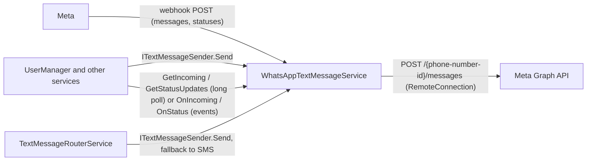

# SysWeaver.TextMessage.WhatsApp

[⬆ SysWeaver overview](../../README.md)

> Send and receive text messages using the WhatsApp Cloud API, on any number of business phone numbers. Combine it with an SMS provider using the [text message router](../SysWeaver.TextMessage.Router/README.md) for SMS fallback.

| | |
|---|---|
| **Layer** | Users |
| **Kind** | Micro service |

## Purpose

Implement `ITextMessageSender`, `ITextMessageReceiverService`, `ITextMessageStatusService` and `ITextMessageEvents` using WhatsApp, so that phone verification, notifications and conversations can use WhatsApp instead of (or in addition to) SMS.

## How it fits into SysWeaver



## Key features

- No official .NET SDK exists, the Cloud API is implemented in the `api` folder (`IWhatsAppCloudApi` + json types) using `RemoteConnection`. Graph API json errors are surfaced as `WhatsAppApiException` (with the WhatsApp error code).
- Multiple business numbers (any countries, any WhatsApp Business Accounts / portfolios, optionally with their own access token). The sending number is selected by: the number's `System`, an open conversation with the recipient (reply from the number the user wrote to), the recipient's country, else the first number.
- Incoming messages and delivery statuses are pushed by Meta to a webhook served by this service (an `IHttpServerModule`), validated using the `X-Hub-Signature-256` signature, de-duplicated, published as events (`OnIncoming`, `OnStatus`) and queued for `GetIncoming` / `GetStatusUpdates` (long polling with a cursor). Incoming messages get the `System` of the number they were sent to, `To` (the business number), `SenderName` (the WhatsApp profile name) and a `ResponseToken` that replies from the same number.
- Tracks the 24 hour customer service window per number and user. Outside the window a template is used: the template of the message (`OutgoingTextMessage.Template`), or the configured `Template` (with the text as its single parameter). `From` selects a specific business number.
- WhatsApp errors are mapped to `TextMessageFailures` (131026 = NotOnChannel, 131047 = OutsideWindow, 131050 = Blocked, rate limits etc). Recipient related failures are returned as a failed `TextMessageSendResult` (or a failed status update), other errors throw. Numbers that failed with 131026 fail directly (without calling WhatsApp) for `NotOnWhatsAppHours`, so that a router quickly falls back to SMS.
- Delivery statuses (sent, delivered, read, failed) are tracked in the message table.
- Retries on transient errors, optional read receipts, stats and perf monitoring.

## Limitations and considerations

- **WhatsApp can't send or receive SMS.** Use the [text message router](../SysWeaver.TextMessage.Router/README.md) with an SMS provider for fallback, and to receive SMS on the same numbers (using that provider).
- **There's no way to check if a number is on WhatsApp up front.** A message to a non-WhatsApp number is accepted by the API, and fails asynchronously with 131026 (which can also mean that the user blocked you or hasn't accepted the latest terms). So `Send` returns `Accepted`, and the failure arrives as a status update (the router falls back then).
- **Business initiated messages require templates.** Free form text can only be sent within 24 hours after the user's last message. Without a template, sending to a user that hasn't written recently fails with OutsideWindow (131047).
- Incoming messages, statuses and the window tracking are kept in memory only (lost on restart); pollers without a known cursor only get the last 5 minutes.
- Media messages are reported as their caption or a "[type]" text, the media is not downloaded.
- The webhook must be reachable by Meta over https with a valid (CA signed) certificate.
- `Send`, `GetIncoming`, `GetStatusUpdates` and `MessageTable` require the `Admin` or `Ops` role when called over http.

## Using it

```json
{ "Type": "SysWeaver.TextMessage.WhatsAppTextMessageService, SysWeaver.TextMessage.WhatsApp",
  "Params": {
    "CredFile": "$(KeyFolder)/WhatsAppToken.txt",
    "AppSecret": { "CredFile": "$(KeyFolder)/WhatsAppAppSecret.txt" },
    "VerifyToken": "some-random-string",
    "WebhookUrl": "whatsapp/webhook",
    "Numbers": [
      { "PhoneNumberId": "106540352242922", "PhoneNumber": "+46 8 123 456 78", "Countries": ["NO", "DK", "FI"] },
      { "PhoneNumberId": "113269274970227", "PhoneNumber": "+1 555 000 1234", "System": "support" }
    ],
    "Template": { "Name": "notification_text", "Language": "en" } } }
```

## Setting up a Meta account for testing

1. **Accounts** - create a Meta developer account at <https://developers.facebook.com/> (log in with a Facebook account) and a business portfolio at <https://business.facebook.com/>.
2. **Create an app** - *My Apps → Create app*, use case "Other" / type *Business*, select the business portfolio, then add the *WhatsApp* product. Meta creates a test WhatsApp Business Account with a free **test phone number** and shows a temporary access token (valid 24 hours) under *WhatsApp → API Setup*.
3. **Allowed recipients** - the test number can only send to up to 5 verified numbers: add your own phone under *API Setup → To* (you get a code by WhatsApp). Other recipients fail with 131030.
4. **Note the ids** - the *Phone number ID* (for `Numbers[].PhoneNumberId`) and the *WhatsApp Business Account ID* on the API Setup page.
5. **Permanent token** - *Business settings → Users → System users → Add* (Admin), *Assign assets*: the app and the WhatsApp account (full control). *Generate new token* for the app with the permissions `whatsapp_business_messaging` and `whatsapp_business_management`, expiration "Never". Put it in the `CredFile`.
6. **App secret** - *App settings → Basic → App secret* (Show), put it in the `AppSecret` file.
7. **Webhook** - the service must be reachable over https (for local testing use a tunnel, ex: `ngrok http 443` or a Visual Studio dev tunnel). In the app: *WhatsApp → Configuration → Webhook → Edit*: Callback URL `https://your.host/whatsapp/webhook`, Verify token = `VerifyToken`, *Verify and save* (the service must be running). Then under *Webhook fields* subscribe to **messages**.
8. **Test receiving** - send a WhatsApp message from your phone to the test number; it shows up in `GetIncoming` and in the message table. Reply within 24 hours using `Send` (free form text works inside the window).
9. **Test business initiated messages** - create a template under *WhatsApp Manager → Message templates*: category *Utility*, a body with one variable, ex: `You have a new message: {{1}}`. Approval is usually quick. Set it as `Template`. (The pre-approved `hello_world` template has no variable, so it can't carry the text.)
10. **Production numbers** - *WhatsApp Manager → Phone numbers → Add phone number* for each country. The number must be able to receive an SMS or a voice call for verification and must not be in use with the WhatsApp (Business) app (unless using coexistence). Set a display name (reviewed by Meta), register the number for the Cloud API (two-step verification PIN), add a payment method, and complete *business verification* to raise the limits on numbers and messaging. All numbers in all WhatsApp accounts that are subscribed to the app are delivered to the same webhook, the service routes them using the phone number id.
11. **Costs** - Meta charges per delivered template message (by category and recipient country), replies within the customer service window are free. See <https://developers.facebook.com/docs/whatsapp/pricing>.

## Relationships

- **Project:** [`SysWeaver.TextMessage.WhatsApp.csproj`](SysWeaver.TextMessage.WhatsApp.csproj)
- **Builds on:** [SysWeaver.Common](../../SysWeaver.Common/README.md), [SysWeaver.HttpServer](../../SysWeaver.HttpServer/README.md), [SysWeaver.IsoData](../../SysWeaver.IsoData/README.md), [SysWeaver.MicroServices.ServiceManager](../../SysWeaver.MicroServices.ServiceManager/README.md), [SysWeaver.Remote.Connection](../../SysWeaver.Remote.Connection/README.md), [SysWeaver.TableData](../../SysWeaver.TableData/README.md)
- **Used with:** [SysWeaver.TextMessage.Router](../SysWeaver.TextMessage.Router/README.md)
- **Alternative to:** [SysWeaver.TextMessage.Fake](../SysWeaver.TextMessage.Fake/README.md)
