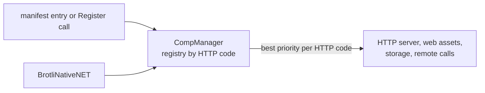

# SysWeaver.Compression.BrotliNativeNET

[⬆ SysWeaver overview](../../README.md)

> Codec plug-in: **br** (Brotli) backed by the native Brotli library of Brotli.NET, preferred over the built-in .NET Brotli codec when registered.

| | |
|---|---|
| **Layer** | Compression |
| **Kind** | Plug-in (codec, `ICompType`) |
| **Platform** | x64 / x86 only (Windows, Linux, macOS x64); no arm64 |

## Purpose

An alternative `br` implementation that calls the native Brotli library of the [Brotli.NET](https://www.nuget.org/packages/Brotli.NET) package directly (bypassing its managed stream). The framework's asset compression tool (`_tools/compress`) ships with it.

## How it fits into SysWeaver



All compressed data in SysWeaver — HTTP content encoding, pre-compressed web assets, stored values, compressed API parameters — goes through the codec registry in [SysWeaver.Compression](../../SysWeaver.Compression/README.md). Adding a plug-in makes its codec available everywhere at once; clients choose it through the HTTP `Accept-Encoding` header.

## Key features

- Registered for `br` (file extension `.br`) with priority 1, above the built-in .NET Brotli codec (priority 0).
- `CompBrotliNativeNET` (singleton `Instance`) implements the full `ICompType` API through `CompStreamCodec`, with pooled buffers.
- Effort levels map to Brotli quality 1 / 4 / 11, with a 2^22 byte window.
- `CompBrotliNativeNET.IsSupported` tells if the native library loads; `Register()` does nothing when it doesn't (the built-in `br` codec is then used).
- Registered through the manifest like any service, or with one static call in code.

## Key components

- [`CompBrotliNativeNET`](CompBrotliNativeNET.cs) — the codec type

## Using it

The service manager recognises codec types and registers them instead of creating an instance:

```json
{ "Type": "SysWeaver.Compression.CompBrotliNativeNET, SysWeaver.Compression.BrotliNativeNET" }
```

Or register it from code at startup: `SysWeaver.Compression.CompBrotliNativeNET.Register();`

## Limitations and considerations

- Depends on native binaries, which must match the process architecture and platform. The Brotli.NET package only ships win-x64, win-x86, linux-x64, linux-x86 and osx-x64 binaries: there is none for linux-arm64, win-arm64 or osx-arm64. Calling the codec directly where it isn't supported throws a `TypeInitializationException`.
- Linux: the native library only needs libc. The Brotli.NET loader imports `dlopen` from "libdl.so", which only exists with the libc6-dev package; this plug-in maps it to "libdl.so.2" / "libc.so.6" with a `NativeLibrary.SetDllImportResolver` for the Brotli.NET assembly (unless the application registered its own resolver first).
- A native encoder / decoder state is created and destroyed per call (no pooling, no one-shot API).
- Concatenated Brotli streams are not decoded (data after the first stream is ignored).
- Selection between codecs of the same HTTP code is by priority, so registering this plug-in replaces the built-in `br` codec for every consumer.

## Relationships

- **Project:** [`SysWeaver.Compression.BrotliNativeNET.csproj`](SysWeaver.Compression.BrotliNativeNET.csproj)
- **Builds on:** [SysWeaver.Compression](../../SysWeaver.Compression/README.md)
- **Used by:** in SysWeaver.Tools: [Compress](https://github.com/dosh1974/SysWeaver.Tools/blob/main/Compress/README.md), [Decompress](https://github.com/dosh1974/SysWeaver.Tools/blob/main/Decompress/README.md)
- **Third-party:** [Brotli.NET](https://www.nuget.org/packages/Brotli.NET)
