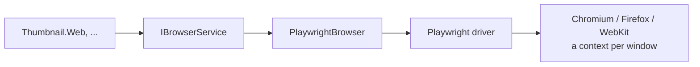

# SysWeaver.WebBrowser.Playwright

[⬆ SysWeaver overview](../../README.md)

> Playwright implementation of the browser service: Chromium (an installed Chrome or Edge, or the one downloaded by Playwright), Firefox or WebKit, headless or windowed.

| | |
|---|---|
| **Layer** | Media |
| **Kind** | Plug-in (`IBrowserService`) |
| **Platform** | Cross-platform (Windows, Linux, macOS) |

## Purpose

Render, script and operate web pages from a service — screenshots, thumbnails, automation — with a real browser driven through [Microsoft Playwright](https://playwright.dev/dotnet/). Unlike the CEF and WebView2 implementations it runs on every platform .NET runs on, can use other engines than Chromium, and can send real input events, so a person can operate a window that runs on a server through a remote view (ex: a check that needs a person).

The project folder is `SysWeaver.Browser.Playwright`, the project and assembly are named `SysWeaver.WebBrowser.Playwright`.

## How it fits into SysWeaver



Implements `IBrowserService` (and `IBrowserWindowInput` for its windows) from [SysWeaver.WebBrowser](../../SysWeaver.WebBrowser/README.md); list it in the manifest before consumers such as [SysWeaver.MicroService.Thumbnail.Web](../../SysWeaver.MicroService.Thumbnail.Web/README.md). It is interchangeable with [SysWeaver.WebBrowser.Cef](../SysWeaver.WebBrowser.Cef/README.md) and [SysWeaver.WebBrowser.WebView2](../SysWeaver.WebBrowser.WebView2/README.md).

## Key features

- Engine selection (`Browser`: `Chromium`, `Firefox` or `Webkit`); for Chromium an installed Chrome or Edge is found automatically (Windows: Program Files and the local application data folder; Linux: `/usr/bin/google-chrome`, `chromium`, `chromium-browser`, `microsoft-edge`), or set `ExecutablePath` (path variables allowed) or a Playwright `Channel`
- The browser is started on first use and started again when it has died; if a window can't be opened, a new browser is started and the open is tried once more
- Every window gets its own browser context (isolated, nothing stored), unless `UserDataFolder` is set: then one persistent profile (cookies etc) is shared by all windows
- Recycling: a new browser is started after `RecycleAfterWindows` windows (default 500); the old one is closed when its windows are closed or after `RecycleWaitMs`
- Headless by default; a process without an interactive desktop (ex: a service) always runs headless and renders WebGL in software (SwiftShader) unless `SoftwareWebGl` says otherwise; `DisableGpu`, `IgnoreCertErrors`, `Locale` (default `en-US`), `ExtraArgs`
- `HideAutomation` (default on, Chromium only): removes the automation flag and `navigator.webdriver`, since some sites refuse to show anything to an automated browser
- Windows: load and wait (`LoadTimeoutMs`, a page that times out can still be used), wait for network idle (`IdleTimeoutMs`, `WaitNetworkIdle` tracks the requests of all frames and ignores long lived ones), run JavaScript, expose .NET objects to JavaScript, PNG (transparent background) or JPEG capture (`CaptureTimeoutMs`)
- Input (`IBrowserWindowInput`): viewport size, mouse move, click, typing and key presses
- Statistics (`IHaveStats`): starts, opened / open windows, recoveries, recycles, failed and slow closes (`SlowCloseMs`)

## Key components

- [`PlaywrightBrowser`](PlaywrightBrowser.cs) — the browser service, its parameters (`PlaywrightBrowserParams`) and the window implementation, all in one file

## Using it

```json
{
  "Type": "SysWeaver.WebBrowser.PlaywrightBrowser, SysWeaver.WebBrowser.Playwright",
  "Params": {
    "Browser": "Chromium",
    "Headless": true
  }
}
```

## Limitations and considerations

- Firefox, WebKit and Chromium without an installed Chrome / Edge use the browsers downloaded by Playwright; the code does not download them (use the Playwright command line `install`). Those downloads are per user: a service running as another user won't find them
- A `UserDataFolder` can only be used by one browser process at a time, and the user running the process needs full access to it; recycling is not used with a profile
- The scale (device scale factor) can only be changed before a page is loaded, and not with a `UserDataFolder`: a scale change replaces the window's context and page
- Software WebGL rendering is slow, and a long running browser rendering WebGL in software slowly builds up state, which is why browsers are recycled
- Closing the service waits up to 5 seconds for the browsers to stop

## Relationships

- **Project:** [`SysWeaver.WebBrowser.Playwright.csproj`](SysWeaver.WebBrowser.Playwright.csproj)
- **Builds on:** [SysWeaver.Common](../../SysWeaver.Common/README.md), [SysWeaver.WebBrowser](../../SysWeaver.WebBrowser/README.md)
- **Third-party:** [Microsoft.Playwright](https://www.nuget.org/packages/Microsoft.Playwright)
