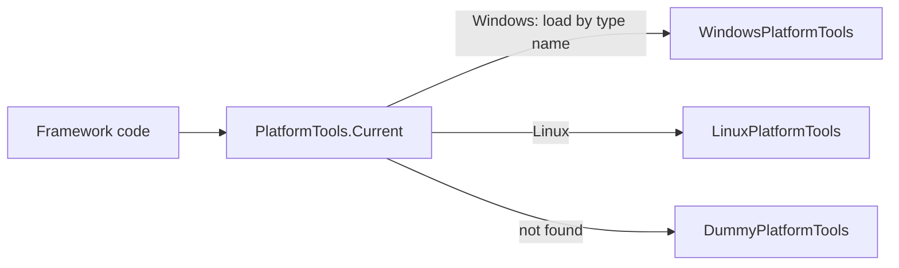

# SysWeaver.Common.Windows

[⬆ SysWeaver overview](../../README.md)

> Windows implementation of the platform abstraction (`IPlatformTools`): system metrics, reboot, disk flush and directory permissions.

| | |
|---|---|
| **Layer** | Foundation |
| **Kind** | Library (platform plug-in, loaded by type name at runtime) |
| **Platform** | Windows only |

## Purpose

Keeps Windows-only APIs (performance counters, WMI, Win32 shutdown/flush and ACL calls) out of the portable core. The core asks `PlatformTools.Current` for an implementation and gets this one when running on Windows.

## How it fits into SysWeaver

No project calls this assembly directly; it only needs to be deployed with the application ([SysWeaver.Storage](../../SysWeaver.Storage/README.md) references both platform assemblies so they are copied to the output automatically).

## Key features

- CPU usage (performance counter `Processor Information\% Processor Time\_Total`) and physical memory (`GlobalMemoryStatusEx`), shown in the service manager's statistics
- OS friendly name from WMI (`Win32_OperatingSystem` caption, plus build and bitness); default key folder `C:\Keys`
- Machine reboot via `ExitWindowsEx` after enabling `SeShutdownPrivilege` (used by administrative services)
- Flushing file buffers to disk (`FlushFileBuffers`)
- Granting the Everyone group full control on a directory, inherited by contained files and folders (used for data folders shared by all users)
- Failures counted as statistics (`IHaveStats`, system `Windows.Platform`)

## Key components

- [`WindowsPlatformTools`](WindowsPlatformTools.cs) — the `IPlatformTools` implementation

## Using it

Nothing to configure — deploy the DLL with the application and use `PlatformTools.Current`.

## Limitations and considerations

- Windows only
- If the assembly is missing, the framework silently falls back to a dummy implementation
- If the performance counter can't be created only CPU usage is unavailable; if WMI fails the OS name falls back to `RuntimeInformation.OSDescription`
- `Reboot` requires `SeShutdownPrivilege` and only reports whether the shutdown was initiated

## Relationships

- **Project:** [`SysWeaver.Common.Windows.csproj`](SysWeaver.Common.Windows.csproj)
- **Builds on:** [SysWeaver.Common](../../SysWeaver.Common/README.md)
- **Used by:** [SysWeaver.Storage](../../SysWeaver.Storage/README.md)
- **Third-party:** System.Diagnostics.PerformanceCounter, System.Management
