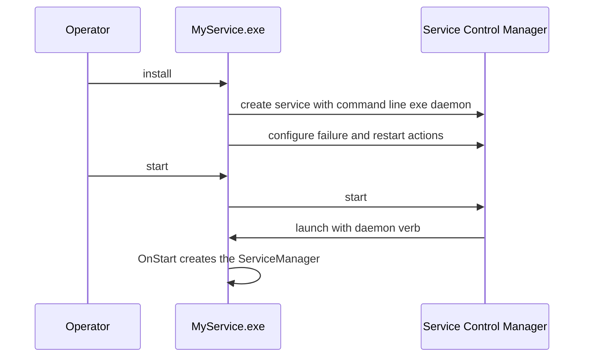

# SysWeaver.OsServices.ServiceHostFactoryWin32NT

[⬆ SysWeaver overview](../../README.md)

> Windows back-end for `ServiceHost`: installs, configures and runs the application as a Windows service.

| | |
|---|---|
| **Layer** | Runtime |
| **Kind** | Library (platform adapter, resolved by name at runtime) |
| **Platform** | Windows only |

## Purpose

Implements the service host contract (`IServiceHostFactory` / `IServiceHost`) of [SysWeaver.OsServices](../../SysWeaver.OsServices/README.md) on top of the Windows Service Control Manager and `System.ServiceProcess`. `ServiceHost.Run` finds it by name (`SysWeaver.OsServices.ServiceHostFactoryWin32NT`), so the executable only has to reference and deploy it.

## How it fits into SysWeaver



## Key features

- Service registration (own process, LocalSystem, command line `[exe] daemon`) with display name, description, start-up type (disabled, manual, automatic or delayed automatic) and restart-on-failure actions (`RestartDelaySeconds` for the 1st/2nd failure, `RestartDelayLastSeconds` for later ones, reset after `ResetSeconds`)
- Elevation through the standard Windows "run as administrator" mechanism (`runas` verb, UAC prompt)
- SCM pause/continue pause and resume all services; stop and system shutdown dispose the `ServiceManager`
- Direct advapi32 interop (Unicode `...W` API) for install, uninstall, configuration and control; read-only queries such as `status` don't need elevation

## Key components

- [`ServiceHostFactoryWin32NT`](ServiceHostFactoryWin32NT.cs) — the `IServiceHostFactory` found by name by `ServiceHost.Run`
- [`ServiceHostWindows`](ServiceHostWindows.cs) — internal `IServiceHost` (install, control, status)
- [`ServiceInstance`](ServiceInstance.cs) — the `ServiceBase` that hosts the `ServiceManager`
- [`Win32ServiceManager`](ServiceManager/Win32ServiceManager.cs) — internal SCM interop
- [`ElevatedProcessWin32NT`](ElevatedProcessWin32NT.cs) — `IsElevated` (Administrators role) and `RunElevated`
- [`Win32SystemServices`](Win32SystemServices.cs) — internal `ISystemServices`: lists all Win32 services (`EnumServicesStatusEx`, configuration, failure actions etc) and controls them (`ServiceController`)
- [`Win32Firewall`](Win32Firewall.cs) — internal `IFirewall` for Windows Defender Firewall (late bound `HNetCfg.FwPolicy2`), rule ids are a hash of the rule values since names aren't unique
- [`Win32Storage`](Win32Storage.cs) — internal `IStorage` (Storage Management WMI `MSFT_Disk` / `MSFT_PhysicalDisk` / `MSFT_Partition` / `MSFT_Volume`, BitLocker from `Win32_EncryptableVolume` when running as admin)
- [`Win32NetworkConfig`](Win32NetworkConfig.cs) — internal `INetworkConfig` (`MSFT_NetAdapter` enable / disable, `MSFT_NetRoute`, `DnsFlushResolverCache`)
- [`Win32Environment`](Win32Environment.cs) — internal `IEnvironmentVariables`, writes the registry directly so `REG_EXPAND_SZ` values (ex: PATH) stay expandable, then broadcasts `WM_SETTINGCHANGE`
- [`Win32Startup`](Win32Startup.cs) — internal `IStartupItems` (Run / RunOnce keys of HKCU, HKLM and WOW6432Node, the startup folders), enabled state stored in `Explorer\StartupApproved` like Task Manager
- [`Win32Power`](Win32Power.cs) — internal `IPower` (shutdown.exe, `SetSuspendState`)
- [`Win32FilePermissions`](Win32FilePermissions.cs) — internal `IFilePermissions` (NTFS ACL's, owner changes enable SeTakeOwnership / SeRestore)
- [`Win32Wmi`](Win32Wmi.cs) / [`Win32Privileges`](Win32Privileges.cs) — WMI query helpers and token privilege enabling

## Using it

Reference it (and [SysWeaver.OsServices](../../SysWeaver.OsServices/README.md)) from your executable project; everything else is driven by `ServiceHost.Run` and the command line verbs:

```text
MyService install
MyService start
MyService status
```

## Limitations and considerations

- The service always runs as LocalSystem; change the account in the Services console if needed.
- `start` does not resume a paused service (use `continue`).
- `uninstall` marks the service for deletion; Windows removes it once all handles are closed.
- All changing verbs need elevation (re-run with the `runas` verb). A service that can't be opened (missing, or access denied) is reported as not installed.
- `pause` of a paused service returns `AlreadyPaused` and `continue` of a running service `AlreadyRunning` (exit code 0, as on Linux).

## Folder layout

| Folder | Content |
|---|---|
| [`ServiceManager/`](ServiceManager/README.md) | advapi32 Service Control Manager interop: `Win32ServiceManager` and the Win32 enums and structures it uses |

## Relationships

- **Project:** [`SysWeaver.OsServices.ServiceHostFactoryWin32NT.csproj`](SysWeaver.OsServices.ServiceHostFactoryWin32NT.csproj)
- **Builds on:** [SysWeaver.MicroServices.ServiceManager](../../SysWeaver.MicroServices.ServiceManager/README.md), [SysWeaver.OsServices](../../SysWeaver.OsServices/README.md)
- **Used by:** services [ExchangeRateService](https://github.com/dosh1974/SysWeaver.Services/blob/main/ExchangeRateService/README.md), [FakeEmailService](https://github.com/dosh1974/SysWeaver.Services/blob/main/FakeEmailService/README.md), [FakeTextService](https://github.com/dosh1974/SysWeaver.Services/blob/main/FakeTextService/README.md), [IpLocationService](https://github.com/dosh1974/SysWeaver.Services/blob/main/IpLocationService/README.md), [ReverseProxyClient](https://github.com/dosh1974/SysWeaver.Services/blob/main/ReverseProxyClient/README.md), [ReverseProxyServer](https://github.com/dosh1974/SysWeaver.Services/blob/main/ReverseProxyServer/README.md), [SwLanCertManager](https://github.com/dosh1974/SysWeaver.Services/blob/main/SwLanCertManager/README.md), [SwServerManager](https://github.com/dosh1974/SysWeaver.Services/blob/main/SwServerManager/README.md), [TranslationService](https://github.com/dosh1974/SysWeaver.Services/blob/main/TranslationService/README.md), [WebServerService](https://github.com/dosh1974/SysWeaver.Services/blob/main/WebServerService/README.md)
- **Third-party:** `System.ServiceProcess.ServiceController`, `System.Management`
