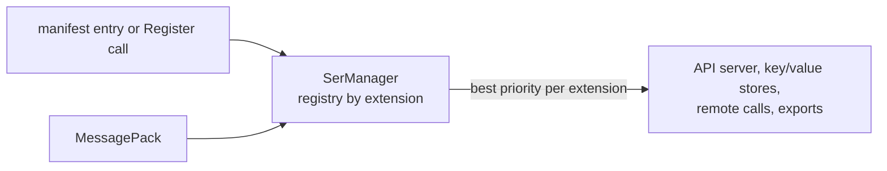

# SysWeaver.Serialization.MessagePack

[⬆ SysWeaver overview](../../README.md)

> Serializer plug-in: **msgpack** (binary) backed by MessagePack-CSharp.

| | |
|---|---|
| **Layer** | Serialization |
| **Kind** | Plug-in (serializer, `ISerializerType`) |

## Purpose

Adds MessagePack, a compact binary format with wide cross-language support.

## How it fits into SysWeaver



All data that SysWeaver moves — web API payloads, stored values, remote API calls, table exports — goes through the serializer registry in [SysWeaver.Serialization](../../SysWeaver.Serialization/README.md). Adding a plug-in makes its format available everywhere at once; clients choose it through HTTP `Accept` / `Content-Type` headers.

## Key features

- Registered for `msgpack` (`application/x-msgpack`) with priority 0, the only bundled `msgpack` serializer.
- `MessagePackSerializer` (singleton `Instance`, binary only) uses the *contractless* standard resolver, so types need no `[MessagePackObject]` / `[Key]` attributes.
- Very compact and fast binary encoding.
- Registered through the manifest like any service, or with one static call in code.

## Key components

- [`MessagePackSerializer`](MessagePackSerializer.cs) — the serializer type

## Using it

The service manager recognises serializer types and registers them instead of creating an instance:

```json
{ "Type": "SysWeaver.Serialization.MessagePackSerializer, SysWeaver.Serialization.MessagePack" }
```

Or register it from code at startup: `SysWeaver.Serialization.MessagePackSerializer.Register();`

## Limitations and considerations

- Members are written by name (contractless resolver), which is larger than integer keyed contracts.
- `SerializerOptions` are ignored.
- Selection between serializers of the same extension is by priority; this is currently the only bundled `msgpack` implementation.

## Relationships

- **Project:** [`SysWeaver.Serialization.MessagePack.csproj`](SysWeaver.Serialization.MessagePack.csproj)
- **Builds on:** [SysWeaver.Serialization](../../SysWeaver.Serialization/README.md)
- **Third-party:** [MessagePack](https://www.nuget.org/packages/MessagePack) (MessagePack-CSharp)
