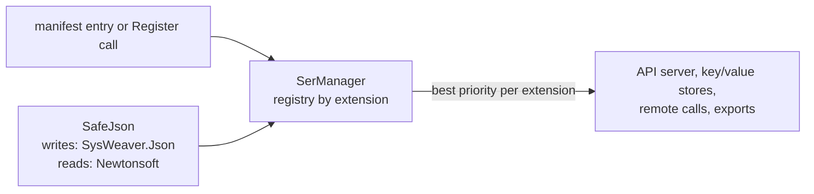

# SysWeaver.Serialization.SafeJson

[⬆ SysWeaver overview](../../README.md)

> Serializer plug-in (obsolete): **json** (text) that writes with SysWeaver's fast JSON writer and reads with the tolerant Newtonsoft parser, taking precedence over all other JSON serializers when registered.

| | |
|---|---|
| **Layer** | Serialization |
| **Kind** | Plug-in (serializer, `ITextSerializerType`) |

## Purpose

Combine the strengths of two implementations: fast, compact output for responses and storage, and forgiving, well-proven parsing for input coming from clients and files.
The serializer class, `SafeJsonSerializerX`, is marked `[Obsolete]`.

## How it fits into SysWeaver



All data that SysWeaver moves — web API payloads, stored values, remote API calls, table exports — goes through the serializer registry in [SysWeaver.Serialization](../../SysWeaver.Serialization/README.md). Adding a plug-in makes its format available everywhere at once; clients choose it through HTTP `Accept` / `Content-Type` headers.

## Key features

- Registered for `json` (`application/json`) with priority 10, the highest of the bundled JSON serializers (SafeJson 10, SysWeaver.Json 2, Newtonsoft 1, System.Text.Json 0, CompactJson / SpanJson / Utf8Json -5), so registering it makes it *the* JSON implementation of the process.
- `SafeJsonSerializerX` (singleton `Instance`): `Compact` and `Typeless` output is written by SysWeaver.Json; `Verbose` output is written by Newtonsoft (indented, `$type` on every object); all input is read by Newtonsoft.
- `SafeJsonSerializerX.ToFormattedJson` gives human-readable output (byte arrays as aligned number rows) for diagnostics.
- Registered through the manifest like any service, or with one static call in code.

## Key components

- [`SafeJsonSerializerX`](SafeJsonSerializer.cs) — the serializer type

## Using it

The service manager recognises serializer types and registers them instead of creating an instance:

```json
{ "Type": "SysWeaver.Serialization.SafeJsonSerializerX, SysWeaver.Serialization.SafeJson" }
```

Or register it from code at startup: `SysWeaver.Serialization.SafeJsonSerializerX.Register();`

## Limitations and considerations

- Obsolete: referencing `SafeJsonSerializerX` from code gives a compiler warning (registering it through the manifest does not).
- Reading and writing use different engines; types must serialize compatibly with both.
- Compact output writes a `float` / `double` NaN or infinity as `null`, which is read back as NaN (`null` for a nullable member), so infinities come back as NaN.
- **Security:** reading goes through Newtonsoft with `$type` handling enabled; `$type` names are restricted by the `DataTypePolicy` (see [SysWeaver.Serialization.NewtonsoftJson](../SysWeaver.Serialization.NewtonsoftJson/README.md)). Avoid `object` members in input models where possible.
- Registering it does not register the Newtonsoft and SysWeaver.Json serializers themselves; they are only used internally.
- Selection between serializers of the same extension is by priority, so the effective JSON implementation depends on which plug-ins are registered.

## Relationships

- **Project:** [`SysWeaver.Serialization.SafeJson.csproj`](SysWeaver.Serialization.SafeJson.csproj)
- **Builds on:** [SysWeaver.Serialization.NewtonsoftJson](../SysWeaver.Serialization.NewtonsoftJson/README.md), [SysWeaver.Serialization.SwJson](../SysWeaver.Serialization.SwJson/README.md), [SysWeaver.Serialization](../../SysWeaver.Serialization/README.md)
