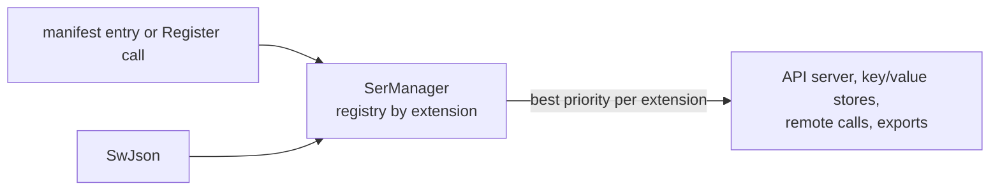

# SysWeaver.Serialization.SwJson

[⬆ SysWeaver overview](../../README.md)

> Serializer plug-in: **json** (text) backed by SysWeaver's own JSON reader/writer.

| | |
|---|---|
| **Layer** | Serialization |
| **Kind** | Plug-in (serializer, `ITextSerializerType`) |

## Purpose

The framework's own, dependency-free JSON implementation. It has the highest priority of the plain JSON serializers, so registering it makes it the default JSON implementation (for example for web API responses). It is also the *writing* half of [SysWeaver.Serialization.SafeJson](../SysWeaver.Serialization.SafeJson/README.md).

## How it fits into SysWeaver



All data that SysWeaver moves — web API payloads, stored values, remote API calls, table exports — goes through the serializer registry in [SysWeaver.Serialization](../../SysWeaver.Serialization/README.md). Adding a plug-in makes its format available everywhere at once; clients choose it through HTTP `Accept` / `Content-Type` headers.

## Key features

- Registered for `json` (`application/json`) with priority 2, above Newtonsoft and System.Text.Json and below SafeJson (SafeJson 10, SysWeaver.Json 2, Newtonsoft 1, System.Text.Json 0, CompactJson / SpanJson / Utf8Json -5).
- `SysWeaverJsonSerializer` (singleton `Instance`) wraps two engines that can also be used directly:
  - `JsonWriter.ToJsonString<T>` / `JsonWriter.ToJsonBytes<T>` (optionally into a caller supplied buffer) write UTF-8 through pooled buffers, so the only allocation is the result.
  - `JsonReader.Create<T>` / `JsonReader.Create(Type, ...)` parse UTF-8 bytes (or a string) directly.
- Per-type readers and writers are generated with compiled expression trees and cached for the life of the process.
- Handles primitives, dates and times, `Guid`, enums, `byte[]` (base64), nullables, arrays, collections, dictionaries (with string, number, enum, date and similar keys) and classes / structs (public read/write properties and non-readonly public fields).
- Polymorphism: when the runtime type differs from the declared type, values are written Newtonsoft-style with `$type` (and `$value` / `$values`) and the reader re-creates that type; type names can be customised with `JsonWriter.ToTypename`, `JsonWriter.AssemblyMap` and `JsonWriter.NamespaceMap` (set before first use).
- Culture-invariant number and date handling: shortest round-trip floats, ISO-8601 (`"o"`) dates, `"c"` time spans; only control characters, `"` and `\` are escaped.
- Lenient reader: unquoted keys, quoted numbers/booleans, `//` and `/* */` comments and trailing commas are accepted; unknown members are skipped.
- Registered through the manifest like any service, or with one static call in code.

## Key components

- [`SysWeaverJsonSerializer`](SysWeaverJsonSerializer.cs) — the serializer type
- [`JsonWriter`](JsonWriter.cs) — the JSON writer (type name customisation, pooled buffers)
- [`JsonReader`](JsonReader.cs) — the JSON reader

## Using it

The service manager recognises serializer types and registers them instead of creating an instance:

```json
{ "Type": "SysWeaver.Serialization.SysWeaverJsonSerializer, SysWeaver.Serialization.SwJson" }
```

Or register it from code at startup: `SysWeaver.Serialization.SysWeaverJsonSerializer.Register();`

## Limitations and considerations

- As a custom implementation, edge cases of exotic types may behave differently from System.Text.Json or Newtonsoft; test your payload types.
- The first use of a type is slow (code generation), and every type used stays in memory.
- `SerializerOptions` are ignored: output is always compact (no indentation).
- Member names are matched case-sensitively.
- Dictionaries with other key types are written with the key's `ToString()` as the property name and can't be read back.
- JSON has no `NaN` / `Infinity`: a `float` / `double` NaN or infinity is written as `null` and read back as NaN (`null` for a nullable member), so infinities don't round-trip. The bare `NaN`, `Infinity` and `-Infinity` tokens written by older versions are still read.
- Integer values must be plain integers in the range of the target type when reading (a fraction, an exponent or an out-of-range value is an error).
- **Security:** `$type` in the input can only name types allowed by the `DataTypePolicy` (see `TypeFinder.GetForData`), and the type must be assignable to the declared type.
- Selection between serializers of the same extension is by priority, so the effective JSON implementation depends on which plug-ins are registered.

## Relationships

- **Project:** [`SysWeaver.Serialization.SwJson.csproj`](SysWeaver.Serialization.SwJson.csproj)
- **Builds on:** [SysWeaver.Serialization](../../SysWeaver.Serialization/README.md)
- **Used by:** [SysWeaver.Serialization.SafeJson](../SysWeaver.Serialization.SafeJson/README.md); in SysWeaver.Services: [ExchangeRateService](https://github.com/dosh1974/SysWeaver.Services/blob/main/ExchangeRateService/README.md), [FakeEmailService](https://github.com/dosh1974/SysWeaver.Services/blob/main/FakeEmailService/README.md), [FakeTextService](https://github.com/dosh1974/SysWeaver.Services/blob/main/FakeTextService/README.md), [IpLocationService](https://github.com/dosh1974/SysWeaver.Services/blob/main/IpLocationService/README.md), [ReverseProxyClient](https://github.com/dosh1974/SysWeaver.Services/blob/main/ReverseProxyClient/README.md), [ReverseProxyServer](https://github.com/dosh1974/SysWeaver.Services/blob/main/ReverseProxyServer/README.md), [SwLanCertManager](https://github.com/dosh1974/SysWeaver.Services/blob/main/SwLanCertManager/README.md), [SwServerManager](https://github.com/dosh1974/SysWeaver.Services/blob/main/SwServerManager/README.md), [TranslationService](https://github.com/dosh1974/SysWeaver.Services/blob/main/TranslationService/README.md), [WebServerService](https://github.com/dosh1974/SysWeaver.Services/blob/main/WebServerService/README.md)
