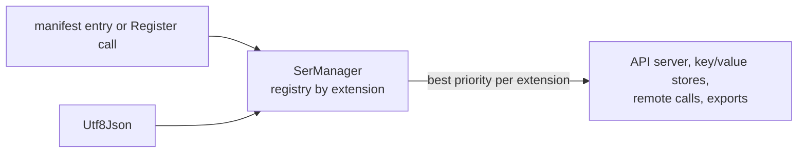

# SysWeaver.Serialization.Utf8Json

[⬆ SysWeaver overview](../../README.md)

> Serializer plug-in: **json** (text) backed by Utf8Json.

| | |
|---|---|
| **Layer** | Serialization |
| **Kind** | Plug-in (serializer, `ITextSerializerType`) |

## Purpose

An alternative UTF-8 based JSON implementation registered with a low priority: it never displaces the other JSON serializers when they are present, which makes it useful mainly for comparison and compatibility scenarios.

## How it fits into SysWeaver



All data that SysWeaver moves — web API payloads, stored values, remote API calls, table exports — goes through the serializer registry in [SysWeaver.Serialization](../../SysWeaver.Serialization/README.md). Adding a plug-in makes its format available everywhere at once; clients choose it through HTTP `Accept` / `Content-Type` headers.

## Key features

- Registered for `json` (`application/json`) with priority -5, the lowest of the bundled JSON serializers (SafeJson 10, SysWeaver.Json 2, Newtonsoft 1, System.Text.Json 0, CompactJson / SpanJson / Utf8Json -5).
- `Utf8JsonSerializer` (singleton `Instance`) implements both the binary (UTF-8) and the string APIs using Utf8Json's default resolver.
- Registered through the manifest like any service, or with one static call in code.

## Key components

- [`Utf8JsonSerializer`](Utf8JsonSerializer.cs) — the serializer type

## Using it

The service manager recognises serializer types and registers them instead of creating an instance:

```json
{ "Type": "SysWeaver.Serialization.Utf8JsonSerializer, SysWeaver.Serialization.Utf8Json" }
```

Or register it from code at startup: `SysWeaver.Serialization.Utf8JsonSerializer.Register();`

## Limitations and considerations

- `SerializerOptions` are ignored; output is always compact.
- Selection between serializers of the same extension is by priority, so the effective JSON implementation depends on which plug-ins are registered.

## Relationships

- **Project:** [`SysWeaver.Serialization.Utf8Json.csproj`](SysWeaver.Serialization.Utf8Json.csproj)
- **Builds on:** [SysWeaver.Serialization](../../SysWeaver.Serialization/README.md)
- **Third-party:** [Utf8Json](https://www.nuget.org/packages/Utf8Json)
