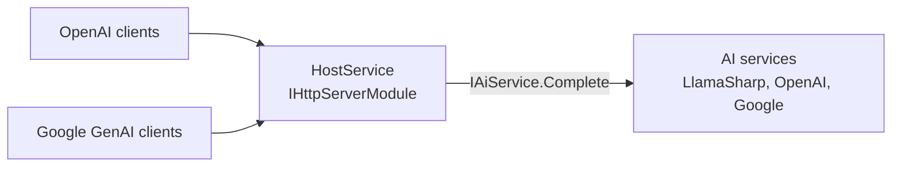

# SysWeaver.AI.HostService

[⬆ SysWeaver overview](../README.md)

> OpenAI compatible (Chat Completions and Responses) and Google compatible (Gemini API and Vertex AI) APIs, with streaming and tool calls, in front of one or more SysWeaver AI services.

| | |
|---|---|
| **Layer** | AI |
| **Kind** | Micro service (HTTP server module) |

## Purpose

Let standard OpenAI and Google GenAI clients (SDKs, agents, tools) use the models of the AI services ([`IAiService`](../SysWeaver.AI/IAiService.cs)) registered in the application — typically local models from [SysWeaver.AI.LlamaSharp](../SysWeaver.AI.LlamaSharp/README.md). Each request is forwarded to the AI service that provides the requested model.

## How it fits into SysWeaver



The service is an HTTP server module, so the web server picks it up automatically; authentication uses the server's normal mechanisms (session, `Authorization: Bearer`, `x-api-key` / `x-goog-api-key` headers).

## Key features

- OpenAI API under `OpenAiPrefix` (default `openai/v1/`): models, `chat/completions` and `responses`
- Google API under `GooglePrefix` (default `google/`), any API version: Gemini API models, `generateContent` and `streamGenerateContent`, and the same for Vertex AI paths (including express mode); camel and snake case properties, OpenAPI and JSON schemas
- Streaming for all APIs (server sent events, or a streamed JSON array for Google without `alt=sse`)
- Caller defined function tools, tool calls are returned to the client
- Hosted AI services are selected by instance name (`Instances`, in creation order; without names the first AI service is used) and each model is mapped to the first service providing it; the default model (OpenAI, no model given) is the last model of the last service
- Errors use the OpenAI or Google error format; access is restricted by the `Auth` tokens
- The two APIs have conflicting end points, so they must use different prefixes (checked on creation); a prefix set to null disables that API

## Key components

- [`HostService`](HostService.cs) — the HTTP module: routing, model mapping, shared request/tool handling
- [`HostService_ChatCompletions`](HostService_ChatCompletions.cs) / [`HostService_Responses`](HostService_Responses.cs) — the OpenAI APIs
- [`HostService_Google`](HostService_Google.cs) — the Gemini API and Vertex AI
- [`HostParams`](HostParams.cs) — parameters

## Using it

```json
{ "Type": "SysWeaver.AI.HostService, SysWeaver.AI.HostService", "Params": { "Instances": ["local"], "Auth": "ai" } }
```
```csharp
//  OpenAI
var openAi = new OpenAIClient(new ApiKeyCredential(apiKey), new OpenAIClientOptions { Endpoint = new Uri("https://myserver/openai/v1") });
var chat = openAi.GetChatClient("qwen3-8b");
//  Google Gemini API (or vertexAI: true for Vertex AI express mode)
var google = new Google.GenAI.Client(apiKey: apiKey, httpOptions: new HttpOptions { BaseUrl = "https://myserver/google/" });
var r = await google.Models.GenerateContentAsync("qwen3-8b", "Hello");
```

## Limitations and considerations

- Stateless: the Responses API `previous_response_id` and `conversation` are not supported, clients must send the whole conversation
- Text only (no images, audio or files) and only function tools (no built in tools like web search or code execution)
- OpenAI: `n` must be 1, logprobs are not supported. Google: `candidateCount` must be 1; `countTokens`, caching, embeddings, structured output and stop sequences are not supported; the `?key=` query parameter is not supported (use the `x-goog-api-key` header)
- Vertex AI with Google OAuth credentials can't be used, use an API key (express mode) or a Bearer token known by the server
- Tool calls and token streaming need a native `IAiService.Complete` (only [SysWeaver.AI.LlamaSharp](../SysWeaver.AI.LlamaSharp/README.md) has one); with the OpenAI and Google services the conversation is sent as a transcript, caller defined tools are rejected when required (ignored otherwise) and the response arrives in a single update

## Relationships

- **Project:** [`SysWeaver.AI.HostService.csproj`](SysWeaver.AI.HostService.csproj)
- **Builds on:** [SysWeaver.AI](../SysWeaver.AI/README.md)
