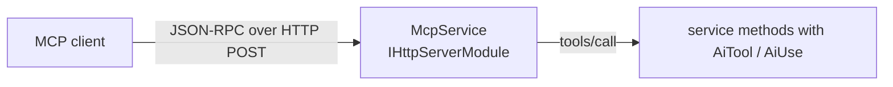

# SysWeaver.AI.McpService

[⬆ SysWeaver overview](../README.md)

> An MCP (Model Context Protocol) server for SysWeaver: exposes the AI tools of the registered services to MCP clients (agents, IDEs, desktop assistants) over the Streamable HTTP transport.

| | |
|---|---|
| **Layer** | AI |
| **Kind** | Micro service (HTTP server module) |

## Purpose

Let external AI agents use the same tools that the built in AI chat uses. Any method marked `[AiTool]` / `[AiUse]` on a registered service becomes an MCP tool, with its description and input schema generated from the signature and XML documentation by [SysWeaver.AI.Tools](../SysWeaver.AI.Tools/README.md). No AI provider is needed.

## How it fits into SysWeaver



The service is an HTTP server module, so the web server picks it up automatically. Authentication uses the server's normal mechanisms (session, `Authorization: Bearer`, `x-api-key` headers); unauthenticated requests get a 401 instead of a login redirect.

## Key features

- Streamable HTTP transport on a single end point (`Url`, default `mcp`): `initialize`, `ping`, `tools/list` and `tools/call`; protocol versions `2025-11-25` (the default), `2025-06-18` and `2025-03-26`
- Long running tool calls (`StreamToolCalls`, default on): a `tools/call` from a client that accepts `text/event-stream` is answered with a server sent event stream, the headers are sent at once and a keep alive (a `notifications/progress` if the request has a progress token, else an SSE comment) is sent every `KeepAliveSeconds` while the tool runs, so clients and proxies don't time out (ex: a 15 minute video generation)
- Data proxying (`ProxyData` of a `WebApis` entry): the data returned by all `[WebApiRaw]` methods of that service is kept in memory under `{Url}/data/{id}/{name}` (for `DataLifetimeMinutes`) and the tool returns the url instead of the data, for data that is too large for a tool result (video, audio)
- Tools of all service instances are found automatically when `ServiceTools` is set (default off; also services added later), they don't have to implement `IHaveAiTools`; methods marked `[AiHideMcp]` are excluded and tools can also be added or removed in code
- Each tool keeps its own auth (`[WebApiAuth]`, else the service's `Auth`); tools a user may not call are not listed
- Any service API can be exposed (`WebApis`): all `[WebApi]` methods of the selected service instance (by type and optional instance name) become tools, each keeping the method's own auth (every MCP request also requires `Auth`). Methods returning binary data (`[WebApiRaw]` with a non text mime or a `MemoryFile`, ex: a generated image) attach the data to the tool result as a file (image content for images), only pre-compressed raw data is skipped
- Files and links attached by tools (images, maps etc) are returned with the tool result; files are stored in the user's storage if available, otherwise served temporarily under `{Url}/files/`
- Tools table (`ToolTable`, the *Tools* table of Admin > MCP debug, requires the admin role): every served tool with kind (AI tool or WebApi), auth, description, input schema, return type, implementing service/method and call statistics
- Call log table (`CallLogTable`, the *Calls* table of Admin > MCP debug, requires the admin role): the latest `CallLogSize` (default 256) tool calls kept in memory, with time, duration, input and output (json, cut off at `CallLogMaxLength` chars), attached files and links, user, API key flag, client address, user agent and session id. Both tables show the main end point, or a temporary server when its guid is the table `Param`
- `AddWebApiTools` can filter the methods by their auth (`onlyForAuths`: only methods requiring one of the tokens, open methods always, "" = methods any logged in user may use) and replace the auth of the added tools (`overrideAuth`, checked by the MCP end point only, the end point of the method isn't changed)
- Temporary MCP servers (`CreateTempServer`, not a web API): a server at `mcp_{guid}` that exposes the `[WebApi]` methods of some instances (or the registered instances of some type names), protected by a new auth token (`mcp_{guid}`) that replaces the auth of all its tools. The service is the authorizer of the generated API key (the only way to get the token). The server isn't registered in the service manager, it's removed `TempServerLifetimeMinutes` (default 60) after the last request to it, by `RemoveTempServer` (only by the user that created it) or when the service is disposed. A server can be bound to a session (the `session` of `CreateTempServer`, the debug server is always bound to the session that started it): every tool call then runs as that session and its user (methods that take the request get a copy of the MCP request with that session, also the tool context and returned files), and the server is removed when the session is closed, when its user signs out or when another user signs in on it (a call that comes in meanwhile is refused). The tool and call log tables show the data of a temporary server when its guid is the table `Param`
- MCP debug (Admin > MCP debug, page `mcp_tools/index.html`, requires the admin role): a temporary server with selected API's and AI tools of this process, so that an AI agent can analyze (or use) the running service:
  - `GetDebugMcpServices` lists what can be exposed: the service manager, the HTTP server and every registered local service that has `[WebApi]` methods or AI tools (`[AiTool]` / `[AiUse]`), with per method the tool name, the first paragraph of its description and the auth it normally requires. Only methods the current user may use are listed (the debug server replaces their auth with its own token), methods hidden from MCP, disabled methods, pre-compressed raw methods and the debug server API's themselves are not. The monitoring services (the service manager, the HTTP server, `ExploreHttpServerService`, `FileLogService` and `ChartJsService`) are marked `Default`
  - `StartDebugMcp` takes the selection (`StartDebugMcpRequest`: per service the `WebApis` and `AiTools` method names, null = all, empty = none) and creates the server; requested services or methods that aren't available are reported as warnings, nothing to expose is a 400. Without a selection it exposes all API's of the default services (no AI tools)
  - `CheckDebugMcp` returns its state (calls, errors, last error, time to expiration, the exposed services with their number of API's and AI tools)
  - The page lists the services (search, per service / group / method check boxes, *Defaults*, *All*, *None*, the selection is remembered in the browser), then shows the url and API key (with an MCP client configuration to copy), the exposed services, the calls and the tools
- Browser origin checking (`AllowedOrigins`) to prevent DNS rebinding, configurable server name and instructions

## Key components

- [`McpService`](McpService.cs) — the HTTP module: JSON-RPC handling, tool registry, tool invocation and attached files
- [`McpToolContext`](McpToolContext.cs) — the tool context used for MCP calls (collects files and links added by tools)
- [`McpService.CallLog.cs`](McpService.CallLog.cs) — the call log and its table
- [`McpService.TempServers.cs`](McpService.TempServers.cs) — temporary servers, the MCP debug API's and the authorizer of their API keys
- [`McpEventStream`](McpEventStream.cs) — the server sent event stream of streamed tool calls
- [`McpParams`](McpParams.cs) — parameters
- [`srcWeb/`](srcWeb/README.md) — the MCP debug page

## Using it

```json
{ "Type": "SysWeaver.AI.McpService, SysWeaver.AI.McpService", "Params": { "Url": "mcp", "Auth": "service", "ServiceTools": true } }
```

To also expose the API's of a service:

```json
"WebApis": [ { "InstanceType": "SysWeaver.MyNamespace.MyService", "InstanceName": null } ]
```

To return urls instead of attaching the binary data of the service (ex: generated video):

```json
"WebApis": [ { "InstanceType": "SysWeaver.MyNamespace.MyService", "ProxyData": true } ]
```

MCP clients then connect to `https://<server>/mcp`, authenticating with an API key (`Authorization: Bearer <key>`). An API key only gets access to what requires one of its tokens: with `Auth` = "service" keys with the `service` token (and users with the `debug` or `dev` token) are let in, with the default `Auth` = "" any signed in user but no API key. The same applies to the auth of each tool.

## Limitations and considerations

- Stateless: no `Mcp-Session-Id` and no server initiated event stream (GET returns 405); responses are plain JSON, except streamed tool calls
- The API key of a temporary server requires an auth manager (the service registers itself as an authorizer); its only token is `mcp_{guid}`, so it reaches nothing but the tools of its server
- An overridden auth only changes who may list and call the tool: a method that checks the user itself (using the request) sees the API key user, which only has the token of the temporary server, unless the server is bound to a session (then it sees the user of that session)
- A server bound to a session lives as long as the session: a session that times out (ex: the browser tab was closed) removes the server; the debug page keeps its session alive while it's open
- The debug server exposes the selected methods as they are, including the ones that change state (ex: ending sessions, invalidating caches, deleting the log file, sending push messages, resetting performance monitors); the defaults are all API's of the monitoring services
- A method that is both a `[WebApi]` and an AI tool gets the same tool name, it's only exposed once
- Remote (proxied) services are not offered by the debug server
- A streamed tool call keeps running if the client disconnects (the result is discarded); proxied data is held in memory until it expires
- Tools only: no resources, prompts or sampling, and no tool list change notifications
- Exposing tools lets external agents call service methods on behalf of the authenticated user — set `Auth` and the tools' own auth accordingly, and use `[AiHideMcp]` for tools that only make sense inside the AI chat

## Relationships

- **Project:** [`SysWeaver.AI.McpService.csproj`](SysWeaver.AI.McpService.csproj)
- **Builds on:** [SysWeaver.AI.Tools](../SysWeaver.AI.Tools/README.md), [SysWeaver.MicroServices.ServiceManager](../SysWeaver.MicroServices.ServiceManager/README.md)
