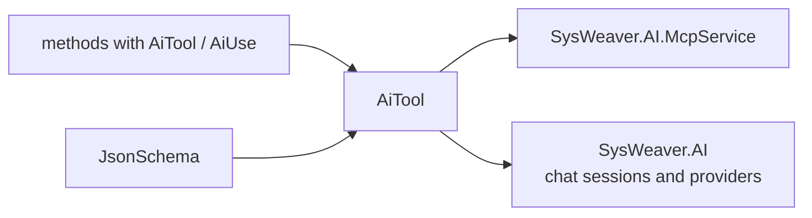

# SysWeaver.AI.Tools

[⬆ SysWeaver overview](../README.md)

> Describe service methods as AI tools (name, description, JSON schema of the argument) and invoke them, without depending on an AI provider, chat or sessions.

| | |
|---|---|
| **Layer** | AI |
| **Kind** | Library |

## Purpose

Hold what is needed to use a method as an AI tool, so that projects that only serve tools ([SysWeaver.AI.McpService](../SysWeaver.AI.McpService/README.md)) don't need the AI chat, provider base classes and image functionality of [SysWeaver.AI](../SysWeaver.AI/README.md).

## How it fits into SysWeaver



## Key features

- Tools are created from a method or an API end point; the name comes from the type and method (`[AiToolPrefix]`, `[AiToolName]`), the description and the argument schema from the signature and XML documentation (attributes are defined in [SysWeaver.Common](../SysWeaver.Common/README.md))
- `AiTool.GetToolMethods` finds all methods marked `[AiTool]` / `[AiUse]` of a type, including private methods of base types
- A tool is invoked using its API end point (`AiTool.Invoke`), with json in and out (`AiTool.IoParams`)
- External tools (`AiTool.CreateExternal`) describe a function that the caller executes, they can't be invoked (`AiTool.IsExternal`)
- `AiToolFunction` is API agnostic and caches the API specific representations (`GetApiTool`)

## Key components

- [`AiTool`](AiTool.cs) — a tool and its function definition (`AiToolFunction`)
- [`JsonSchema`](JsonSchema.cs) — JSON schema generation from .NET types and XML documentation, `JsonSchemaCache` caches the schemas of tool arguments. A type that contains itself (directly or through other types) is expanded once, the inner reference is a plain object whose description names the type; objects nested deeper than 24 levels are described the same way. A nullable value type (ex: `DateTime?`) has the schema of its value type. Members are required unless `[AiOptional]` says otherwise, or they are nullable value types or have `[EditAllowNull]`: those are optional (left out of `required`, the description starts with "[Optional]")
- [`JsonSchemaParam`](JsonSchemaParam.cs) — a JSON schema node

## Using it

```csharp
foreach (var m in AiTool.GetToolMethods(service.GetType()))
{
    var tool = AiTool.FromMethod(service, m);
    Console.WriteLine(tool.Name + ": " + tool.Tool.FunctionDescription);
}
```

## Limitations and considerations

- The types are in the `SysWeaver.AI` namespace
- Invoking a tool doesn't check its auth (`AiTool.Auth`), the caller must do it
- The json serializer is looked up once, when the static fields of `AiTool` are initialized: it must be registered before that (the service manager registers all serializers found)
- Running a tool as a chat command (`AsCommand`) is an extension in [SysWeaver.AI](../SysWeaver.AI/README.md)

## Relationships

- **Project:** [`SysWeaver.AI.Tools.csproj`](SysWeaver.AI.Tools.csproj)
- **Builds on:** [SysWeaver.HttpServer](../SysWeaver.HttpServer/README.md)
- **Used by:** [SysWeaver.AI](../SysWeaver.AI/README.md), [SysWeaver.AI.McpService](../SysWeaver.AI.McpService/README.md)
- **Third-party:** System.Memory.Data
