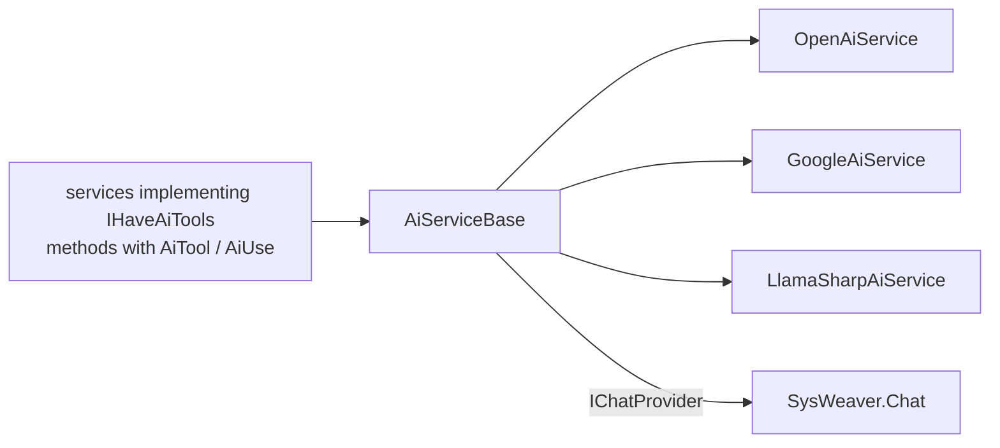

# SysWeaver.AI

[⬆ SysWeaver overview](../README.md)

> API agnostic AI (LLM) functionality for SysWeaver: the chat provider, tool calling of service methods, AI memory, default tools and the service/session base classes that the AI provider projects build on.

| | |
|---|---|
| **Layer** | AI |
| **Kind** | Library (base classes and interfaces) |

## Purpose

Hold everything that is common to all AI providers, so that a provider project ([OpenAI](../SysWeaver.AI.OpenAI/README.md), [Google](../SysWeaver.AI.Google/README.md), [LlamaSharp](../SysWeaver.AI.LlamaSharp/README.md)) only implements the actual API calls. Code that consumes AI (the host and MCP services, LLM based translation and language identification) works against `IAiService` and so with any provider.

## How it fits into SysWeaver



A provider derives from `AiServiceBase` and implements `CreateAiChatSession`, `CreateAiQuerySession` and `FetchModels` (optionally overriding `Complete` and `AddDefaultTools`). Its sessions derive from `AiChatSessionBase` / `AiQuerySessionBase` and implement the API calls (`Query`, `Complete`, `CompleteUpdate`, `ClearApiMessages`, `WriteConversation`, `SystemPrompt`), using the base's `AiCalls` to execute tool calls. Provider specific web APIs are declared in the derived service, since the API url is based on the declaring type.

## Key features

- `IAiService` is an `IChatProvider`, so AI chats appear in the [SysWeaver.Chat](../SysWeaver.Chat/README.md) UI, with chat commands (`help`, `clear`, `prompt`, `save`)
- Tool calling: methods marked `[AiTool]` / `[AiUse]` (attributes defined in [SysWeaver.Common](../SysWeaver.Common/README.md)) on registered services implementing `IHaveAiTools` are picked up automatically, also when services are added later; JSON schemas and descriptions are generated from signatures and XML documentation
- Default tools for chat sessions: predefined images, file and flag icons, QR codes, tables, data, charts, maps, calculator, elapsed time, URL display, file/link storage and REST API call validation (tools that live in other services are only added when those services are registered)
- Per user AI memory (`IAiMemory`) exposed to the model as memory tools; `KeyValueStorageAiMemory` stores it in the application key/value store and, when registered as a service, shows each user's memory in an "AI Memory" table
- Stateless completion (`IAiService.Complete`) with caller defined tools (returned to the caller, not executed) and image / file attachments (`AiCompletionMessage.Parts`, also on tool results), used by [SysWeaver.AI.HostService](../SysWeaver.AI.HostService/README.md); implemented natively by the OpenAI, Google and LlamaSharp services, the default implementation falls back to a query session with a transcript (tools ignored)
- Model listing (`GetLlmModels`, `GetImageModels`, cached for 5 minutes), concurrency limits for chats and image generation, usage events (`OnUse`) and performance monitoring
- Common service parameters (`AiServiceParams`: endpoint, API key, timeout, default models, reasoning effort, concurrency) and session parameters (`AiSessionParams`: model, reasoning)

## Key components

- [`IAiService`](IAiService.cs) — the provider agnostic AI service contract (chat provider, tool cache, sessions, completion, models)
- [`AiServiceBase`](AiServiceBase.cs) — base class for providers: chat provider, tool registration, commands, default tools
- [`AiChatSessionBase`](AiChatSessionBase.cs) / [`AiQuerySessionBase`](AiQuerySessionBase.cs) — base classes for conversation and stateless query sessions (tools, memory tools, system prompt)
- [`JsonSchema`](JsonSchema.cs) — JSON schema generation from .NET types and XML documentation
- [`KeyValueStorageAiMemory`](KeyValueStorageAiMemory.cs) — per user AI memory

## Using it

Make a method of any registered service available as a tool (no reference to an AI provider needed):

```csharp
public sealed class WeatherService : IHaveAiTools
{
    /// <summary>Current temperature in a city, in degrees Celsius</summary>
    [AiUse]
    public double GetTemperature(string city) => 21.5;
}
```

Use any provider through `IAiService`, adding the tools a session may call:

```csharp
IAiService ai = manager.Get<IAiService>();
var chat = ai.CreateChatSession(true);
chat.AddRegistredTool("WeatherServiceGetTemperature");   // tool name: type name (or [AiToolPrefix]) + method name
ai.AddChat(chat, "Weather");
```

## Limitations and considerations

- Registered tools are not added to sessions automatically; the code creating a session chooses which tools it may call (`AddTool`, `AddRegistredTool`) besides the default tools
- A tool call executes the method with the auth of the requesting user — only expose methods that are safe for those users
- Chat sessions are created by code (`AddChat`, `AddChatSession`), users can't create new AI chats from the chat UI

## Folder layout

| Folder | Content |
|---|---|
| [`srcWeb/`](srcWeb/README.md) | Shared AI chat icons (error, debug, working) and predefined smiley images, compressed and embedded at build time |

## Relationships

- **Project:** [`SysWeaver.AI.csproj`](SysWeaver.AI.csproj)
- **Builds on:** [SysWeaver.Chat](../SysWeaver.Chat/README.md), [SysWeaver.HttpServer](../SysWeaver.HttpServer/README.md), [SysWeaver.IsoData](../SysWeaver.IsoData/README.md), [SysWeaver.Media.Png](../SysWeaver.Media.Png/README.md), [SysWeaver.MicroServices.ServiceManager](../SysWeaver.MicroServices.ServiceManager/README.md)
- **Used by:** [SysWeaver.AI.OpenAI](../SysWeaver.AI.OpenAI/README.md), [SysWeaver.AI.Google](../SysWeaver.AI.Google/README.md), [SysWeaver.AI.LlamaSharp](../SysWeaver.AI.LlamaSharp/README.md), [SysWeaver.AI.HostService](../SysWeaver.AI.HostService/README.md), [SysWeaver.AI.McpService](../SysWeaver.AI.McpService/README.md)
- **Third-party:** Newtonsoft.Json
