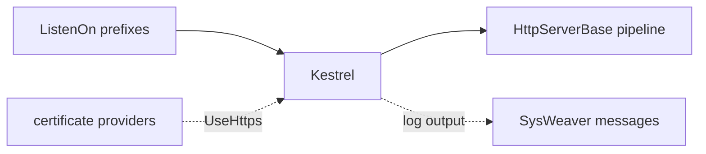

# SysWeaver.AspHttpServer

[⬆ SysWeaver overview](../README.md)

> HTTP listener adapter for the SysWeaver pipeline based on ASP.NET Core Kestrel, with optional HTTP/3.

| | |
|---|---|
| **Layer** | Web platform |
| **Kind** | Library |

## Purpose

Host the SysWeaver pipeline on Kestrel for a modern, cross-platform, high-performance server — without adopting the ASP.NET Core application model. Kestrel is used purely as the transport; routing, auth and everything else remain SysWeaver's.

## How it fits into SysWeaver

## Key features

- Cross-platform HTTPS with certificates from SysWeaver certificate providers; the server restarts its listeners when a provider reports a new certificate.
- HTTP/1.1 for plain HTTP, HTTP/1.1 and HTTP/2 for HTTPS, plus HTTP/3 with `EnableHttp3`.
- Validates each prefix and, with `IgnoreBadPrefixes` (default), skips prefixes that fail instead of failing the server.
- Optional firewall rule per prefix, pause mode (503) and graceful shutdown.
- Kestrel logging routed into the SysWeaver message system.

## Key components

- [`AspHttpServer`](AspHttpServer.cs) — the `HttpServerBase` implementation hosting Kestrel directly (no ASP.NET Core host)
- [`AspHttpServerParams`](AspHttpServerParams.cs) — listen prefixes and server options

## Using it

Through [SysWeaver.MicroService.AspHttpServer](../SysWeaver.MicroService.AspHttpServer/README.md).

## Limitations and considerations

- Prefixes can't contain a path, and the host must be `*`, `localhost` (or another loopback address) or an IP address; host names are rejected.
- HTTP/3 requires OS support (Windows 11 / Server 2022 or libmsquic on Linux).
- Some Kestrel internals are resolved by type name via reflection, which can be sensitive to ASP.NET Core version changes.
- The default `ListenOn` is external HTTPS on port 443; configure prefixes explicitly.

## Relationships

- **Project:** [`SysWeaver.AspHttpServer.csproj`](SysWeaver.AspHttpServer.csproj)
- **Builds on:** [SysWeaver.HttpServer](../SysWeaver.HttpServer/README.md)
- **Used by:** [SysWeaver.MicroService.AspHttpServer](../SysWeaver.MicroService.AspHttpServer/README.md)
- **Third-party:** ASP.NET Core shared framework (`Microsoft.AspNetCore.App`, Kestrel)
