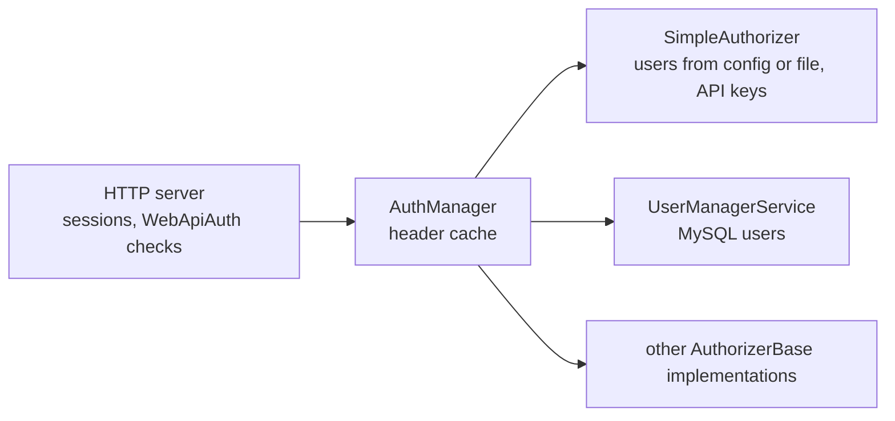

# SysWeaver.Auth.Core

[⬆ SysWeaver overview](../README.md)

> Authentication core: the `AuthManager` that validates users across any number of pluggable authorizers and caches Authorization header results, the authorizer contract, a configuration-based `SimpleAuthorizer` with API keys, password policies and localizable message templates.

| | |
|---|---|
| **Layer** | Security |
| **Kind** | Library |

## Purpose

Separate *who can log in and with which tokens* from the web server. The server only asks the `AuthManager`; the manager consults its authorizers (a static user list, a database-backed user manager, passkeys, …) in order, and caches the results of HTTP `Authorization` headers.

## How it fits into SysWeaver



The manager is normally created by `AuthManagerService` in [SysWeaver.MicroService.Auth](../SysWeaver.MicroService.Auth/README.md), which also picks up every authorizer registered in the manifest (`SimpleAuthorizer` can be added there directly).

## Key features

- Multiple authorizers behind one manager, each with a unique user guid prefix; supported methods are basic auth, bearer tokens, SCRAM, the one-time-pad secure login (`SecureAuth`, for authorizers with their own hashing, ex: SolidAdmin) and one-time tokens from external authorizers (`TokenAuth`, ex: `auth/redirect?u=<url>&t=<token>`)
- A successful login yields an `Authorization`: user identity, guid and the set of lower case *tokens* (roles) that `[WebApiAuth]` checks against, plus shared per-user data
- Cache of successful `Authorization` header results, invalidated when an authorizer reports a change
- SCRAM style login (RFC 5802 / 7677, see [`Scram.cs`](Scram.cs)): authorizers store a verifier (`StoredKey = SHA256(HMAC(PBKDF2-SHA256(H + "|" + binding, salt, iterations), "Client Key"))`, where `H = SHA256(password|salt)` is computed by the client) instead of a password equivalent hash, and the client proves the password with a proof bound to a one-time pad and a client nonce. A stolen verifier can't be used to sign in and costs PBKDF2 per guess. The binding string ties stored values to an application. Authorizers opt in with `ScramDefaults` / `GetScramInfoAsync` / `ScramAuth`; the others (ex: SolidAdmin) use the `SecureAuth` login (`SHA256(H|pad)`). An unknown user gets a fake salt and fake SCRAM parameters that look like real ones: keyed (HMAC with a random key stored in `KeyValueStore.AllApp`, so it is stable across restarts), so nobody can compute it and tell an unknown user from a real one
- `SimpleAuthorizer`: users defined as `user:password[:tokens[:domain]]` lines in the parameters or a monitored file, the password is a `$s1$...` SCRAM verifier (from the *Generate password hash* page, the `hash` verb of the service host or `AuthTools.ComputeSimpleVerifier`) or a clear text password (a 44 char password hash is refused). Sign in is SCRAM only. `AppHashString` binds stored values to the application (default: the entry assembly name), `ScramIterations` sets the PBKDF2 cost. Header auth (basic / bearer) is only for API keys unless `AllowBasicAuth` is set (basic auth compares the password hash, no PBKDF2 per request, so it only works for users with a clear text password). API keys (usable as bearer tokens and basic auth, never as one-time tokens) are managed from the web UI (audited), can be restricted to client addresses / networks, and have their own tokens: at least one, each "service" or "service_<scope>" (`ApiKeyAuth` is the default of a new key, default "Service"). A key only gets access to end points that require one of its tokens, never to the "any logged in user" (`""`) end points (`Authorization.IsApiKey`); each service token is a token of its own ("service_<scope>" does not fulfill "service"), and a requirement with a service token ("service" or "service_<scope>") is also fulfilled by "debug" and "dev" (`Authorization.ServiceImpliedTokens`). Stored users (`AllowStoredUsers`, default true): users added at run time from a `user : $s1$...` line and tokens, stored encrypted in `KeyValueStore.AllApp`, managed (audited) by "admin" or "debug" users; only a "debug" user may give the "debug" token, or change or remove a user that has it
- Admin pages to generate password verifiers (role ops), manage API keys and stored users, and a read-only "Built-in users" table (menu `Admin/...`)
- Password policies (length and character classes) reported to clients so the UI can validate early
- Managed texts: localizable text, mail and Markdown templates with variables, loaded from files, embedded resources or literal text and reloaded when files change (used by the account flows)
- `NameGen`: random, human friendly nick names (deterministic per user guid)
- `IAuthorizedRequest`: the caller of a web api for services that can't reference the http server; an api method may take it as its trailing parameter instead of `HttpServerRequest` (ex: `SimpleAuthorizer` logs who created an API key)
- Optional passkey storage on any authorizer ([`AuthorizerBase_PassKey.cs`](AuthorizerBase_PassKey.cs)): `SupportPasskeys` plus virtual CRUD methods on plain records (`PassKeyData`, no Fido2 types; `GetPassKey`, `GetPassKeys`, `FindPassKeys`, `AddPassKey`, `UsePassKey`, `RenamePassKey`, `DeletePassKey`, ...) and the optional token flows (`SupportPasskeyTokens`). The passkey service (SysWeaver.MicroService.PassKey) uses every authorizer that supports them. `SimpleAuthorizer` stores its users' passkeys in `KeyValueStore.AllApp` (`AllowPasskeys`, default true; API key users can't have passkeys, no token flows)

## Key components

- [`AuthManager`](AuthManager.cs) — validates users across all authorizers and caches header results
- [`AuthorizerBase`](AuthorizerBase.cs) — the contract every source of users implements
- [`Authorization`](Authorization.cs) — the result of a login: identity, tokens and per-user data
- [`SimpleAuthorizer`](SimpleAuthorizer.cs) — configuration or file based users with API keys ([`SimpleAuthorizer_ApiKeys.cs`](SimpleAuthorizer_ApiKeys.cs)), stored users ([`SimpleAuthorizer_StoredUsers.cs`](SimpleAuthorizer_StoredUsers.cs)) and passkeys ([`SimpleAuthorizer_PassKey.cs`](SimpleAuthorizer_PassKey.cs))
- [`Scram.cs`](Scram.cs) — `ScramVerifier`, `ScramInfo`, `ScramTools`: the SCRAM verifier format and proof checks
- [`DataProtection`](DataProtection.cs) — keyed lookup hashes and AES-GCM encryption of stored values
- [`AuthorizerBase_PassKey.cs`](AuthorizerBase_PassKey.cs) — the optional passkey storage contract of authorizers
- [`ManagedMessages`](ManagedMessages.cs) — localizable message templates for e-mail, text and Markdown

## Using it

```json
[
  { "Type": "SysWeaver.Auth.SimpleAuthorizer, SysWeaver.Auth.Core",
    "Params": { "Users": [ "admin:<$s1$-verifier-or-password>:Admin, Ops" ] } },
  { "Type": "SysWeaver.MicroService.AuthManagerService, SysWeaver.MicroService.Auth" }
]
```

## Limitations and considerations

- `SimpleAuthorizer` is meant for small, static user sets (operators, services); use [SysWeaver.MicroService.UserManager](../SysWeaver.MicroService.UserManager/README.md) for self-service accounts
- Clear text passwords in configuration work but should be replaced with `$s1$` verifiers (a users file with verifiers can't be used to sign in)
- API keys are stored encrypted in the application key/value store (`KeyValueStore.AllApp`, see [`DataProtection.cs`](DataProtection.cs): the secret is stored in the same store, so this protects against a copied key list, not against full access to the machine). Anyone with the API key management role can read the keys (they only give "service" / "service_<scope>" access)
- `DataProtection` (lookup hashes and AES-GCM encrypted values with a per row random, secret in `KeyValueStore.AllApp`) protects stored personal data and keys: losing the key value store (or moving the data to another computer without the secret) makes the protected values unreadable. Back it up, and share the secret explicitly between applications / computers that share data
- A removed user or changed password can still be used with a cached `Authorization` header until the cache entry expires (30 seconds by default), unless the authorizer reports the change
- `AuthManager` doesn't issue or consume one-time pads itself; the login service does
- `SimpleAuthorizer` passwords can't contain `:` or `|`, and clear-text passwords that fail the password policy are skipped with a warning
- A managed text string that isn't an existing file or embedded resource is used as the literal text, so a missing file silently becomes its path

## Folder layout

| Folder | Content |
|---|---|
| [`srcWeb/`](srcWeb/README.md) | `SimpleAuthorizer` web pages (password verifier generator, API key management with address restrictions) and the card template of the users table, compressed and embedded at build time |

## Relationships

- **Project:** [`SysWeaver.Auth.Core.csproj`](SysWeaver.Auth.Core.csproj)
- **Builds on:** [SysWeaver.Common](../SysWeaver.Common/README.md), [SysWeaver.Compression](../SysWeaver.Compression/README.md), [SysWeaver.MicroServices](../SysWeaver.MicroServices/README.md), [SysWeaver.Storage](../SysWeaver.Storage/README.md), [SysWeaver.TableData](../SysWeaver.TableData/README.md)
- **Used by:** [SysWeaver.HttpServer](../SysWeaver.HttpServer/README.md), [SysWeaver.MicroService.AspHttpServer](../SysWeaver.MicroService.AspHttpServer/README.md), [SysWeaver.MicroService.Auth](../SysWeaver.MicroService.Auth/README.md), [SysWeaver.MicroService.HttpServer](../SysWeaver.MicroService.HttpServer/README.md), [SysWeaver.MicroService.NetHttpServer](../SysWeaver.MicroService.NetHttpServer/README.md), [SysWeaver.MicroService.UserStorage](../SysWeaver.MicroService.UserStorage/README.md)
