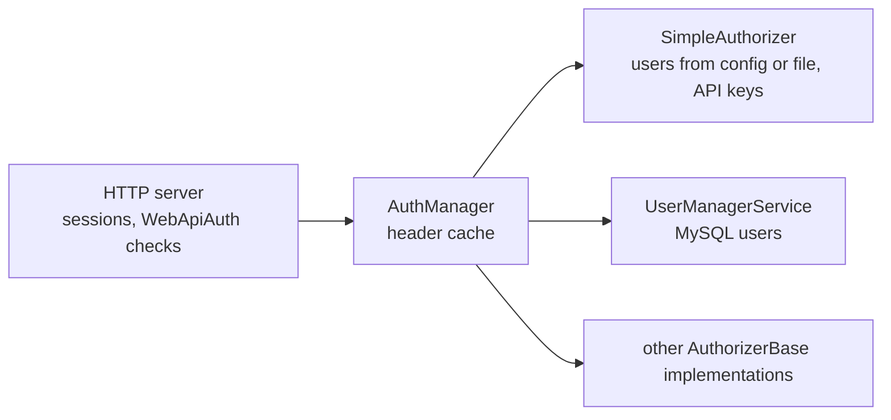

# SysWeaver.Auth.Core

[⬆ SysWeaver overview](../README.md)

> Authentication core: the `AuthManager` that validates users across any number of pluggable authorizers and caches Authorization header results, the authorizer contract, a configuration-based `SimpleAuthorizer` with API keys, password policies and localizable message templates.

| | |
|---|---|
| **Layer** | Security |
| **Kind** | Library |

## Purpose

Separate *who can log in and with which tokens* from the web server. The server only asks the `AuthManager`; the manager consults its authorizers (a static user list, a database-backed user manager, passkeys, …) in order, and caches the results of HTTP `Authorization` headers.

## How it fits into SysWeaver



The manager is normally created by `AuthManagerService` in [SysWeaver.MicroService.Auth](../SysWeaver.MicroService.Auth/README.md), which also picks up every authorizer registered in the manifest (`SimpleAuthorizer` can be added there directly).

## Key features

- Multiple authorizers behind one manager, each with a unique user guid prefix; supported methods are basic auth, bearer tokens, one-time-pad secure login and one-time tokens
- A successful login yields an `Authorization`: user identity, guid and the set of lower case *tokens* (roles) that `[WebApiAuth]` checks against, plus shared per-user data
- Cache of successful `Authorization` header results, invalidated when an authorizer reports a change
- Client-side salted hashing: clients send `SHA256(password|salt)`, the secure login additionally binds the hash to a one-time pad so it can't be replayed
- `SimpleAuthorizer`: users defined as `user:password[:tokens[:domain]]` lines (clear text or pre-computed hash) in the parameters or a monitored file, optional basic auth, and API keys (usable as bearer tokens) managed from the web UI
- Debug pages to generate password hashes and manage API keys
- Password policies (length and character classes) reported to clients so the UI can validate early
- Managed texts: localizable text, mail and Markdown templates with variables, loaded from files, embedded resources or literal text and reloaded when files change (used by the account flows)
- `NameGen`: random, human friendly nick names (deterministic per user guid)

## Key components

- [`AuthManager`](AuthManager.cs) — validates users across all authorizers and caches header results
- [`AuthorizerBase`](AuthorizerBase.cs) — the contract every source of users implements
- [`Authorization`](Authorization.cs) — the result of a login: identity, tokens and per-user data
- [`SimpleAuthorizer`](SimpleAuthorizer.cs) — configuration or file based users with API keys
- [`ManagedMessages`](ManagedMessages.cs) — localizable message templates for e-mail, text and Markdown

## Using it

```json
[
  { "Type": "SysWeaver.Auth.SimpleAuthorizer, SysWeaver.Auth.Core",
    "Params": { "Users": [ "admin:<hash-or-password>:Admin, Ops" ] } },
  { "Type": "SysWeaver.MicroService.AuthManagerService, SysWeaver.MicroService.Auth" }
]
```

## Limitations and considerations

- `SimpleAuthorizer` is meant for small, static user sets (operators, services); use [SysWeaver.MicroService.UserManager](../SysWeaver.MicroService.UserManager/README.md) for self-service accounts
- Password hashes are a single, fast SHA256, so keep user files and configuration private; clear-text passwords in configuration work but should be replaced with hashes from the *Generate password hash* debug page
- API keys are stored in clear text in the application key/value store (`KeyValueStore.AllApp`)
- A removed user or changed password can still be used with a cached `Authorization` header until the cache entry expires (30 seconds by default), unless the authorizer reports the change
- `AuthManager` doesn't issue or consume one-time pads itself; the login service does
- `SimpleAuthorizer` passwords can't contain `:` or `|`, and clear-text passwords that fail the password policy are skipped with a warning
- A managed text string that isn't an existing file or embedded resource is used as the literal text, so a missing file silently becomes its path

## Folder layout

| Folder | Content |
|---|---|
| [`srcWeb/`](srcWeb/README.md) | `SimpleAuthorizer` web pages (password hash generator, API key management), compressed and embedded at build time |

## Relationships

- **Project:** [`SysWeaver.Auth.Core.csproj`](SysWeaver.Auth.Core.csproj)
- **Builds on:** [SysWeaver.Common](../SysWeaver.Common/README.md), [SysWeaver.Compression](../SysWeaver.Compression/README.md), [SysWeaver.MicroServices](../SysWeaver.MicroServices/README.md), [SysWeaver.Storage](../SysWeaver.Storage/README.md), [SysWeaver.TableData](../SysWeaver.TableData/README.md)
- **Used by:** [SysWeaver.HttpServer](../SysWeaver.HttpServer/README.md), [SysWeaver.MicroService.AspHttpServer](../SysWeaver.MicroService.AspHttpServer/README.md), [SysWeaver.MicroService.Auth](../SysWeaver.MicroService.Auth/README.md), [SysWeaver.MicroService.HttpServer](../SysWeaver.MicroService.HttpServer/README.md), [SysWeaver.MicroService.NetHttpServer](../SysWeaver.MicroService.NetHttpServer/README.md), [SysWeaver.MicroService.UserStorage](../SysWeaver.MicroService.UserStorage/README.md)
