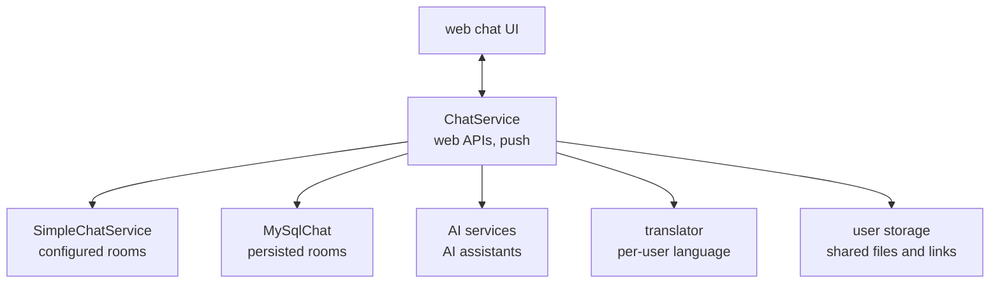

# SysWeaver.Chat

[⬆ SysWeaver overview](../README.md)

> A chat framework: rooms/sessions with pluggable providers (simple in-memory rooms, MySQL-persisted rooms, AI assistants), real-time delivery, translation, file and link sharing and a web chat UI.

| | |
|---|---|
| **Layer** | Chat |
| **Kind** | Micro service + provider contract |

## Purpose

One chat UI and API for very different conversation partners: people in a room, or an AI. Providers decide *what* a chat is; the chat service handles sessions, delivery and the user experience.

## How it fits into SysWeaver



`ChatService` picks up every registered `IChatProvider` (also those added later) and serves them through one set of web APIs and the embedded chat page. New messages, edits and removals are pushed to the clients through the HTTP server's session push messages.

## Key features

- Pluggable providers (`IChatProvider`): [SysWeaver.Chat.MySql](../SysWeaver.Chat.MySql/README.md) for persisted rooms, the AI services of [SysWeaver.AI](../SysWeaver.AI/README.md) for AI assistants, `SimpleChatService` for configured in-memory rooms
- Per room permissions (`ChatSessionParams`): join, post, clear, remove own / any message, including anonymous rooms
- Text, Markdown and HTML messages, message and chat menus, user profiles
- On-demand translation of messages into the user's language (when the server has a translator)
- Optional continuous speech input with a wake word
- File and link sharing through the user storage, privately or publicly (`AllowPublicStore`); other services can provide shareable links (`IChatStoreLinkHandler`)
- AI tools for storing files and links and listing stored ones, used by the AI chat

## Key components

- [`ChatService`](ChatService.cs) — the micro service: provider registry, web APIs, push delivery, storage and translation
- [`IChatProvider`](IChatProvider.cs) / [`IChatController`](IChatController.cs) — the provider contract and the controller a provider uses to push changes
- [`SimpleChatService`](SimpleChatService.cs) — a provider with rooms configured in the manifest (kept in memory)
- [`ChatSessionParams`](ChatSessionParams.cs) — permissions and options of a room / session

## Using it

```json
[
  { "Type": "SysWeaver.Chat.SimpleChatService, SysWeaver.Chat",
    "Params": { "Rooms": [ { "Name": "Lobby", "Auth": "" }, { "Name": "Admins", "Auth": "Admin" } ] } },
  { "Type": "SysWeaver.Chat.ChatService, SysWeaver.Chat" }
]
```

## Limitations and considerations

- `SimpleChatService` keeps messages in memory; use the MySQL provider for persistence
- Sharing requires a user storage service (`IUserStorageService`), translation requires a translator on the HTTP server

## Relationships

- **Project:** [`SysWeaver.Chat.csproj`](SysWeaver.Chat.csproj)
- **Builds on:** [SysWeaver.HttpServer](../SysWeaver.HttpServer/README.md), [SysWeaver.MicroServices.ServiceManager](../SysWeaver.MicroServices.ServiceManager/README.md)
- **Used by:** [SysWeaver.AI](../SysWeaver.AI/README.md), [SysWeaver.AI.OpenAI](../SysWeaver.AI.OpenAI/README.md), [SysWeaver.Chat.MySql](../SysWeaver.Chat.MySql/README.md)
- **Third-party:** HtmlAgilityPack, CommunityToolkit.HighPerformance
