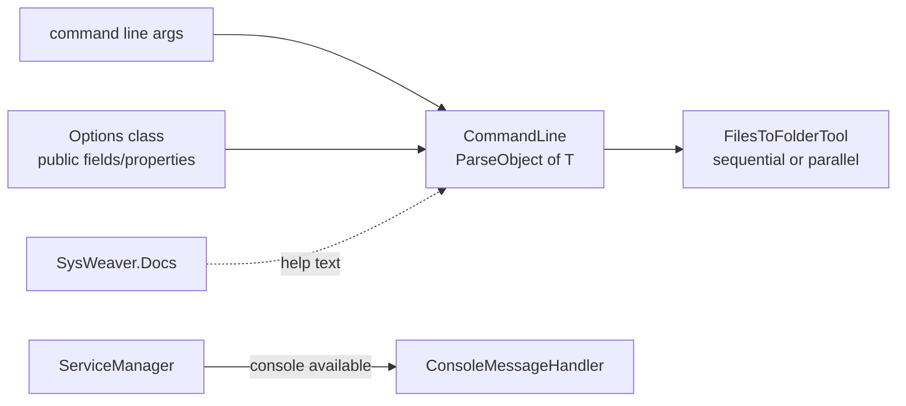

# SysWeaver.CommandLine

[⬆ SysWeaver overview](../README.md)

> Command line parsing into typed option objects, auto-generated help from XML docs, a console log handler, and a ready-made shell for "files in → folder out" tools.

| | |
|---|---|
| **Layer** | Foundation |
| **Kind** | Library |

## Purpose

Provides everything needed to build small, consistent command line tools on top of SysWeaver — the SysWeaver.Tools command line tools (e.g. Compress, SvgOpt, FolderSync) are built this way — and supplies the console output used when a service runs interactively.

## How it fits into SysWeaver



The service manager registers a `ConsoleMessageHandler` automatically when a console is available (synchronous with full details in DEBUG builds, asynchronous otherwise), which is how `debug`/`execute` mode prints log messages.

## Key features

- `CommandLine.ParseObject<T>` maps options onto the public properties (by default), fields or both of any class, including nested objects (`Parent.Child` options); `CommandLine.ParseOptions` parses against explicitly declared `CommandLineOption`s
- Typed positional arguments (`CommandLineArgument`) with required/optional handling, defaults, valid values and limits
- Values for primitive types, strings, dates, time spans, GUIDs, enums, arrays and lists; numbers accept expressions via SysWeaver.ExpressionEvaluator; extra parsers via `CommandLine.AddParser`
- Help/syntax text (`SyntaxObject<T>` / `SyntaxOptions`) generated from the options and their XML documentation; `-?` and `-help` are built in
- File arguments (`FileCommandLineArgument`, `FileCommandLineOptionArgument`) with wildcards, `;` separated masks, a trailing `+` for recursive search and optional numbered file sequences
- `FilesToFolderTool`: an input-files/output-folder tool shell with synchronous, asynchronous and parallel variants and consistent process exit codes
- `Wildcard.Match`: Windows (case insensitive) or Unix style (case sensitive) file name wildcard matching
- `ConsoleMessageHandler`: console log output with detail styles, level colouring and sync/async modes

## Key components

- [`CommandLine`](CommandLine.cs) — option and argument parsing, help generation
- [`FilesToFolderTool`](FilesToFolderTool_T.cs) — the "files in → folder out" tool shell and its exit codes
- [`ConsoleMessageHandler`](ConsoleMessageHandler.cs) — console message handler

## Using it

```csharp
public sealed class Options
{
    /// <summary>Overwrite existing files</summary>
    public bool Force;
}

static int Main(string[] args) =>
    FilesToFolderTool.OnFiles<Options>(args, (log, options, sourceFile, relativeName, destFolder) =>
    {
        // process one input file; return 0 to continue, anything else (use 1-255) aborts with that exit code
        return 0;
    });
// Usage: MyTool [-Force] *.png+ OutFolder
```

`FilesToFolderTool` exit codes: 0 (`ExitSuccess`) success, also when help was requested; 1 (`ExitGenericError`) a file callback threw; 2 (`ExitInvalidArguments`) invalid command line; otherwise the first non-zero value returned by the validation or file callback.

## Limitations and considerations

- Designed for the SysWeaver conventions; not a replacement for full-featured CLI frameworks with sub-command trees
- Options are recognised by the prefixes `-`, `--` and `/`; positional values starting with `-` or `/` (negative numbers, absolute Unix paths) are taken as options
- Help quality depends on XML comments being present and deployed
- Configuration (prefixes, parsers) is global static state; set it up once at startup
- Integer values are evaluated as 64-bit expressions and converted without range checks; use argument limits to reject out of range values
- Return exit codes in the range 1-255 from callbacks: Linux truncates exit codes to 8 bits

## Relationships

- **Project:** [`SysWeaver.CommandLine.csproj`](SysWeaver.CommandLine.csproj)
- **Builds on:** [SysWeaver.Common](../SysWeaver.Common/README.md), [SysWeaver.Docs](../SysWeaver.Docs/README.md), [SysWeaver.ExpressionEvaluator](../SysWeaver.ExpressionEvaluator/README.md)
- **Used by:** [SysWeaver.Media](../SysWeaver.Media/README.md), [SysWeaver.MicroService.HttpServer](../SysWeaver.MicroService.HttpServer/README.md), [SysWeaver.MicroServices.ServiceManager](../SysWeaver.MicroServices.ServiceManager/README.md); tools [AcmeCertUtil](https://github.com/dosh1974/SysWeaver.Tools/blob/main/AcmeCertUtil/README.md), [Compress](https://github.com/dosh1974/SysWeaver.Tools/blob/main/Compress/README.md), [Decompress](https://github.com/dosh1974/SysWeaver.Tools/blob/main/Decompress/README.md), [FolderSync](https://github.com/dosh1974/SysWeaver.Tools/blob/main/FolderSync/README.md), [OnDuplicates](https://github.com/dosh1974/SysWeaver.Tools/blob/main/OnDuplicates/README.md), [SvgOpt](https://github.com/dosh1974/SysWeaver.Tools/blob/main/SvgOpt/README.md), [SwCurl](https://github.com/dosh1974/SysWeaver.Tools/blob/main/SwCurl/README.md), [SwSyncTool](https://github.com/dosh1974/SysWeaver.Tools/blob/main/SwSyncTool/README.md)
