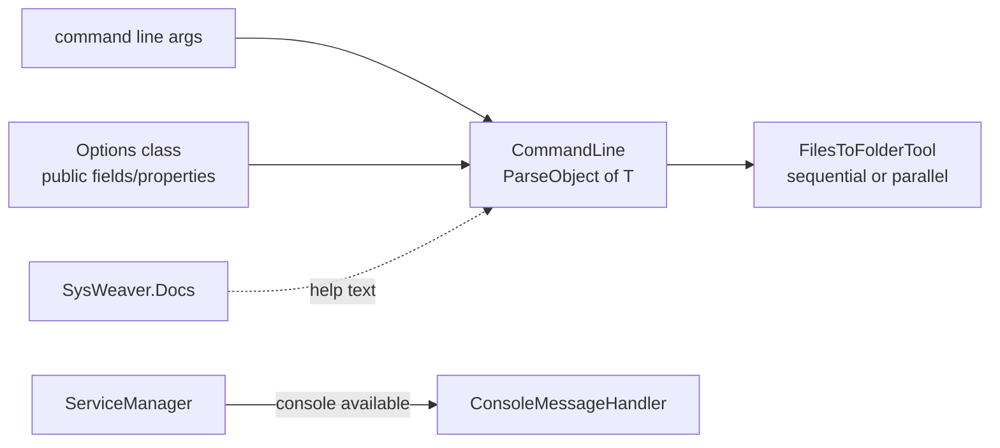

# SysWeaver.CommandLine

[⬆ SysWeaver overview](../README.md)

> Command line parsing into typed option objects, auto-generated help from XML docs, a console log handler, and a ready-made shell for "files in → folder out" tools.

| | |
|---|---|
| **Layer** | Foundation |
| **Kind** | Library |

## Purpose

Provides everything needed to build small, consistent command line tools on top of SysWeaver — the framework's own build tools (compression, SVG optimisation, folder sync) are built this way — and supplies the console output used when a service runs interactively.

## How it fits into SysWeaver



The service manager registers the console message handler automatically when a console is available (synchronous with full details in DEBUG builds, asynchronous otherwise), which is how `debug`/`execute` mode prints log messages.

## Key features

- `CommandLine.ParseObject<T>` maps options onto the public fields/properties of any class (nested objects become `Parent.Child` options, a `false` boolean becomes a flag); `CommandLine.ParseOptions` parses against explicitly declared `CommandLineOption`s.
- Positional arguments (`CommandLineArgument`) with required/optional handling, optional "any number of arguments", and per-argument tags (default, valid values, limits, type).
- Values parsed for all primitive types, `String`, `Char`, `DateTime`, `TimeSpan`, `Guid`, enums, arrays and lists (`;` separated); numbers accept expressions via SysWeaver.ExpressionEvaluator; extra parsers via `CommandLine.AddParser`.
- Help/syntax text (`CommandLine.SyntaxObject<T>` / `SyntaxOptions`) generated from the options class and its XML documentation; `-?` and `-help` are built in.
- `FileCommandLineArgument` / `FileCommandLineOptionArgument`: existing files with wildcards, `;` separated masks, a trailing `+` for recursive search and optional numbered file sequences.
- `FilesToFolderTool` / `FilesToFolderTool<T>`: an input-files/output-folder tool shell with synchronous, asynchronous and parallel processing variants and consistent process exit codes (0 ok or help, 1 exception, 2 bad command line, see below).
- `Wildcard.Match`: Windows (cmd.exe like, case insensitive) or Unix style (case sensitive) file name wildcard matching.
- `ConsoleMessageHandler`: console message handler with three detail styles, level colouring and sync/async output.

## Limitations and considerations

- Designed for the SysWeaver conventions (option prefix, option naming); not a general replacement for full-featured CLI frameworks with sub-command trees.
- Options are recognised by the prefixes `-`, `--` and `/` (the longest matching prefix is removed, so `--name` is looked up as `name`); positional values starting with `-` or `/` (negative numbers, absolute Unix paths) are taken as options.
- Help quality depends on XML comments being present and deployed; only the plain text of `<summary>` is used.
- Configuration (prefixes, tags, parsers) is global static state; set it up once at startup (`AddParser` uses a plain, not thread safe, dictionary).
- Integer values are evaluated as 64-bit expressions and converted with an unchecked cast (`ParseSByte("200")` is -56, no range error); use argument limits (`Make<T>(name, min, max)`) to reject out of range values.
- Options objects: indexers are skipped, read-only members are skipped (unless they are nested option objects), a `false` boolean becomes a flag. A nested object that is null on the instance is only created to list its options, setting such an option throws. A nested member whose type is already on the current nesting path (ex: `Node.Child` of type `Node`) is skipped. Nested struct typed members must be fields: a struct typed *property* without a parser (ex: `ValuePair Pair { get; set; }`) is skipped and has no options (a property returns a copy, members assigned to it would be lost; cmdline-cov-7, won't fix), so `-pair.a 4` throws `ArgumentException` (unknown option). Nullable value type members (ex: `int?`) are options parsed like their underlying type. When `-?`/`-help` is given, `ParseObject` returns null, but options before it have already been applied to the instance.
- `FilesToFolderTool` exit codes follow the common convention **0 = success, non-zero (1-255) = failure** (Windows `if errorlevel 1` / `%errorlevel%`, PowerShell `$LASTEXITCODE`, POSIX shells, MSBuild `Exec`):
  0 (`FilesToFolderTool.ExitSuccess`) ok, also when help was requested (`-?` / `-help`); 1 (`ExitGenericError`) a file callback threw; 2 (`ExitInvalidArguments`) invalid command line (unknown option, no source files argument, a source folder that doesn't exist, or `validateParams` threw; a name / mask that matches no file in an existing folder is not an error: nothing is processed and the result is 0);
  else the first non-zero value returned by `validateParams` or a file callback, passed through unchanged (return 1-255 from them: Linux truncates exit codes to 8 bits, -1 becomes 255, and `if errorlevel 1` ignores negative codes).
  Before cmdline-cov-8 was fixed the codes were 1 for help, -1 for an invalid command line and -2 for an exception. The parallel variants skip files not yet started after a non-zero value. File sequences (`AllowSourceSequence`) count up the last number of the file name and stop at the first gap.

## Using it

```csharp
public sealed class Options
{
    /// <summary>Overwrite existing files</summary>
    public bool Force;
}

static int Main(string[] args) =>
    FilesToFolderTool.OnFiles<Options>(args, (log, options, sourceFile, relativeName, destFolder) =>
    {
        // process one input file; return 0 to continue, anything else (use 1-255) aborts with that exit code
        return 0;
    });
// Usage: MyTool [-Force] *.png+ OutFolder
```

## Relationships

- **Project:** [`SysWeaver.CommandLine.csproj`](SysWeaver.CommandLine.csproj)
- **Builds on:** [SysWeaver.Common](../SysWeaver.Common/README.md), [SysWeaver.Docs](../SysWeaver.Docs/README.md), [SysWeaver.ExpressionEvaluator](../SysWeaver.ExpressionEvaluator/README.md)
- **Used by:** [SysWeaver.Media](../SysWeaver.Media/README.md), [SysWeaver.MicroService.HttpServer](../SysWeaver.MicroService.HttpServer/README.md), [SysWeaver.MicroServices.ServiceManager](../SysWeaver.MicroServices.ServiceManager/README.md)
