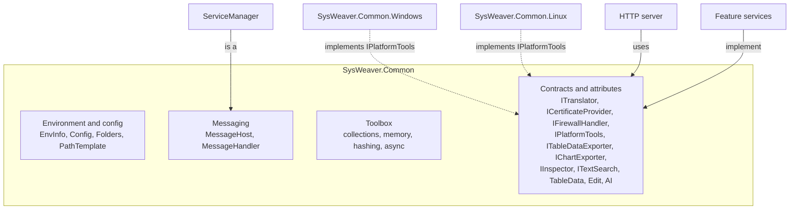

# SysWeaver.Common

[⬆ SysWeaver overview](../README.md)

> The foundation every other SysWeaver project stands on: environment and configuration, folders, messaging/logging, async and collection primitives, and — importantly — the shared *vocabulary* of contracts and attributes that the rest of the framework implements.

| | |
|---|---|
| **Layer** | Foundation |
| **Kind** | Library (no external dependencies) |

## Purpose

`SysWeaver.Common` exists so that higher layers never have to agree on anything except this assembly. It serves three roles:

1. **Runtime environment** – where am I running, which files and folders belong to this application, how is it configured, where do log messages go.
2. **General purpose toolbox** – high performance collections, string and memory helpers, hashing, caching, scheduling and async coordination primitives that are reused throughout the framework.
3. **Contract hub** – interfaces and attributes that let independent projects cooperate without referencing each other (translation, language identification, certificates, firewalls, table data and chart export, inspection, text search, object editing, AI tools, platform tools, …).

It is cross-platform; OS specific functionality is delegated to `IPlatformTools` implementations in separate assemblies.

## How it fits into SysWeaver



The `ServiceManager` *is* a `MessageHost`, so every service logs through the same pipeline. Feature projects implement the contracts defined here and consumers discover them at runtime through the service manager — neither side references the other:

| Area | Contracts / vocabulary | Implemented or consumed by |
|---|---|---|
| Translation | `ITranslator`, `TranslateRequest`, `AutoTranslate*` attributes | Translation services and caches, TableData |
| Language identification | `ILanguageIdentifier` | LanguageIdentifier.FastText, LanguageIdentifier.Llm |
| Security | `ICertificateProvider`, `IFirewallHandler`, `CertificateTools` | Security, Security.Acme, HTTP servers |
| Table data | `TableData`, `TableDataRequest`, `TableData*` attributes, `ITableDataExporter` | TableData, Excel, HTTP server explorer |
| Charts | `IChartExporter`, `ChartExportOptions` | ChartJs, ChartJs.Excel |
| Inspection | `IInspector`, `IReadInspector`, `IWriteInspector`, `IDescribable` | Inspection and its binary serializer |
| Text search | `ITextSearch`, `ITextRanker`, `SimpleTextSearch` | TableData, Media.Svg |
| Object editing | `Edit*` attributes | MicroService.Edit |
| AI tools | `AiToolAttribute` / `AiUseAttribute`, `AiToolPrefixAttribute`, `AiToolNameAttribute`, `AiIgnoreAttribute`, `AiOptionalAttribute`, `AiHideMcpAttribute`, `IHaveAiTools`, `IAiToolContext` | AI chat services and the MCP service |
| Platform | `IPlatformTools`, `PlatformTools.Current` | Common.Windows, Common.Linux |
| Monitoring | `IPerfMonitored` / `PerfMonitor`, `IHaveStats` / `Stats` | ServiceManager |

## Key features

- **Environment** (`EnvInfo`): executable location and base name (which drives the names of the config, manifest and log files), OS platform, application identity and native library folder conventions
- **Layered configuration** (`Config`): machine-wide defaults (`DefaultSystemConfig.json`), the application's `<ExecutableBase>.Config.json` and machine-wide enforced values (`ForcedSystemConfig.json`); `Config.ApplyConfig` maps a JSON file onto a parameter object
- **Folders and path templates** (`Folders`, `PathTemplate`): standard data locations (all users / per user, shared / per application, key folder) and `$(Variable)` path expansion used by almost every configurable path in the framework
- **Messaging** (`MessageHost`, `MessageHandler`): a hub distributing log/status messages to any number of handlers (debug output, size-limited log file, console, …), synchronously or asynchronously
- **Text templates** (`TextTemplate`, `LanguageTemplate`): `$(Variable)` templates with transforms, and per-extension handlers used for localized web files
- **Plug-in loading** (`TypeFinder`, `PlatformTools`, `DataTypePolicy`): resolve types by name from loaded assemblies or the executable folder — the basis of manifest-driven composition — with a deny list for types named in serialized data
- **Roles** (`Roles`): the standard auth tokens (Admin, Ops, Dev, Debug, Service and combinations) used by `[WebApiAuth]`
- **Toolbox**: fast string helpers and validators, prefix lookup trees, read-optimised and low-allocation collections, caches (`FastMemCache`), pooled streams and memory, file and path helpers with retries and change watching, hashing (`GxHash`, `QuickHash`, `FileHash`), a pooled CSPRNG (`SecureRng`), human-friendly code generators
- **Async coordination**: async locks and signals, long-poll change notification, concurrency and rate limiters, object pools, periodic tasks, a scheduler and retry helpers
- **Web and net helpers** (`WebTools`, `NetworkTools`, `MimeTypeMap`): shared `HttpClient`s (optionally via Tor when SysWeaver.Tor is deployed), markdown to HTML / e-mail HTML / Slack, LAN address and connectivity probing, MIME types
- **Safe exception texts** (`ExceptionExt.SafeMessage()` / `SafeText()`): exception messages with paths, secrets, tokens and internal addresses masked, used wherever exception text is sent to clients
- **Performance and statistics** (`IPerfMonitored`, `IHaveStats`, `ExceptionTracker`): collected and displayed automatically by the service manager

## Key components

- [`Config`](Config.cs) — layered configuration files and mapping of JSON onto parameter objects
- [`PathTemplate`](PathTemplate.cs) / [`Folders`](Folders.cs) — path variables and the standard data folders
- [`MessageHost`](MessageHost.cs) — the message/logging hub that the service manager derives from
- [`TypeFinder`](TypeFinder.cs) — type resolution by name for manifests and plug-ins
- [`PlatformTools`](PlatformTools.cs) — the `IPlatformTools` contract and its runtime resolution

## Using it

You rarely reference it explicitly; it arrives transitively. Typical direct uses:

```csharp
using SysWeaver;

// Read an application setting (merged from default, app and forced config files)
if (Config.TryGetString("KeyFolder", out var keys)) { /* … */ }

// Expand a path template used in service parameters
var dataFile = PathTemplate.Resolve("$(CommonApplicationData)/MyApp/data.bin");

// OS specific helpers, implementation chosen at runtime
if (PlatformTools.Current.GetCpuUsage(out var cpu)) { /* … */ }
```

Deploy `SysWeaver.Common.Windows` and/or `SysWeaver.Common.Linux` next to the executable so the platform tools can be resolved (SysWeaver.Storage references both, so they are usually copied automatically).

## Limitations and considerations

- It is a large, broad assembly; everything depends on it, so changes here ripple through the whole framework
- Optional assemblies are resolved at runtime (platform tools, Tor, SysWeaver.Docs for config file comments); when missing the code silently falls back (e.g. to `DummyPlatformTools`), which can hide deployment mistakes
- The attribute vocabularies only *describe*; they have no effect without the corresponding processing project (table data, editor, translation, AI)
- Several helpers use unsafe code and raw memory for performance. `GxHash` (and comparers using it) requires AES-NI or ARM AES and throws `PlatformNotSupportedException` otherwise
- Hashes from `QuickHash`, `ObjectHash` and `FileHash` are for in-process or caching use, not security
- Not everything is thread safe (e.g. `DictionaryList`, `StringTree`; use the frozen variants for concurrent reads)
- Data folders shared by all users are made writable by everyone (`PathExt.CreateDataFolder`): Everyone full control on Windows, mode bits plus a POSIX default ACL on Linux (needs `setfacl`, package `acl`)
- On Linux `$(CommonApplicationData)` is `/var/lib`, where only root can create folders; until the application has run once as root (or `/var/lib/SysWeaver` is created with `sudo mkdir -p /var/lib/SysWeaver && sudo chmod 1777 /var/lib/SysWeaver`), the all-user folders fall back to per-user folders
- Path validation and file helpers follow the rules of the OS they run on (e.g. on Linux `\` is a valid file name character); files are memory mapped only on Windows and read into pooled memory elsewhere
- The `Inspection` contracts live in a folder spelled `Inpsection`; the namespace is `SysWeaver.Inspection`. The public `SysWeaver.ReadOnlyDictionary<K,V>` clashes with `System.Collections.ObjectModel.ReadOnlyDictionary` when both namespaces are imported

## Relationships

- **Project:** [`SysWeaver.Common.csproj`](SysWeaver.Common.csproj)
- **Builds on:** —
- **Used by:** [SysWeaver.Auth.Core](../SysWeaver.Auth.Core/README.md), [SysWeaver.CommandLine](../SysWeaver.CommandLine/README.md), [SysWeaver.Common.Linux](../Platform/SysWeaver.Common.Linux/README.md), [SysWeaver.Common.Windows](../Platform/SysWeaver.Common.Windows/README.md), [SysWeaver.Compression](../SysWeaver.Compression/README.md), [SysWeaver.DbSimpleStack](../SysWeaver.DbSimpleStack/README.md), [SysWeaver.Email.AmazonSes](../Communication/SysWeaver.Email.AmazonSes/README.md), [SysWeaver.Email.Fake](../Communication/SysWeaver.Email.Fake/README.md), [SysWeaver.Email.MicrosoftAcs](../Communication/SysWeaver.Email.MicrosoftAcs/README.md), [SysWeaver.Email.Smtp](../Communication/SysWeaver.Email.Smtp/README.md), [SysWeaver.EmailReader.Imap](../Communication/SysWeaver.EmailReader.Imap/README.md), [SysWeaver.EmailReader.Pop3](../Communication/SysWeaver.EmailReader.Pop3/README.md), [SysWeaver.Excel](../SysWeaver.Excel/README.md), [SysWeaver.ExpressionEvaluator](../SysWeaver.ExpressionEvaluator/README.md), [SysWeaver.FileTranslation](../SysWeaver.FileTranslation/README.md), [SysWeaver.FolderSync](../SysWeaver.FolderSync/README.md), [SysWeaver.HttpServer](../SysWeaver.HttpServer/README.md), [SysWeaver.HttpServer.ExploreModule](../SysWeaver.HttpServer.ExploreModule/README.md), [SysWeaver.Inspection](../SysWeaver.Inspection/README.md), [SysWeaver.IsoData](../SysWeaver.IsoData/README.md), [SysWeaver.Knowledge](../SysWeaver.Knowledge/README.md), [SysWeaver.LanguageIdentifier.FastText](../SysWeaver.LanguageIdentifier.FastText/README.md), [SysWeaver.Map](../SysWeaver.Map/README.md), [SysWeaver.Math](../SysWeaver.Math/README.md), [SysWeaver.Media.Png](../SysWeaver.Media.Png/README.md), [SysWeaver.Media.Psd](../SysWeaver.Media.Psd/README.md), [SysWeaver.Media.Svg](../SysWeaver.Media.Svg/README.md), [SysWeaver.MicroService.FileUploader](../SysWeaver.MicroService.FileUploader/README.md), [SysWeaver.MicroService.Map](../SysWeaver.MicroService.Map/README.md), [SysWeaver.MicroService.Media](../SysWeaver.MicroService.Media/README.md), [SysWeaver.MicroService.Translation](../SysWeaver.MicroService.Translation/README.md), [SysWeaver.MicroService.TranslationDbCache](../SysWeaver.MicroService.TranslationDbCache/README.md), [SysWeaver.MicroService.UserManager](../SysWeaver.MicroService.UserManager/README.md), [SysWeaver.MicroService.UserStorage](../SysWeaver.MicroService.UserStorage/README.md), [SysWeaver.MicroServices](../SysWeaver.MicroServices/README.md), [SysWeaver.MicroServices.Log](../SysWeaver.MicroServices.Log/README.md), [SysWeaver.MicroServices.ServiceManager](../SysWeaver.MicroServices.ServiceManager/README.md), [SysWeaver.Minifier.Svg](../SysWeaver.Minifier.Svg/README.md), [SysWeaver.Remote.Connection](../SysWeaver.Remote.Connection/README.md), [SysWeaver.Remote.Services](../SysWeaver.Remote.Services/README.md), [SysWeaver.Security](../SysWeaver.Security/README.md), [SysWeaver.Serialization](../SysWeaver.Serialization/README.md), [SysWeaver.Storage](../SysWeaver.Storage/README.md), [SysWeaver.TableData](../SysWeaver.TableData/README.md), [SysWeaver.TextMessage.AmazonEndUserMessaging](../Communication/SysWeaver.TextMessage.AmazonEndUserMessaging/README.md), [SysWeaver.TextMessage.Fake](../Communication/SysWeaver.TextMessage.Fake/README.md), [SysWeaver.TextMessage.Router](../Communication/SysWeaver.TextMessage.Router/README.md), [SysWeaver.TextMessage.Twilio](../Communication/SysWeaver.TextMessage.Twilio/README.md), [SysWeaver.TextMessage.WhatsApp](../Communication/SysWeaver.TextMessage.WhatsApp/README.md), [SysWeaver.Tor](../SysWeaver.Tor/README.md), [SysWeaver.Translation.Google](../SysWeaver.Translation.Google/README.md), [SysWeaver.WebBrowser.Cef](../Internet/SysWeaver.WebBrowser.Cef/README.md), [SysWeaver.WebBrowser.WebView2](../Internet/SysWeaver.WebBrowser.WebView2/README.md); tools [Compress](https://github.com/dosh1974/SysWeaver.Tools/blob/main/Compress/README.md), [Decompress](https://github.com/dosh1974/SysWeaver.Tools/blob/main/Decompress/README.md), [SearchAndReplaceAll](https://github.com/dosh1974/SysWeaver.Tools/blob/main/SearchAndReplaceAll/README.md), [SvgOpt](https://github.com/dosh1974/SysWeaver.Tools/blob/main/SvgOpt/README.md), [SwSyncTool](https://github.com/dosh1974/SysWeaver.Tools/blob/main/SwSyncTool/README.md), [VsClean](https://github.com/dosh1974/SysWeaver.Tools/blob/main/VsClean/README.md)
