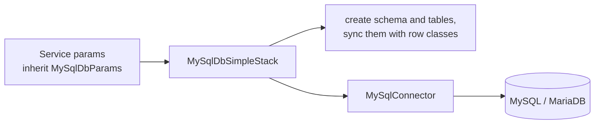

# SysWeaver.DbSimpleStack.MySql

[⬆ SysWeaver overview](../README.md)

> MySQL / MariaDB back-end for the SysWeaver database layer, including character set/collation control, table partition folders, and automatic creation and evolution of tables.

| | |
|---|---|
| **Layer** | Storage / Data |
| **Kind** | Library (database dialect) |

## Purpose

All SysWeaver services that persist relational data do so through this project. Their parameter classes typically *inherit* `MySqlDbParams`, so each service is configured with its own server/schema/credentials directly in its manifest entry.

## How it fits into SysWeaver



## Key features

- UTF-8 (`utf8mb4`) by default with case-sensitive (`utf8mb4_bin`) and case-insensitive (`utf8mb4_unicode_ci`) collations selectable per column, plus ASCII columns
- Automatic schema and table creation; on every table init the table is synchronised with its row class (columns added, modified, reordered and dropped, indices and full-text indices created and removed)
- Table partitioning (MySQL 8+) by key or hash for row classes marked with `PartitionByKey` / `PartitionByHash`, with each partition in its own data folder (`Partitions`)
- Upsert and batched bulk upsert, plus copying all rows of a table between two databases
- Table maintenance helpers: optimize, page compression and row format
- Optional server RSA public key file for password exchange on unencrypted connections

## Key components

- [`MySqlDbSimpleStack`](MySqlDbSimpleStack.cs) — the MySQL dialect: schema/table creation and synchronisation, partitioning, upserts, maintenance
- [`MySqlDbParams`](MySqlDbParams.cs) — connection, character set / collation and partition parameters; base class for service parameters

## Using it

Configure any service whose parameters derive from `MySqlDbParams`, e.g. the audit service:

```json
{ "Type": "SysWeaver.MicroService.MySqlApiAuditService, SysWeaver.MicroService.MySqlAudit",
  "Params": { "Server": "db.local", "Schema": "audit", "User": "svc", "Password": "…" } }
```

The same connection members (`Server`, `Port`, `Schema`, `User`, `Password` or `CredFile`, ...) apply to every service whose parameters derive from `MySqlDbParams`.

## Limitations and considerations

- Table synchronisation is not purely additive: columns that no longer exist in the row class are **dropped** (with their data), and indices not declared on the row class are removed. Set `ReadOnly` to prevent any schema change.
- The default connection string disables TLS (`SSL Mode=None`) and allows public key retrieval; override `ConnectionString` / `ConnectionStringNoSchema` for encrypted connections.
- Partitioning is skipped on servers older than MySQL 8 and when fewer than two partition folders are configured.

## Relationships

- **Project:** [`SysWeaver.DbSimpleStack.MySql.csproj`](SysWeaver.DbSimpleStack.MySql.csproj)
- **Builds on:** [SysWeaver.DbSimpleStack](../SysWeaver.DbSimpleStack/README.md)
- **Vendored libraries:** SimpleStack.Orm.MySQLConnector (see [_external](../_external/README.md))
- **Used by:** [SysWeaver.Chat.MySql](../SysWeaver.Chat.MySql/README.md), [SysWeaver.IpLocation.MySqlCache](../SysWeaver.IpLocation.MySqlCache/README.md), [SysWeaver.MicroService.MySqlAudit](../SysWeaver.MicroService.MySqlAudit/README.md), [SysWeaver.MicroService.TranslationDbCache](../SysWeaver.MicroService.TranslationDbCache/README.md), [SysWeaver.MicroService.UserManager](../SysWeaver.MicroService.UserManager/README.md)
