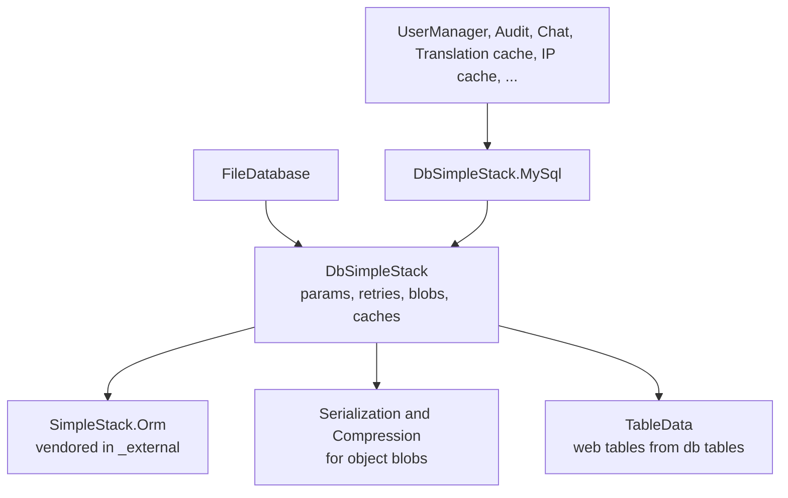

# SysWeaver.DbSimpleStack

[⬆ SysWeaver overview](../README.md)

> The relational database layer: a thin framework over the vendored SimpleStack.Orm that adds SysWeaver-style parameters, connection retry, automatic schema handling, object blobs, column attributes and in-memory table caches.

| | |
|---|---|
| **Layer** | Storage / Data |
| **Kind** | Library (database-agnostic core) |

## Purpose

Services that need a real database (users, audit logs, chat history, caches) describe their tables as C# row classes and let this layer create and access them. The core is dialect-independent; [SysWeaver.DbSimpleStack.MySql](../SysWeaver.DbSimpleStack.MySql/README.md) supplies the MySQL / MariaDB dialect and the actual table creation and evolution.

## How it fits into SysWeaver

## Key features

- Connection string templates (`[Server]`, `[Port]`, `[Schema]`, `[User]`, `[Password]`) filled from the parameters; credentials can come from a credential file and the server address from a text file
- Machine-wide forced settings per server and port (`DbConfigs/<ParamsType>_<server>_<port>.json` in the system config folder)
- `Init` waits and retries (default 5 minutes) while the database server starts, and creates the schema if it is missing
- Objects stored as serialized, compressed blobs (JSON + Brotli by default)
- Column attributes for case sensitivity, ASCII columns and full-text indices (`CaseSensitive`, `CaseInsensitive`, `Ascii`, `FullTextSearchIndex`)
- Whole-table in-memory caches with optional background refresh
- Answers filtered, sorted and paged [table data](../SysWeaver.TableData/README.md) requests directly from a database table
- Raw SQL helpers with positional parameters (`p0`, `p1`, ...) and fast typed readers
- Optional read-only mode that skips schema creation and table changes

## Key components

- [`DbSimpleStack`](DbSimpleStack.cs) — abstract base: connection factory, init with retry, blobs, table init/validation hooks
- [`DbParams`](DbParams.cs) — base parameters shared by all database-backed services
- [`DbTableCache`](DbTableCache.cs) — caches a complete table in a dictionary, optionally refreshed in the background
- [`DbData`](DbDataExtension.cs) — answers `TableDataRequest`s from a table
- [`CaseSensitiveAttribute` and friends](DbAttributes.cs) — column attributes (declared in the `SimpleStack.Orm.Attributes` namespace)

## Using it

Use it through a dialect project such as [SysWeaver.DbSimpleStack.MySql](../SysWeaver.DbSimpleStack.MySql/README.md).

## Limitations and considerations

- Relies on a vendored ORM fork rather than a NuGet package; updates must be done in the repository.
- Only the MySQL dialect is wired up by SysWeaver projects, although the vendored ORM contains others.
- `DateTime` values are always stored as UTC: local times are converted, unspecified times are assumed to be UTC.
- The column attributes live in the `SimpleStack.Orm.Attributes` namespace, not `SysWeaver.Db`.

## Relationships

- **Project:** [`SysWeaver.DbSimpleStack.csproj`](SysWeaver.DbSimpleStack.csproj)
- **Builds on:** [SysWeaver.Common](../SysWeaver.Common/README.md), [SysWeaver.Compression](../SysWeaver.Compression/README.md), [SysWeaver.Serialization](../SysWeaver.Serialization/README.md), [SysWeaver.TableData](../SysWeaver.TableData/README.md)
- **Vendored libraries:** SimpleStack.Orm (see [_external](../_external/README.md))
- **Used by:** [SysWeaver.DbSimpleStack.MySql](../SysWeaver.DbSimpleStack.MySql/README.md), [SysWeaver.FileDatabase](../SysWeaver.FileDatabase/README.md)
