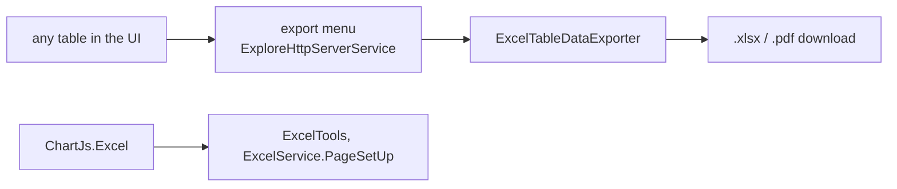

# SysWeaver.Excel

[⬆ SysWeaver overview](../README.md)

> Excel and PDF export of table data, using GemBox.Spreadsheet.

| | |
|---|---|
| **Layer** | Media |
| **Kind** | Plug-in (table exporter provider) |

## Purpose

Adds "export as Excel workbook" and "export as PDF document" to every table in the web UI by contributing table exporters. It also holds the GemBox licensing and page set-up helpers reused by the chart exporter in [SysWeaver.MicroService.ChartJs.Excel](../SysWeaver.MicroService.ChartJs.Excel/README.md).

## How it fits into SysWeaver



`ExcelService` implements `IHaveTableDataExporters`; the explore service in [SysWeaver.MicroService.HttpServer](../SysWeaver.MicroService.HttpServer/README.md) picks up its exporters automatically when the service is registered.

## Key features

- Two table exporters: Excel workbook (`.xlsx`, written as a styled Excel table) and PDF document (A4, fitted to page width, banded rows)
- Cell formatting driven by the table-data column formats (numbers, byte sizes, speeds, durations, URLs, tags, per-row formats); hidden columns are skipped
- Configurable page margins (`TableMarginInch`)

## Key components

- [`ExcelService`](ExcelService.cs) — the service registered in the manifest; sets the license and provides the exporters. The same file contains `ExcelTools` (licensing, colour conversion)
- [`ExcelTableDataExporter`](ExcelTableDataExporter.cs) — renders table data to `.xlsx` or `.pdf`
- [`ExcelTableDataFormat`](ExcelTableDataFormat.cs) — maps table-data column formats to Excel cell formats

## Using it

```json
{
  "Type": "SysWeaver.Excel.ExcelService, SysWeaver.Excel",
  "Params": {
    "CredFile": "$(KeyFolder)/GemBox.Spreadsheet.txt"
  }
}
```

## Limitations and considerations

- GemBox.Spreadsheet is commercial. `ExcelParams` is an API key parameter class (`ApiKey` or `CredFile`) and a key must be configured — without one, or with a missing key file, the service fails to start. To use the vendor's free, limited mode set `"ApiKey": "FREE-LIMITED-KEY"`. The service status reports whether a real license or the free mode is active.
- The license is set once per process; the first caller wins.

## Relationships

- **Project:** [`SysWeaver.Excel.csproj`](SysWeaver.Excel.csproj)
- **Builds on:** [SysWeaver.Common](../SysWeaver.Common/README.md)
- **Used by:** [SysWeaver.MicroService.ChartJs.Excel](../SysWeaver.MicroService.ChartJs.Excel/README.md), [ExchangeRateService](https://github.com/dosh1974/SysWeaver.Services/blob/main/ExchangeRateService/README.md), [IpLocationService](https://github.com/dosh1974/SysWeaver.Services/blob/main/IpLocationService/README.md)
- **Third-party:** GemBox.Spreadsheet
