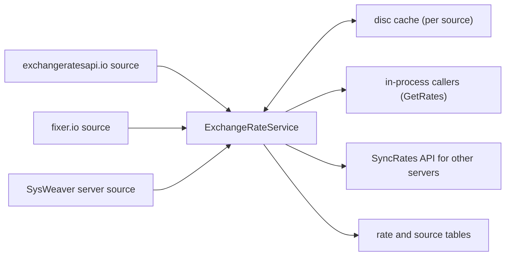

# SysWeaver.ExchangeRate

[⬆ SysWeaver overview](../README.md)

> Currency exchange rates as a service: fetches rates from pluggable sources with failover, caches them on disc and can serve other SysWeaver instances.

| | |
|---|---|
| **Layer** | Networking |
| **Kind** | Micro service with source plug-ins |

## Purpose

Give applications current currency conversion rates without each service integrating a provider. One server can fetch from commercial APIs and act as the source for others.

## How it fits into SysWeaver



The service requires at least one `IRateSource` registered before it in the manifest. In-process code gets the current rates from `ExchangeRateService.GetRates()` and converts using `RateCache.GetRate(from, to)` (ISO 4217 codes).

## Key features

- Sources included: [exchangeratesapi.io](https://exchangeratesapi.io/) (`ErsExchangeRatesApiDotIo`), [fixer.io](https://fixer.io/) (`ErsFixerDotIo`) and another SysWeaver server running this service (`ErsSysWeaverService`)
- Each source is refreshed on its own schedule (`RefreshMinutes`, aligned to the clock); rates are served from the first source (in registration order) whose rates are fresh, else from the most recently updated one
- Rates of each source are cached on disc (`CacheFolder`, default a folder under the common application data), so they survive restarts and outages
- Currency code aliases: a code missing from the sources can get the rate of another code (`OldToNewRateMap`, default `NLE=SLL`)
- `SyncRates` lets other servers fetch the rates when they changed (requires the `Service` role)
- Current rates, sources and all rates per source as web tables (menu *Debug / Exchange rate*); the optional `ExchangeRateDebugService` adds extra menu shortcuts to them
- Stats and perf monitoring

## Key components

- [`ExchangeRateService`](ExchangeRateService.cs) - source scheduling, selection of the current rates and the web API
- [`IRateSource`](IRateSource.cs) - the source plug-in contract
- [`RateCache`](RateCache.cs) - an immutable set of rates with `GetRate` / `GetRateNoThrow` conversions
- [`RateDiscCache`](RateDiscCache.cs) - per source disc cache

## Using it

Register one or more rate sources, then the service:

```json
[
  { "Type": "SysWeaver.ExchangeRate.Sources.ErsFixerDotIo, SysWeaver.ExchangeRate",
    "Params": { "CredFile": "$(KeyFolder)/fixer.io.txt" } },
  { "Type": "SysWeaver.ExchangeRate.Sources.ErsExchangeRatesApiDotIo, SysWeaver.ExchangeRate",
    "Params": { "CredFile": "$(KeyFolder)/exchangeratesapi.io.txt" } },
  { "Type": "SysWeaver.ExchangeRate.ExchangeRateService, SysWeaver.ExchangeRate" }
]
```

To use another SysWeaver server as the source, register `SysWeaver.ExchangeRate.Sources.ErsSysWeaverService, SysWeaver.ExchangeRate` with `BaseUrl` (and credentials of a user with the `Service` role) instead.

## Limitations and considerations

- Needs at least one source; commercial sources require API keys and have update-frequency limits (the default refresh is every 8 hours)
- Rates from different sources are not merged, one source's rates are used at a time
- Rates are only as fresh as the sources' update schedule

## Folder layout

| Folder | Content |
|---|---|
| [`Sources/`](Sources/README.md) | The rate sources (exchangeratesapi.io, fixer.io, another SysWeaver server) and their parameters |

## Relationships

- **Project:** [`SysWeaver.ExchangeRate.csproj`](SysWeaver.ExchangeRate.csproj)
- **Builds on:** [SysWeaver.IsoData](../SysWeaver.IsoData/README.md), [SysWeaver.MicroServices.ServiceManager](../SysWeaver.MicroServices.ServiceManager/README.md), [SysWeaver.Remote.Connection](../SysWeaver.Remote.Connection/README.md), [SysWeaver.Serialization](../SysWeaver.Serialization/README.md)
- **Used by:** [ExchangeRateService](https://github.com/dosh1974/SysWeaver.Services/blob/main/ExchangeRateService/README.md) (SysWeaver.Services)
