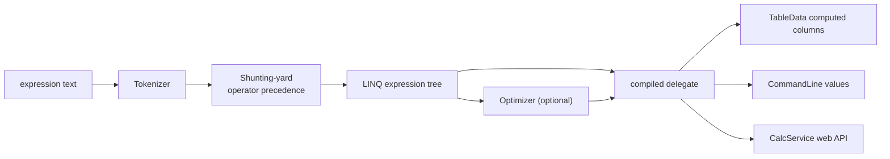

# SysWeaver.ExpressionEvaluator

[⬆ SysWeaver overview](../README.md)

> A compiling expression engine: text expressions are parsed and turned into LINQ expression trees for fast repeated evaluation in several numeric types. Also exposes a small calculator web API.

| | |
|---|---|
| **Layer** | Foundation |
| **Kind** | Library + optional web API object |

## Purpose

Lets users and configuration express numeric formulas as text ("x * 2 + y", "Max(a, b) / 2") while the framework executes them at compiled speed. It is the engine behind computed columns in table data (`TableDataEdit`), behind numeric value parsing in the command line tools (so "4 * 1024" is a valid number argument) and behind the calculator tool of SysWeaver.AI.

## How it fits into SysWeaver



## Key features

- Standard evaluators for `Double`, `Decimal`, `Int64` and `UInt64` (`ExpressionEvaluator.Double` etc), `ExpressionEvaluator.Get(type)` picks the one for any primitive numeric type.
- Named parameters (passed as an array, by index), so one expression compiles once and runs many times.
- Access to the raw expression tree (`Exp`), also with your own LINQ expressions as the parameter values, for embedding into larger LINQ expressions.
- Tokenization output (`ToTokens`: class, start, end, text) for validation or syntax highlighting.
- All public static `Math` functions and constants that only use the evaluator type, with their .NET names: `Sin`, `Sqrt`, `Log10`, `Max`, `Clamp`, `Round`, `PI`, `E`, `Tau` ... Overloads are selected by the number of arguments (`Log(8)` and `Log(8, 2)`).
- Numbers are always parsed with the invariant culture; `0x` (hex), `0b` (binary) and `0o` (octal) prefixes (case insensitive), exponents (`1e-3`).
- `ExpressionOptimizer`: constant folding and algebraic simplification of any LINQ expression (`Optimize`).
- `CalcService`: a tiny service that publishes calculator endpoints over HTTP.

## The language

| Precedence (high to low) | Double / Decimal | Int64 / UInt64 |
|---|---|---|
| unary | `-x`, `+x` | `-x` (not UInt64), `+x`, `~x`, `!x` (both bitwise not) |
| power | `^` (right associative) | - |
| multiplicative | `*`, `/`, `%` | `*`, `/`, `%` |
| additive | `+`, `-` | `+`, `-` |
| shift | `<<`, `>>` (multiply / divide by a power of 2) | `<<`, `>>` |
| bit AND | - | `&` |
| bit XOR | - | `^` |
| bit OR | - | <code>&#124;</code> |

- Functions are called as `Name(arg, arg)`. Parentheses and `,` (argument separator).
- All names (functions, constants and parameters) are case sensitive (ordinal): `PI` is the constant, `pi` can be a parameter, `sin(x)` is an unknown identifier.
- There are no comparison or logical operators.
- `-2^2` is 4 (unary minus binds tighter than `^`).
- The integer operators follow the C# precedence: `6|1&2` is `6|(1&2)` = 6.
- Decimal `x^y` is exact for an integer `y` (repeated multiplication), else it uses `Math.Pow` on Double values; `x<<y` / `x>>y` are `x * 2^y` / `x / 2^y`.
- A `,` in the *first* number of a Double / Decimal expression is a decimal separator (`"1,5"` = 1.5), anywhere else it's the argument separator (`"1+1,5"` is an error).
- Integer arithmetic is unchecked (wraps around), integer and decimal division by zero throws `DivideByZeroException` when evaluated; Double follows IEEE (`1/0` = infinity).
- Int64 literals are limited to `Int64.MaxValue` (write `-9223372036854775807-1` for the minimum, or use hex).

Parse errors throw an `ArgumentException`, in most cases an `ExpressionParserException` with the expression and the start / end position of the error (its `ToString()` marks the position).

## Limitations and considerations

- Numeric expression language; it is not a general scripting language (use [SysWeaver.Script](../SysWeaver.Script/README.md) for C# code).
- A function used without parentheses (`Sin 1`) uses its overload with the fewest arguments.
- Custom evaluators (`new ExpressionEvaluator<T>(flags, reader, customTypes)`): with the prefix flag of a type, its functions and constants get the type name as prefix (`MathSin`, `MathPI`); the first method found per name and argument count wins.
- Compiling is much slower than evaluating (tens of microseconds or more versus a few nanoseconds), keep the delegate from `Evaluator` and reuse it.
- `ObjectEvaluator` converts the values with `Convert.ChangeType` (strings use the current culture), `ToValue` with parameters requires values of exactly the evaluator type (they are unboxed).
- `ExpressionOptimizer.Optimize` doesn't fold `x * 0`, `0 * x` and `0 - x` for floating point types (IEEE: NaN, infinity, -0). It merges identical nodes through `ObjectMerger`, a process wide least recently used cache: nodes not used for `ObjectMerger.Timeout` (5 minutes) are removed (expr-cov-15: they were kept forever).
- Optimized floating point expressions can differ from IEEE arithmetic in the sign of a zero result (by design, expr-cov-17): `x + 0` and `0 + x` are folded to `x`, so x = -0 gives -0 (unoptimized: +0); a LINQ expression `x - c` with a -0.0 constant c is folded too (-0 instead of +0 for x = -0; the evaluator parses `-0` as a negation, it doesn't fold `x - -0`). NaN and infinities give the same results; the `* 1`, `/ 1`, `* -1`, `/ -1` rules are exact (not applied to `Half`). Decimal results have the same value, but the scale can differ (`1.5 + 0.00` is 1.50 unoptimized, 1.5 optimized; `x * 0` is 0).
- `CalcService` declares no authentication of its own; if registered it follows the API server's default auth.

## Known bugs

None known (see `_docs/BugReview-2026-10-06.md`).

## Using it

```csharp
using SysWeaver.Parser;
var f = ExpressionEvaluator.Double.Evaluator("x * x + y", "x", "y");
double r = f(new[] { 3.0, 1.0 });                       // 10
long v = ExpressionEvaluator.Int64.Value("0xff & ~0x0f"); // 240
```
Publish the calculator (optional):
```json
{ "Type": "SysWeaver.MicroService.CalcService, SysWeaver.ExpressionEvaluator" }
```

## Relationships

- **Project:** [`SysWeaver.ExpressionEvaluator.csproj`](SysWeaver.ExpressionEvaluator.csproj)
- **Builds on:** [SysWeaver.Common](../SysWeaver.Common/README.md), [SysWeaver.MicroServices](../SysWeaver.MicroServices/README.md)
- **Used by:** [SysWeaver.CommandLine](../SysWeaver.CommandLine/README.md), [SysWeaver.TableData](../SysWeaver.TableData/README.md), [SysWeaver.AI](../SysWeaver.AI/README.md)
