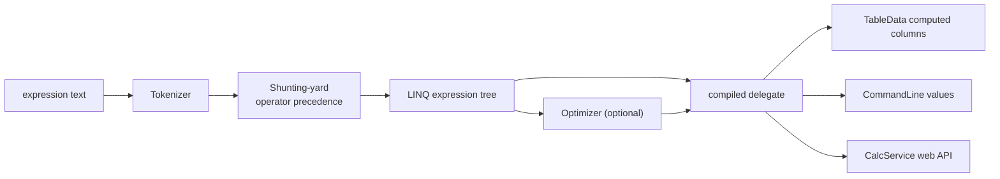

# SysWeaver.ExpressionEvaluator

[⬆ SysWeaver overview](../README.md)

> A compiling expression engine: text expressions are parsed and turned into LINQ expression trees for fast repeated evaluation in several numeric types. Also exposes a small calculator web API.

| | |
|---|---|
| **Layer** | Foundation |
| **Kind** | Library with micro services |

## Purpose

Lets users and configuration express numeric formulas as text ("x * 2 + y", "Max(a, b) / 2") while the framework executes them at compiled speed. It is the engine behind computed columns in table data (`TableDataEdit`), behind numeric value parsing in the command line tools (so "4 * 1024" is a valid number argument) and behind the calculator tool of [SysWeaver.AI](../SysWeaver.AI/README.md).

## How it fits into SysWeaver



## Key features

- Standard evaluators for `Double`, `Decimal`, `Int64` and `UInt64` (`ExpressionEvaluator.Double` etc.); `ExpressionEvaluator.Get(type)` picks the one for any primitive numeric type
- Named parameters (passed as an array, by index), so one expression compiles once and runs many times
- Access to the raw expression tree (`Exp`), also with your own LINQ expressions as parameter values, for embedding into larger LINQ expressions
- Tokenization output (`ToTokens`) for validation or syntax highlighting
- All public static `Math` functions and constants that only use the evaluator type, with their .NET names (`Sin`, `Sqrt`, `Max`, `Clamp`, `PI`, `E`, `Tau`, ...); overloads are selected by argument count
- Operators: unary `-` `+`, power `^` (floating point), `*` `/` `%`, `+` `-`, shifts `<<` `>>`, and for integers bitwise `~` `!` `&` `^` `|`; names are case sensitive and there are no comparison or logical operators
- Numbers are parsed with the invariant culture, with `0x`, `0b` and `0o` prefixes and exponents
- `ExpressionOptimizer`: constant folding and algebraic simplification of any LINQ expression
- `CalcService`: a tiny service that publishes calculator endpoints (`Calc`, `CalcDecimal`, `CalcInteger`, `CalcUnsigned`) over HTTP

## Key components

- [`ExpressionEvaluator`](ExpressionEvaluator.cs) — the standard evaluators and `ExpressionEvaluator<T>` (parse, compile, evaluate)
- [`ExpressionOptimizer`](ExpressionOptimizer.cs) — LINQ expression simplification
- [`CalcService`](CalcService.cs) — calculator web API

## Using it

```csharp
using SysWeaver.Parser;
var f = ExpressionEvaluator.Double.Evaluator("x * x + y", "x", "y");
double r = f(new[] { 3.0, 1.0 });                       // 10
long v = ExpressionEvaluator.Int64.Value("0xff & ~0x0f"); // 240
```
Publish the calculator (optional):
```json
{ "Type": "SysWeaver.MicroService.CalcService, SysWeaver.ExpressionEvaluator" }
```

## Limitations and considerations

- Numeric expression language; it is not a general scripting language (use [SysWeaver.Script](../SysWeaver.Script/README.md) for C# code).
- `-2^2` is 4 (unary minus binds tighter than `^`); integer operators follow C# precedence.
- Integer arithmetic is unchecked (wraps around); integer and decimal division by zero throws, Double follows IEEE.
- Parse errors throw an `ArgumentException`, usually an `ExpressionParserException` with the position of the error.
- Compiling is much slower than evaluating; keep the delegate from `Evaluator` and reuse it.
- Optimized floating point expressions can differ from IEEE arithmetic in the sign of a zero result (`x + 0` is folded to `x`), and optimized decimal results can differ in scale.
- `CalcService` declares no authentication of its own; if registered it follows the API server's default auth.

## Relationships

- **Project:** [`SysWeaver.ExpressionEvaluator.csproj`](SysWeaver.ExpressionEvaluator.csproj)
- **Builds on:** [SysWeaver.Common](../SysWeaver.Common/README.md), [SysWeaver.MicroServices](../SysWeaver.MicroServices/README.md)
- **Used by:** [SysWeaver.CommandLine](../SysWeaver.CommandLine/README.md), [SysWeaver.TableData](../SysWeaver.TableData/README.md)
