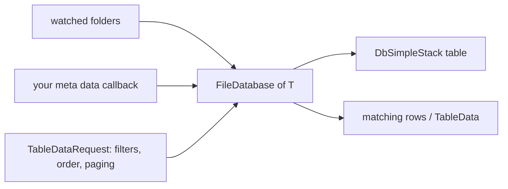

# SysWeaver.FileDatabase

[⬆ SysWeaver overview](../README.md)

> Indexes files and their meta data into a database table and keeps it in sync with the file system.

| | |
|---|---|
| **Layer** | Storage / Data |
| **Kind** | Library |

## Purpose

Make large file collections queryable: a service supplies a callback that fills in meta data columns for each file, and the file database keeps the table in sync with the file system and answers table data requests.

## How it fits into SysWeaver

## Key features

- `FileDatabase<T>`, where the row type `T` derives from `DbFileData` (full path as primary key, lower case extension, last write time, size, time of the last db change) and adds its own meta data columns
- `Init(folders)` creates the table, adds new files, updates changed ones and deletes rows of removed files; overlapping or missing folders are ignored with a warning
- File system watchers (including sub folders) queue changes that are applied in the background every 100 ms; files modified during the last 15 seconds wait until they are older, or until `MarkAsCompleted(file)` is called
- Optional meta data files: a callback maps a changed file (ex: a sidecar) to the file whose row should be updated
- Queries with `TableDataRequest` (`GetAsTable`, `GetFiltered`, `GetFilteredWithParams`)
- Statistics (insert / update / delete counts and failures) and performance monitoring integrated with the service manager

## Key components

- [`FileDatabase<T>`](FileDatabase.cs) — the synchronised file table
- [`DbFileData`](DbFileData.cs) — base class of a file row

## Limitations and considerations

- Requires a database back-end through [SysWeaver.DbSimpleStack](../SysWeaver.DbSimpleStack/README.md).
- Meta data quality depends entirely on the supplied callback.
- Paths longer than 768 characters and extensions longer than 16 characters are skipped (counted as length failures).
- `Init` can only be called once: a second call (also after a failed one) throws an `InvalidOperationException`.
- `FindInFileDatabase` and the `FindFilter*` types are request / response data types only; nothing in this library (or elsewhere in SysWeaver) uses them.

## Relationships

- **Project:** [`SysWeaver.FileDatabase.csproj`](SysWeaver.FileDatabase.csproj)
- **Builds on:** [SysWeaver.DbSimpleStack](../SysWeaver.DbSimpleStack/README.md)
