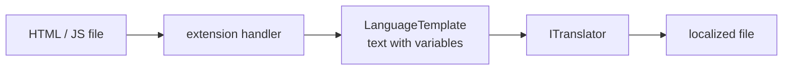

# SysWeaver.FileTranslation

[⬆ SysWeaver overview](../README.md)

> Translation of web files: extracts translatable text from HTML and JavaScript, translates it and rebuilds the file.

| | |
|---|---|
| **Layer** | Translation |
| **Kind** | Library |

## Purpose

Serve localized pages without maintaining a copy per language. The handlers turn a file into a language template: the translatable texts are replaced by variables that are translated per language.

## How it fits into SysWeaver

`TranslatorExtensionHandlers.Register()` registers the handlers for `.html`, `.htm` and `.js` with `LanguageTemplate` (in [SysWeaver.Common](../SysWeaver.Common/README.md)); the HTTP server then uses them to translate served files into the session language. Registration is done by [SysWeaver.HttpTransformer.Translate](../SysWeaver.HttpTransformer.Translate/README.md) and [SysWeaver.MicroService.Translation](../SysWeaver.MicroService.Translation/README.md)'s remote translator.

## Key features

- HTML: text nodes and the `title`, `placeholder` and `alt` attributes are extracted, markup is preserved; inline scripts are handled as JavaScript
- JavaScript: string literals are extracted and unescaped / re-escaped
- Identical texts (with the same context) share one variable; `${...}` variables inside texts are kept

## Key components

- [`TranslatorExtensionHandlers`](TranslatorExtensionHandlers.cs) — registers / unregisters the file handlers
- [`HtmlTranslation`](ExtensionHandlers/HtmlTranslation.cs) — HTML template builder (HtmlAgilityPack)
- [`JsTranslation`](ExtensionHandlers/JsTranslation.cs) — JavaScript template builder

## Limitations and considerations

- Handles HTML and JavaScript only; CSS (also inside HTML) is not handled

## Folder layout

| Folder | Content |
|---|---|
| [`ExtensionHandlers/`](ExtensionHandlers/README.md) | HTML and JavaScript template builders and shared helpers |

## Relationships

- **Project:** [`SysWeaver.FileTranslation.csproj`](SysWeaver.FileTranslation.csproj)
- **Builds on:** [SysWeaver.Common](../SysWeaver.Common/README.md)
- **Used by:** [SysWeaver.HttpTransformer.Translate](../SysWeaver.HttpTransformer.Translate/README.md), [SysWeaver.MicroService.Translation](../SysWeaver.MicroService.Translation/README.md)
- **Third-party:** HtmlAgilityPack
