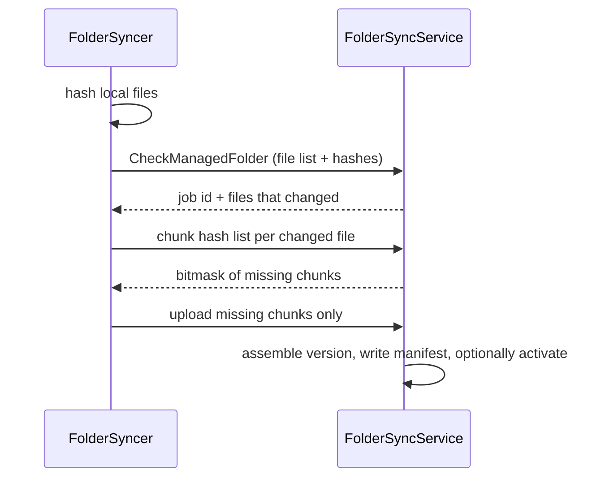

# SysWeaver.FolderSync

[⬆ SysWeaver overview](../README.md)

> Client side of SysWeaver folder synchronisation: push a local folder to a server, or pull a shared folder from it, transferring only changed content chunks.

| | |
|---|---|
| **Layer** | Files / Sync |
| **Kind** | Library (client) |

## Purpose

Deploy and distribute folders (applications, content, configuration) efficiently. Files are compared by hash so only changed files are considered, and with content-defined chunking (CDC) only the chunks the other side does not already have are transferred. The `SwSyncTool` command line tool (prebuilt in `_tools/SwSyncTool`) wraps this client.

## How it fits into SysWeaver

Without CDC (or if the server uses different CDC settings), changed files are uploaded whole, Brotli-compressed unless the file type is already compressed.

## Key features

- **Push** (`PushFolders`): update a server-side managed folder from one or more local folders (`;`-separated), optionally switching the server to the new version immediately
- **Pull** (`PullFolder`): update a local folder from a server-side shared folder, with optional backup of the previous local version and switch-over
- **Change detection**: `GetPullFolderVersion`, `CheckPullFolder` and `WaitPullFolder` (long poll) tell whether a pull is needed
- Concurrent hashing and transfers (`MaxConcurrency`), SysWeaver login authentication via [SysWeaver.Remote.Connection](../SysWeaver.Remote.Connection/README.md), progress callbacks

## Key components

- [`FolderSyncer`](FolderSyncer.cs) — the client: push, pull and change checks
- [`FolderSyncerParams`](FolderSyncerParams.cs) — server address, credentials, concurrency and comment
- [`IFolderSyncApi`](IFolderSyncApi.cs) — the remote JSON API implemented by the server

## Limitations and considerations

- Accepting invalid server certificates (`IgnoreCertErrors`) is possible but explicitly discouraged.
- Needs a server running [SysWeaver.MicroService.FolderSync](../SysWeaver.MicroService.FolderSync/README.md).

## Relationships

- **Project:** [`SysWeaver.FolderSync.csproj`](SysWeaver.FolderSync.csproj)
- **Builds on:** [SysWeaver.Common](../SysWeaver.Common/README.md), [SysWeaver.Compression](../SysWeaver.Compression/README.md), [SysWeaver.Remote.Connection](../SysWeaver.Remote.Connection/README.md), [SysWeaver.Storage.Cdc](../SysWeaver.Storage.Cdc/README.md), [SysWeaver.Storage](../SysWeaver.Storage/README.md)
- **Used by:** [SysWeaver.MicroService.FolderSync](../SysWeaver.MicroService.FolderSync/README.md), [SwSyncTool](https://github.com/dosh1974/SysWeaver.Tools/blob/main/SwSyncTool/README.md) and [FolderSync](https://github.com/dosh1974/SysWeaver.Tools/blob/main/FolderSync/README.md) (SysWeaver.Tools)
