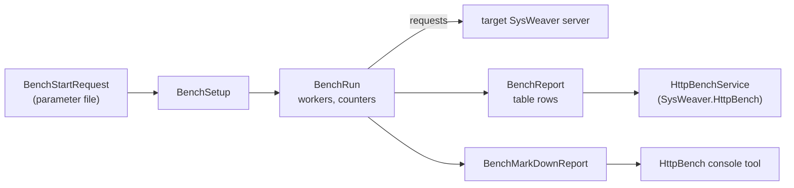

# SysWeaver.HttpBench.Core

[⬆ SysWeaver overview](../README.md)

> The test engine of the HTTP bench: the catalog of end points, the workers that call them, the metrics, the table rows of a report and the markdown report, with no web server, service manager or web api dependencies.

| | |
|---|---|
| **Layer** | Web platform |
| **Kind** | Library |

## Purpose

Run a load test against a SysWeaver web server and describe the result, so that the same engine can be used by the bench service and its page ([SysWeaver.HttpBench](../SysWeaver.HttpBench/README.md)) and by the [HttpBench](https://github.com/dosh1974/SysWeaver.Tools/blob/main/HttpBench/README.md) console tool, which runs without a server.

## How it fits into SysWeaver



How a test runs (workers, timing, wire bytes, errors, the histogram) is described in [SysWeaver.HttpBench](../SysWeaver.HttpBench/README.md#how-a-test-runs).

## Key features

- A fixed catalog of 47 public end points in 7 modules (`BenchCatalog`), the *Error cases* module off by default.
- Settings, limits and validation (`BenchStartRequest`, `BenchLimits`, `BenchSetup.Create`: an `ArgumentException` with a readable message for invalid settings).
- Workers with their own connection and cookie jar, per end point and second counters with a latency histogram (`BenchCounters`, `LatencyHistogram`), request samples and wire byte counting below TLS (`WireCounters`).
- The table rows of a report (`BenchReport`, `BenchRows.cs`) for SysWeaver tables, and a markdown report (`BenchMarkDownReport`).
- Parameter files (`BenchSettingsFile`) shared by the page and the console tool.
- A probe (`BenchServerProbe`, a GET of `serverTime`) to wait for a server that is starting and to keep it active between a warm up and a test.

## Key components

| File | |
|---|---|
| [`BenchCatalog.cs`](BenchCatalog.cs) | Modules and end points |
| [`BenchSettings.cs`](BenchSettings.cs) | Settings (`BenchStartRequest`), limits, validation (`BenchSetup`), parameter files, status |
| [`BenchRun.cs`](BenchRun.cs) | One test: workers, http clients, recording |
| [`BenchStats.cs`](BenchStats.cs) | Counters, latency histogram, request samples, the wire byte counting stream |
| [`BenchRows.cs`](BenchRows.cs) | Table row types |
| [`BenchReport.cs`](BenchReport.cs) | The rows of a test (end points, modules, seconds, workers, status codes, errors, requests, histogram) |
| [`BenchMarkDownReport.cs`](BenchMarkDownReport.cs) | The markdown report |
| [`BenchServerProbe.cs`](BenchServerProbe.cs) | Checks if a SysWeaver server answers (`serverTime`) |

## Using it

```csharp
var settings = BenchSettingsFile.Load("ServerTest.json");   // or new BenchStartRequest { Target = "https://myserver/" }
var limits = new BenchLimits();                             // time out, drain time, max workers and duration
var setup = BenchSetup.Create(settings, limits);            // validates, ArgumentException with a readable message
using var run = new BenchRun(1, setup, limits);
run.Start();
await run.WaitAsync();                                      // run.GetStatus() for live totals, run.Stop() to stop
File.WriteAllText("Report.md", BenchMarkDownReport.Create(run));
```

### Parameter files

`BenchSettingsFile` reads and writes the settings of a test (`BenchStartRequest`) as json with a `"DataType": "HttpBench"` member; a file without it is refused (`InvalidDataException`). Members that are missing get their defaults, `EndPoints` missing or null = the modules that are on by default. The page exports and imports these files, the console tool reads (`-File`) and writes (`-Save`) them.

```json
{
  "DataType": "HttpBench",
  "Target": "http://localhost:7480/",
  "DurationSeconds": 60,
  "Concurrency": 16,
  "EndPoints": [ "Files.index.html", "Application.GetMenu" ],
  "SendAsGet": false,
  "RequestCompression": "",
  "ResponseCompression": "*",
  "IgnoreCertificateErrors": true
}
```

### The markdown report

`BenchMarkDownReport.Create(run)` writes the key results first (requests/s and peak, average, median, P90, P95, P99, min / max, time to first byte, requests, errors, bytes), then the parameters and the tables (exported with `MarkDownTableDataExporter`): end points, modules, status codes, errors, the timeline (at most 60 rows, seconds are merged on longer tests) and the response time distribution.

## Limitations and considerations

- The end point catalog is fixed and only has public end points (no signed in sessions).
- The workers run in the process of the caller: a test of its own server shares the cpu with it.
- Percentiles come from a histogram (20 buckets per decade), so they are accurate to about ±6 %.

## Relationships

- **Project:** [`SysWeaver.HttpBench.Core.csproj`](SysWeaver.HttpBench.Core.csproj)
- **Builds on:** [SysWeaver.Common](../SysWeaver.Common/README.md), [SysWeaver.Compression](../SysWeaver.Compression/README.md), [SysWeaver.TableData](../SysWeaver.TableData/README.md)
- **Used by:** [SysWeaver.HttpBench](../SysWeaver.HttpBench/README.md) (the service and page), [HttpBench](https://github.com/dosh1974/SysWeaver.Tools/blob/main/HttpBench/README.md) (the console tool)
