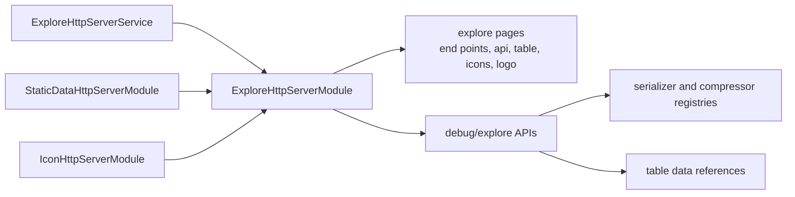

# SysWeaver.HttpServer.ExploreModule

[⬆ SysWeaver overview](../README.md)

> Developer-facing explorer pages for a running SysWeaver server: API browser, generic interactive table viewer, icon browser, serializer/compression inventories and data references.

| | |
|---|---|
| **Layer** | Web platform |
| **Kind** | Library (HTTP module with embedded web pages) |

## Purpose

Make a running system self-describing. Developers and operators can browse the server's end points and published APIs, open any table-data API in a generic grid, see which icons exist, and inspect which serializers and compressors are available — without extra tooling.

## How it fits into SysWeaver

## Key features

- Append `explore` to any folder URL (e.g. `/explore`, `/Api/explore`) to list the server's end points below it, with type, auth, caching, compression, size and location.
- API page and a generic interactive table page for any table-data API or session data reference (`GetTableDataRefUrl` builds the link).
- Icon gallery of the shared icon set and a logo seed designer.
- Debug tables of the registered serializers, compression formats and the live table data references.
- Menu entries under *Debug* in the web UI.

## Key components

- [`ExploreHttpServerModule`](ExploreHttpServerModule.cs) — the module, request handler and `debug/explore` APIs
- [`ExploreHttpServerModuleParams`](ExploreHttpServerModuleParams.cs) — auth (default `Debug,Dev,Ops`) and caching options

## Using it

Added by `ExploreHttpServerService` from [SysWeaver.MicroService.HttpServer](../SysWeaver.MicroService.HttpServer/README.md) (after the static data and icon services).

## Limitations and considerations

- The pages and most APIs are restricted to the Debug, Dev or Ops roles; the module is intended for development and operations, not end users.
- `DataRefTable` returns at most `TableDataTools.DefaultMaxAllowedRows` rows per request (a request with no row limit gets the cap).
- The build pre-compresses the embedded pages with a Windows tool from `_tools`.

## Relationships

- **Project:** [`SysWeaver.HttpServer.ExploreModule.csproj`](SysWeaver.HttpServer.ExploreModule.csproj)
- **Builds on:** [SysWeaver.Common](../SysWeaver.Common/README.md), [SysWeaver.HttpServer.IconModule](../SysWeaver.HttpServer.IconModule/README.md), [SysWeaver.HttpServer](../SysWeaver.HttpServer/README.md)
- **Used by:** [SysWeaver.MicroService.HttpServer](../SysWeaver.MicroService.HttpServer/README.md), [SwLanCertManager](https://github.com/dosh1974/SysWeaver.Services/blob/main/SwLanCertManager/README.md), [SwServerManager](https://github.com/dosh1974/SysWeaver.Services/blob/main/SwServerManager/README.md), [TranslationService](https://github.com/dosh1974/SysWeaver.Services/blob/main/TranslationService/README.md)
