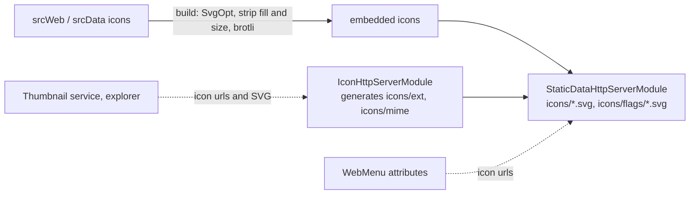

# SysWeaver.HttpServer.IconModule

[⬆ SysWeaver overview](../README.md)

> Serves SysWeaver's shared SVG icon library, plus icons for file extensions, MIME types and country flags.

| | |
|---|---|
| **Layer** | Web platform |
| **Kind** | Library (HTTP module with embedded assets) |

## Purpose

A single, consistent icon set for every page and menu in the framework. Menu attributes and UI components reference icons by URL (`icons/<name>.svg`); this project embeds them and resolves the dynamic ones.

## How it fits into SysWeaver

## Key features

- A general-purpose icon set (`icons/*.svg`), optimised at build time with fill and size removed so icons can be coloured and sized with CSS; separate colour and external icon sets keep their colours.
- Icons for any file extension (`icons/ext/<ext>.svg`) and MIME type (`icons/mime/<type>/<subtype>.svg`): specific icons where available, otherwise generated from a document template labelled with the extension and coloured by MIME type.
- Country flag icons (`icons/flags/<iso2>.svg`), used for example by [SysWeaver.HttpServer.IsoDataModule](../SysWeaver.HttpServer.IsoDataModule/README.md).
- `GetFromExt` / `GetFromMime` return the SVG for a file extension or MIME type, and the URL prefixes (`ExtPrefix`, `MimePrefix`, `FlagPrefix`) let other services link to them (used, for example, as thumbnail fall-backs).
- The served icons are registered in the static data module, so they share its caching and compression.

## Key components

- [`IconHttpServerModule`](IconHttpServerModule.cs) — registers the embedded icons and generates extension and MIME type icons on demand
- [`IconHttpServerModuleParams`](IconHttpServerModuleParams.cs) — URL root and sub folders

## Using it

Added by `IconHttpServerService` in [SysWeaver.MicroService.HttpServer](../SysWeaver.MicroService.HttpServer/README.md), after `StaticDataHttpServerService`.

## Limitations and considerations

- The icon optimisation and compression build steps use Windows tools from `_tools`.
- Icons without fill information depend on page CSS for their colour.

## Folder layout

| Folder | Content |
|---|---|
| [`srcData/`](srcData/README.md) | Icons loaded by the module: document template and overlays for generated icons, folder / API icons, country flags |
| [`srcWeb/`](srcWeb/README.md) | Source of the icon library served under `icons/` (UI icons, colour, external and file extension icons) |

## Relationships

- **Project:** [`SysWeaver.HttpServer.IconModule.csproj`](SysWeaver.HttpServer.IconModule.csproj)
- **Builds on:** [SysWeaver.HttpServer](../SysWeaver.HttpServer/README.md)
- **Used by:** [SysWeaver.HttpServer.ExploreModule](../SysWeaver.HttpServer.ExploreModule/README.md), [SysWeaver.MicroService.HttpServer](../SysWeaver.MicroService.HttpServer/README.md), [SysWeaver.MicroService.Thumbnail](../SysWeaver.MicroService.Thumbnail/README.md), [SwLanCertManager](https://github.com/dosh1974/SysWeaver.Services/blob/main/SwLanCertManager/README.md), [SwServerManager](https://github.com/dosh1974/SysWeaver.Services/blob/main/SwServerManager/README.md), [TranslationService](https://github.com/dosh1974/SysWeaver.Services/blob/main/TranslationService/README.md)
