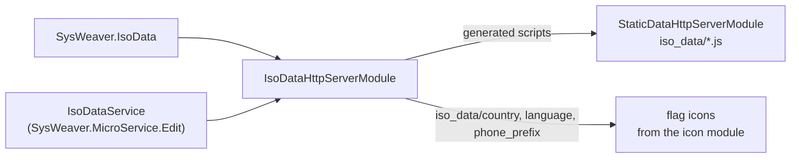

# SysWeaver.HttpServer.IsoDataModule

[⬆ SysWeaver overview](../README.md)

> HTTP module that publishes the ISO reference data (countries, currencies, languages, phone prefixes) as web tables and serves the related SVG assets.

| | |
|---|---|
| **Layer** | Web platform |
| **Kind** | Library (HTTP module) |

## Purpose

Expose [SysWeaver.IsoData](../SysWeaver.IsoData/README.md) to the web UI: the same reference data as JavaScript for browser code, flag images addressable by country, language or phone prefix, and debug tables for inspection.

## How it fits into SysWeaver



## Key features

- Generated client-side scripts `iso_data/languages.js`, `countries.js`, `currencies.js` and `phone_prefixes.js` with the reference data as JavaScript classes.
- Flag URLs by country (`iso_data/country/<name or code>.svg`), language (`iso_data/language/...`) and phone prefix (`iso_data/phone_prefix/...`), falling back to an "unknown" icon.
- Debug tables (Debug role) of currencies, countries, languages and phone number prefixes under `debug/data`, with menu entries.

## Key components

- [`IsoDataHttpServerModule`](IsoDataHttpServerModule.cs) — the module, the generated scripts and the debug tables

## Using it

Registered by `IsoDataService` from [SysWeaver.MicroService.Edit](../SysWeaver.MicroService.Edit/README.md):

```json
{ "Type": "SysWeaver.MicroService.IsoDataService, SysWeaver.MicroService.Edit" }
```

## Limitations and considerations

- The scripts are only published when a `StaticDataHttpServerModule` is registered, and the flag images come from [SysWeaver.HttpServer.IconModule](../SysWeaver.HttpServer.IconModule/README.md), which must be registered too.
- The build optimises and compresses the embedded SVG assets with Windows tools from `_tools`.

## Relationships

- **Project:** [`SysWeaver.HttpServer.IsoDataModule.csproj`](SysWeaver.HttpServer.IsoDataModule.csproj)
- **Builds on:** [SysWeaver.HttpServer](../SysWeaver.HttpServer/README.md), [SysWeaver.IsoData](../SysWeaver.IsoData/README.md)
- **Used by:** [SysWeaver.MicroService.Edit](../SysWeaver.MicroService.Edit/README.md)
