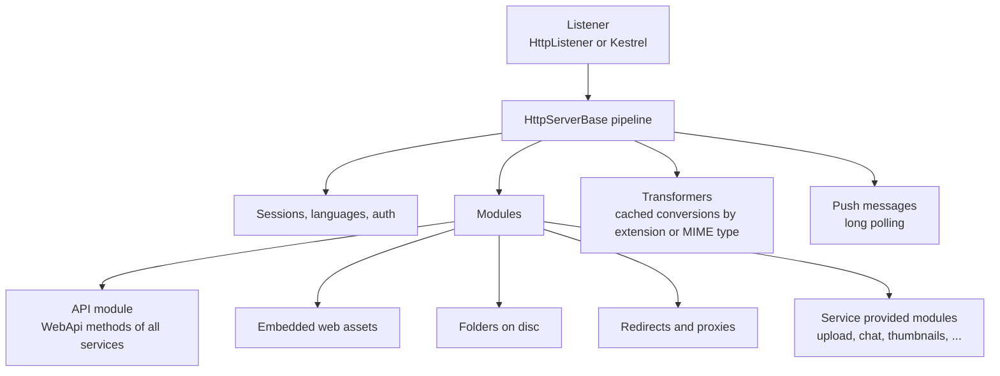
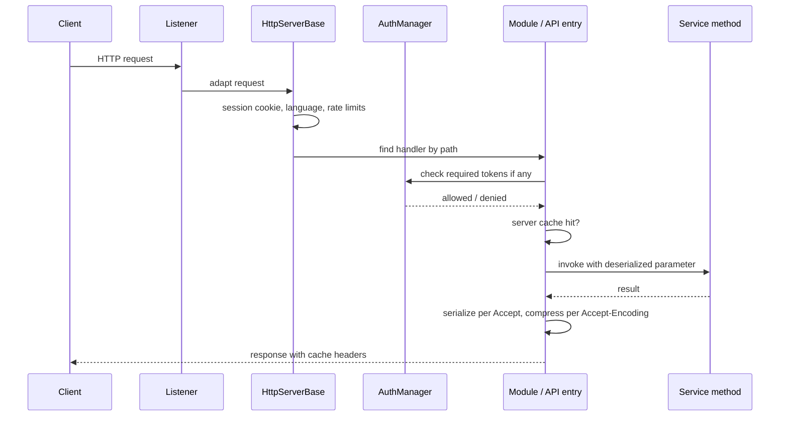

# SysWeaver.HttpServer

[⬆ SysWeaver overview](../README.md)

> The server-agnostic heart of SysWeaver's web layer: request pipeline, module routing, the Web API engine, static/embedded/disc file serving, sessions and authentication hooks, caching, compression, templates, push messages, translation and the built-in web application shell.

| | |
|---|---|
| **Layer** | Web platform |
| **Kind** | Library |

## Purpose

Implement *everything* a SysWeaver web server does once, independent of the socket technology. Concrete listeners ([SysWeaver.NetHttpServer](../SysWeaver.NetHttpServer/README.md) on HttpListener, [SysWeaver.AspHttpServer](../SysWeaver.AspHttpServer/README.md) on Kestrel) only adapt requests into this pipeline; [SysWeaver.MicroService.HttpServer](../SysWeaver.MicroService.HttpServer/README.md) wires it into the service manager.

## How it fits into SysWeaver



A request, end to end:



## Key features

- **Modules:** units that claim URL paths and produce request handlers (`IHttpServerModule`, or `IHttpServerRawModule`, which bypasses the whole pipeline including auth). Any registered service implementing a module interface is attached automatically by the server service.
- **Web API engine:** discovers `[WebApi]` methods on service instances and compiles fast invokers. URLs are `<root>/<class url>/<method>` (root defaults to `Api`, class url from `[WebApiUrl]`, else the type name), matched exactly and case sensitively. A method takes at most one input parameter (optionally followed by an `HttpServerRequest`); GET input is the whole query string (a single JSON value, XML, form data or compressed binary), POST input is the body, deserialized per `Content-Type`. Results are serialized per `Accept`, falling back to the default serializer. Caching, compression, rate limits and auditing are declared with attributes.
- **Sessions and auth:** cookie sessions (`HttpSession`) and device ids; authentication delegated to an `AuthManager` when registered; login redirect for protected pages; API keys via the `Authorization` header (Basic / Bearer) or the `x-api-key` / `x-goog-api-key` headers. Auth per end point is `null` (open), `""` (any logged in user), `"-"` (explicitly open) or a comma separated list of tokens (any one suffices); for APIs method `[WebApiAuth]` > type `[WebApiAuth]` > module default, with `IRunTimeWebApiAuth` overrides on top.
- **Session security:** the session cookie is `HttpOnly` (`Secure` / `SameSite` only with `CorsCookies`); the session token is rotated on login; short-lived anonymous sessions expire quickly; `auth/redirect` only redirects to relative or same-origin URLs.
- **Content serving:** embedded resources, disc folders (`FileHttpServerModule`), in-memory content, redirects and forwarding to other servers (`FileProxy`), with pre-compressed variants, ETags / 304, client cache headers and server-side response caches (global or per session).
- **Templates:** text files matching template patterns (by default `index.html`, `debug.html`, `app/manifest.json`, `app/Home.html`, `common/theme.css`) get `${Variable}` substitution. Only server defined variables are replaced (static ones such as colors and configured `Key=Value` pairs, per-request ones such as `Session.Lang` or `Session.UserName`, and groups like `Env.*`, `EnvInfo.*` or service-provided groups); other `${...}` text, e.g. JavaScript template literals, is kept. Encoding modifiers (`#` html text, `@` attributes, `$` JavaScript / JSON strings, `£` JavaScript values) must be used to match the context.
- **Transformers:** services implementing `IHttpTransformerService` register conversions by file extension or MIME type; `CachedTransformer` is the base for transformers whose results (smaller or better supported variants) are cached on disc. They run for non-dynamic responses with an ETag; a query string starting with `raw` bypasses them.
- **Push messages:** a long-poll channel through which the server pushes messages to a session, a user, all logged in users or all sessions.
- **Translation:** with a translator registered, responses and web assets are translated to the session language.
- **Built-in end points:** `logout`, `auth/redirect`, `auth/logout_user` and `serverTime`, plus fall-backs used when no module serves them (`login`, `basic_auth`, generated favicons and logos from the app name and colors, empty `app/app.css` / `app/app.js`).
- **Web application shell:** an embedded single-page application (home and welcome pages, tabs, tags, themes, common scripts) that other projects extend with their own pages and menus.
- **HTTPS and firewall:** certificate binding from certificate provider services (`CertificateBinder`) and optional firewall rules per listen prefix (`FirewallHandler.Instance` picks `WindowsFirewallHandler`, `LinuxFirewallHandler` or `NoFirewallHandler`).
- **Diagnostics:** tables of APIs, sessions, users, caches, MIME types, template variables and transformer caches.
- **In-process API invocation** (`IApiHttpServerEndPoint.InvokeAsync`) for AI tools and other services. It performs no auth, rate limit or cache checks, so callers must check `Auth` themselves.

## Key components

- [`HttpServerBase`](HttpServerBase.cs) — the abstract pipeline (partial, split over `HttpServerBase*.cs`), configured by [`HttpServerBaseParams`](HttpServerBaseParams.cs)
- [`ApiHttpServerModule`](ApiHttpServerModule.cs) — the Web API engine, with [`ApiHttpEntry`](ApiHttpEntry.cs) as a compiled API method
- [`HttpSession`](HttpSession.cs) — per client session state, user and push message queue
- [`FileHttpServerModule`](FileHttpServerModule.cs) — serves folders on disc
- [`CachedTransformer`](CachedTransformer/CachedTransformer.cs) — base class of the disc-cached file transformers

## Using it

Normally used indirectly through a server micro service. Modules with parameter-only constructors can be declared directly in the manifest and are picked up by the server:

```json
[
  { "Type": "SysWeaver.MicroService.NetHttpServerService, SysWeaver.MicroService.NetHttpServer",
    "Params": { "ListenOn": [ { "Prefix": "http://localhost:8080" } ] } },
  { "Type": "SysWeaver.Net.FileHttpServerModule, SysWeaver.HttpServer",
    "Params": { "Folders": [ { "DiscFolder": "D:/Site", "WebFolder": "site" } ] } },
  { "Type": "SysWeaver.MicroService.ApiHttpServerService, SysWeaver.MicroService.HttpServer" }
]
```

Calling an API: `GET /Api/<class url>/<method>?"value"` or POST the value as the body.

## Limitations and considerations

- Certificate binding for the HttpListener based server uses Windows tooling (`netsh`, elevated rights); on other platforms use the Kestrel server for HTTPS.
- The listeners' default listen prefix is external HTTPS on port 443 (`HttpServerPrefix.DefaultExternalHttps`), which requires a certificate provider (and, on Windows with HttpListener, elevated rights). Always configure prefixes explicitly, e.g. `http://localhost:8080`.
- HTTP range requests are not handled for cached content (TODO in source), which matters for media streaming; suffix and multi-range requests are rejected.
- The client IP is always the direct peer address. `Forwarded` / `X-Forwarded-For` headers are neither read nor added by the built-in proxy components (TODO in source). `FileProxy` strips the Cookie and Authorization headers unless `FileProxyParams.ForwardCookies` / `ForwardAuthorization` are set; the reverse proxy forwards them.
- The API engine limits POST bodies and their decompressed size (64 MB each by default, `ApiHttpServerModuleParams.MaxRequestSize` / `MaxDecompressedSize`, 413 when exceeded). Other modules apply no request body size limit.
- Request path handling and template output have known open hardening issues; expose only folders meant to be public and don't rely on the server as the only protection for sensitive files.
- Firewall handling: Windows uses `netsh advfirewall` (needs elevation); Linux detects firewalld, ufw or plain nftables (needs root, never uses `sudo`, does nothing when no firewall is active, iptables-only systems aren't supported, nftables rules are runtime only); macOS has no firewall support. Rules the handler didn't add are never changed or removed.
- The build pre-compresses the embedded web assets with a Windows tool from `_tools`, so the project builds as-is only on Windows.

## Relationships

- **Project:** [`SysWeaver.HttpServer.csproj`](SysWeaver.HttpServer.csproj)
- **Builds on:** [SysWeaver.Auth.Core](../SysWeaver.Auth.Core/README.md), [SysWeaver.Common](../SysWeaver.Common/README.md), [SysWeaver.Compression](../SysWeaver.Compression/README.md), [SysWeaver.IsoData](../SysWeaver.IsoData/README.md), [SysWeaver.Media.Svg](../SysWeaver.Media.Svg/README.md), [SysWeaver.MicroServices](../SysWeaver.MicroServices/README.md), [SysWeaver.Serialization](../SysWeaver.Serialization/README.md), [SysWeaver.TableData](../SysWeaver.TableData/README.md)
- **Used by:** [SysWeaver.AI](../SysWeaver.AI/README.md), [SysWeaver.AI.OpenAI](../SysWeaver.AI.OpenAI/README.md), [SysWeaver.AspHttpServer](../SysWeaver.AspHttpServer/README.md), [SysWeaver.Chat](../SysWeaver.Chat/README.md), [SysWeaver.HttpServer.ExploreModule](../SysWeaver.HttpServer.ExploreModule/README.md), [SysWeaver.HttpServer.IconModule](../SysWeaver.HttpServer.IconModule/README.md), [SysWeaver.HttpServer.IsoDataModule](../SysWeaver.HttpServer.IsoDataModule/README.md), [SysWeaver.HttpTransformer.Compress](../SysWeaver.HttpTransformer.Compress/README.md), [SysWeaver.HttpTransformer.Image](../SysWeaver.HttpTransformer.Image/README.md), [SysWeaver.HttpTransformer.Svg](../SysWeaver.HttpTransformer.Svg/README.md), [SysWeaver.HttpTransformer.Translate](../SysWeaver.HttpTransformer.Translate/README.md), [SysWeaver.MicroService.AspHttpServer](../SysWeaver.MicroService.AspHttpServer/README.md), [SysWeaver.MicroService.Auth](../SysWeaver.MicroService.Auth/README.md), [SysWeaver.MicroService.Avatar](../SysWeaver.MicroService.Avatar/README.md), [SysWeaver.MicroService.CustomUserImage](../SysWeaver.MicroService.CustomUserImage/README.md), [SysWeaver.MicroService.Edit](../SysWeaver.MicroService.Edit/README.md), [SysWeaver.MicroService.FileUploader](../SysWeaver.MicroService.FileUploader/README.md), [SysWeaver.MicroService.HttpServer](../SysWeaver.MicroService.HttpServer/README.md), [SysWeaver.MicroService.Map](../SysWeaver.MicroService.Map/README.md), [SysWeaver.MicroService.MediaThumbnail](../SysWeaver.MicroService.MediaThumbnail/README.md), [SysWeaver.MicroService.NetHttpServer](../SysWeaver.MicroService.NetHttpServer/README.md), [SysWeaver.MicroService.Thumbnail](../SysWeaver.MicroService.Thumbnail/README.md), [SysWeaver.MicroService.Thumbnail.Web](../SysWeaver.MicroService.Thumbnail.Web/README.md), [SysWeaver.MicroService.UserManager](../SysWeaver.MicroService.UserManager/README.md), [SysWeaver.MicroService.UserStorage](../SysWeaver.MicroService.UserStorage/README.md), [SysWeaver.MicroServices.ServiceManager](../SysWeaver.MicroServices.ServiceManager/README.md), [SysWeaver.NetHttpServer](../SysWeaver.NetHttpServer/README.md), [SysWeaver.ReverseProxy](../SysWeaver.ReverseProxy/README.md), [SysWeaver.Security](../SysWeaver.Security/README.md), [SysWeaver.TextMessage.Twilio](../Communication/SysWeaver.TextMessage.Twilio/README.md), [SysWeaver.TextMessage.WhatsApp](../Communication/SysWeaver.TextMessage.WhatsApp/README.md)
