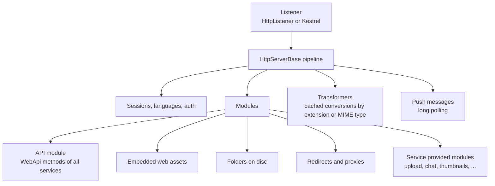
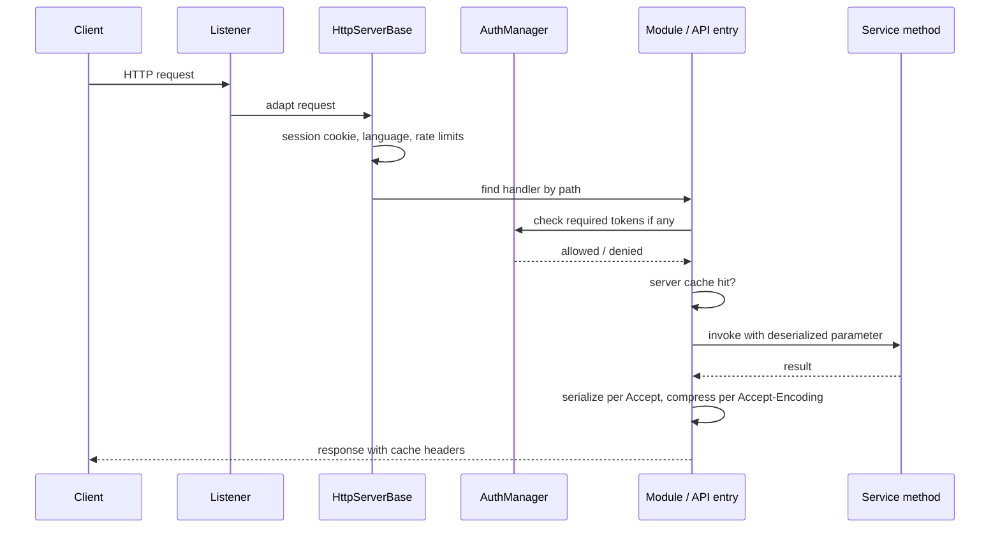

# SysWeaver.HttpServer

[⬆ SysWeaver overview](../README.md)

> The server-agnostic heart of SysWeaver's web layer: request pipeline, module routing, the Web API engine, static/embedded/disc file serving, sessions and authentication hooks, caching, compression, templates, push messages, translation and the built-in web application shell.

| | |
|---|---|
| **Layer** | Web platform |
| **Kind** | Library |

## Purpose

Implement *everything* a SysWeaver web server does once, independent of the socket technology. Concrete listeners ([SysWeaver.NetHttpServer](../SysWeaver.NetHttpServer/README.md) on HttpListener, [SysWeaver.AspHttpServer](../SysWeaver.AspHttpServer/README.md) on Kestrel) only adapt requests into this pipeline; [SysWeaver.MicroService.HttpServer](../SysWeaver.MicroService.HttpServer/README.md) wires it into the service manager.

## How it fits into SysWeaver



A request, end to end:



## Key features

- **Modules:** units that claim URL paths and produce request handlers (`IHttpServerModule`, or `IHttpServerRawModule`, which bypasses the whole pipeline including auth). Any registered service implementing a module interface is attached automatically by the server service.
- **Web API engine:** discovers `[WebApi]` methods on service instances and compiles fast invokers. URLs are `<root>/<class url>/<method>` (root defaults to `Api`, class url from `[WebApiUrl]`, else the type name), matched exactly and case sensitively. A method takes at most one input parameter (optionally followed by an `HttpServerRequest`, or a `SysWeaver.Auth.IAuthorizedRequest` for services that can't reference the http server); GET input is the whole query string (a single JSON value, XML, form data or compressed binary), POST input is the body, deserialized per `Content-Type`. Results are serialized per `Accept`, falling back to the default serializer. Caching, compression, rate limits and auditing are declared with attributes.
- **Sessions and auth:** cookie sessions (`HttpSession`) and device ids; authentication delegated to an `AuthManager` when registered; login redirect for protected pages; API keys via the `Authorization` header (Basic / Bearer) or the `x-api-key` / `x-goog-api-key` headers. Auth per end point is `null` (open), `""` (any logged in user), `"-"` (explicitly open) or a comma separated list of tokens (any one suffices); for APIs method `[WebApiAuth]` > type `[WebApiAuth]` > module default, with `IRunTimeWebApiAuth` overrides on top.
- **Session security:** the session and device id cookies are `HttpOnly` with `SameSite=Lax` (`CookieSameSite`: `Lax`, `Strict` or empty) and `Secure` on https requests (`CorsCookies` uses `SameSite=None;Secure` instead); the session cookie lives 7 days by default (`SessionCookieLifetime`, it used to be one year; the server side session expires after `SessionExtendLifetime` minutes without use anyway); the session token is rotated on login; short-lived anonymous sessions expire quickly; `auth/redirect` only redirects to relative or same-origin URLs.
- **Not signed in / not allowed:** a protected API called without any auth answers **401** (with `X-Login-Url: <sign in page>` and `WWW-Authenticate: SysWeaver ...`, not `Basic`, so browsers don't show a password dialog); a browser navigation to an API url (`Sec-Fetch-Mode: navigate`) and other protected resources (pages, files) still get the **302** to `AuthRedirect`. A signed in user without the required tokens gets **403** "You are not allowed to do this: your account doesn't have the role it needs". `UserNotAllowedException` / `NoUserLoggedInException` thrown by a handler become 403 / 401 (not 500). `Api/auth/CanCall(string[] urls)` -> `{Url, Found, Allowed, Auth}[]` (open, max 128 urls) tells a user interface which APIs the current session may call (used by `Sw.Access`, core/access.js); `Api/debug/GetApiInfo` (the full signature) is restricted to Dev and Debug.
- **Refusal reasons (`X-Sw-Reason: 1`):** a response whose text was written for people (translated to the session language) carries the header `X-Sw-Reason: 1`, for any status: every `HttpResponseException` thrown with a message (`IsReason`, default true when a message is given; false for relayed texts), the 403 role refusal and the 401 "Sign in to do this" of an API. Clients show the text as the reason ("why") instead of a generic sentence for the status (core/net.js). Write the message as a sentence for the person that asked, without "Forbidden - " prefixes or " [403]" suffixes, ex: `throw new HttpResponseException(409, "The invitation could not be withdrawn: it was already used, has expired or was withdrawn")`.
- **Denied by role (`X-Sw-Denied`):** the reason text and the kind of refusal are separate signals. A 403 because the user (or visitor) lacks the role an end point needs adds `X-Sw-Denied: role` (`DeniedHeader`, `DeniedRole`), the server's own 401 "Sign in to do this" adds `X-Sw-Denied: signin`; every other refusal (a 403 / 409 / 400 with a reason from an end point) has none. A client disables the control that asked only on `role` (the user can never do it), whatever the reason text.
- **Outcome kind (`X-Sw-Outcome`):** every 4xx refusal (an `HttpResponseException`, an `IHttpRefusal`, the server's own 401 / role 403) also says what it means for the person that asked, so a client never guesses it from the status (`OutcomeHeader`, values `HttpOutcomes`): `AlreadyDone` (the goal is already met: "not needed"; only when the code that refused says so: `throw HttpResponseException.AlreadyDone("Process #12 has already ended")`), `Refused` (not done, the reason says why: the default of every 4xx except 401 / 404 / 410 / a missing role, also `HttpResponseException.Refused(...)`), `Gone` (the target no longer exists: the default of 404 / 410, also `HttpResponseException.Gone(...)` for a 409), `Denied` (401, or with `X-Sw-Denied`). No header on 2xx / 5xx. An `IHttpRefusal` type may give its kind (`Outcome`). Examples: Kill of an ended process and End session of an ended session = AlreadyDone, End session of your own session = Refused. Input that can't be read is a refusal too, never a 500 server problem: an unknown body type 415, a body / query that doesn't parse 400, both with the reason.
- **Refusals declared by the exception type:** an exception that implements `IHttpRefusal` (SysWeaver.Common, `ResponseCode` 4xx) answers that status with its message as the reason, like an `HttpResponseException` (ex: the UserManager account exceptions: a dead link 410, an address in use 409), never a 500 and never a problem.
- **A client that leaves is no problem:** when the client closes the connection while the request is handled or the response is written (an aborted fetch, a closed tab, a lost network: `HttpListenerException` 22 / 64 / 995 / 1229 / 1236, a socket reset, Kestrel's connection reset), the server counts it in the `ClientGone` statistic and nothing else: it is not logged (clients end long polls like `GetMessages` all the time) and not counted by an exception tracker, so it never shows as a "Failing" problem with a stack trace (`HttpServerBase.IsClientGone`).
- **End a session:** `Api/debug/EndSession` (Admin, Ops) signs the user of another session out (the browser gets a new anonymous session on its next request); the token comes from the "End session" row action of the active sessions table (an HMAC of the session token, random key per process: it can't be guessed, and a crafted link or an image GET can't use it); your own session can't be ended there (sign out instead).
- **Background jobs** (`HttpServerBase.Jobs`, [`BackgroundJobs`](BackgroundJobs.cs)): long work whose result must survive a page reload (an export, a report). A service starts one from its own API with `request.Server.StartJob(request, "Exporting x.csv", async ctx => { ctx.Report(0.5, "Reading the rows"); ...; return memoryFile; }, key, "export")` and returns the `BackgroundJobInfo` (`{Id, Key, Kind, Title, State: "running"|"done"|"failed"|"cancelled", Progress 0..1|null, Text, Error, Started, Ended, Expires, ResultName, ResultMime, ResultSize, ResultUrl, IsNew, Removed}`); the work must not use the original request (use `ctx.Request`, a detached copy) and should honour `ctx.Cancel`. A job belongs to the signed in user (every session of the user sees it) or, for a visitor, to the session; one running job per `key` and owner (the running one is returned, `IsNew` false); at most 4 running and 20 kept per owner (429 with a reason beyond that); a job and its result are kept 30 minutes after it ended (`KeepFor`), in memory only. The client APIs (open, only the caller's jobs, another owner's id is a 404): `Api/jobs/GetJobs` (after a reload), `GetJob?"id"` (poll), `WaitJob {Id, Ms}` (long poll, max 25 s), `GetJobResult?"id"` (the `MemoryFile`, again until it expires; 409 with the reason while running / failed / cancelled), `CancelJob?"id"`, `RemoveJob?"id"`; the push message `sw.job` (`{Job}`, on start, progress (a new `Text` at once, `Progress` at most once per `ProgressPushInterval`, 1 s), stop asked, end and remove) goes to every session of the owner, so other tabs and devices of the user follow a job without a reload (`Sw.Session.Subscribe("sw.job", m => ...)`). A `CancelJob` that comes after the job is done (too late) sets `CancelRequested: true` on the done job (pushed), so every device shows "finished before it could stop". Example user: `Api/StartExportTableApi` / `Api/StartExportTableData` (SysWeaver.MicroService.HttpServer), used by the data table export (explore/table.js). **Honest cancel:** `CancelJob` (and `RemoveJob` of a running job) asks the work to stop (`ctx.Cancel`); the job stays `"running"` with `Stopping: true` and keeps its running slot until the work returned, then it is `"cancelled"` (or `"done"` with `CancelRequested: true` when the work finished before it could stop; a removed job is removed then). **Announced:** `Api/jobs/AckJob?"id"` (and fetching the result) sets `Announced: true`: a client announces an ended job only when Announced is false, so restored jobs (reload, another session or device) stay quiet. **Detached request:** the work gets `ctx.Request`, a copy of the starting request (session, user, url, address) valid until the job ended: use it instead of the original request. **Any result:** `request.Server.StartWork(request, title, async ctx => BackgroundJobResult.FromText("1 204 users imported") / FromFile(file) / null, key, kind)`; the job then has `ResultText` (and no `ResultUrl` without a file).
- **Row action outcomes:** an API behind a table row action (`TableDataActions` / `TableDataActionsEx`) returns true when done and throws `HttpResponseException(409, reason)` when it can't be done (gone, already used, already ended), never a bare false: the reason is translated, shown in the row and not counted as a server problem (500s are). `Api/debug/EndSession` does so ("The session has already ended ..."), and the active sessions table has a hidden `IsCurrent` column (true on the caller's own session, for a "you" mark).
- **`OptimizedSend`** (`HttpServerBaseParams`, default false): debug builds of the web client POST every api argument; true makes them use the release GET encodings too (`?json`, `_u`, `_d` when small enough), to test them while debugging (published in the templated `app/manifest.json` as `sysweaver_optimized_send`).
- **Framing (clickjacking):** every response has `Content-Security-Policy: frame-ancestors 'self'` and `X-Frame-Options: SAMEORIGIN` by default. `HttpServerBaseParams.FrameAncestors` (in the `*.Services.json` params of the http server service) sets the sources that may frame the site: `'none'` (also `X-Frame-Options: DENY`), a space separated list such as `'self' https://portal.mydomain.com` (no `X-Frame-Options`), or empty / `*` for no header (the old behaviour). A host that embeds SysWeaver pages from another site needs that site here (and `CorsCookies` for the session cookie).
- **Content serving:** embedded resources, disc folders (`FileHttpServerModule`), in-memory content, redirects and forwarding to other servers (`FileProxy`), with pre-compressed variants, ETags / 304, client cache headers and server-side response caches (global or per session).
- **Templates:** text files matching template patterns (by default `index.html`, `debug.html`, `app/manifest.json`, `app/Home.html`, `common/theme.css`) get `${Variable}` substitution. Only server defined variables are replaced (static ones such as colors and configured `Key=Value` pairs, per-request ones such as `Session.Lang` or `Session.UserName`, and groups like `Env.*`, `EnvInfo.*` or service-provided groups); other `${...}` text, e.g. JavaScript template literals, is kept. Encoding modifiers (`#` html text, `@` attributes, `$` JavaScript / JSON strings, `£` JavaScript values) must be used to match the context.
- **Transformers:** services implementing `IHttpTransformerService` register conversions by file extension or MIME type; `CachedTransformer` is the base for transformers whose results (smaller or better supported variants) are cached on disc. They run for non-dynamic responses with an ETag; a query string starting with `raw` bypasses them.
- **Push messages:** a long-poll channel through which the server pushes messages to a session, a user, all logged in users or all sessions.
- **Translation:** with a translator registered, responses and web assets are translated to the session language. `Api/application/GetSupportedLanguages`, `GetLocalizedLanguages`, `GetLanguage` and `SetLanguage` read and change the session language; `GetSelectableLanguages` returns the localized languages only when a translator is registered (null otherwise: the app shell then offers no language choice).
- **Built-in end points:** `logout`, `auth/redirect`, `auth/logout_user` and `serverTime`, plus fall-backs used when no module serves them (`login`, `basic_auth`, the generated app icon, logo and banner and the bitmaps rendered from them, see [App icon, logo and banner](#app-icon-logo-and-banner), empty `app/app.css` / `app/app.js`).
- **Web application shell:** an embedded single-page application (home and welcome pages, tabs, tags, themes, common scripts) that other projects extend with their own pages and menus.
- **HTTPS and firewall:** certificate binding from certificate provider services (`CertificateBinder`) and optional firewall rules per listen prefix (`FirewallHandler.Instance` picks `WindowsFirewallHandler`, `LinuxFirewallHandler` or `NoFirewallHandler`).
- **Diagnostics:** tables of APIs, sessions, users, caches, MIME types, template variables and transformer caches.
- **In-process API invocation** (`IApiHttpServerEndPoint.InvokeAsync`) for AI tools and other services. It performs no auth, rate limit or cache checks, so callers must check `Auth` themselves.

## App icon, logo and banner

The server always has three source images, served in the site root:

| File | Aspect | Example size | Generated when missing (`SvgScene`) |
|---|---|---|---|
| `icon.svg` | 1:1 | 256 x 256 | `AddAppIcon(AppDisplayName, colors)` |
| `logo.svg` | 4:3 | 512 x 384 | `AddAppLogo(AppDisplayName, AppDescription, colors)` |
| `banner.svg` | 9:2 | 1260 x 280 | `AddAppBanner(AppDisplayName, AppDescription, colors)` |

These are optional end points: they are generated only if no module serves the file, e.g. an embedded `web/icon.svg` in any project or a file in a folder served from disc (`FileHttpServerModule`). The generated images use the app's display name, description and colors (`HashColors.AppColors`, derived from the app name).

All other icons and logos are rendered from these three files, whether they are provided or generated. They are never needed as files:

| File | Size | Rendered from |
|---|---|---|
| `favicon.ico` | 192 x 192, 48 x 48, 32 x 32 and 16 x 16 (four png images in one file) | `icon.svg` |
| `apple-touch-icon.png` | 180 x 180 | `icon.svg` |
| `icon-180.png` | 180 x 180 | `icon.svg` |
| `icon-192.png` | 192 x 192 | `icon.svg` |
| `icon-512.png` | 512 x 512 | `icon.svg` |
| `logo.png` | 1024 x 768 | `logo.svg` |
| `banner.png` | 1260 x 280 | `banner.svg` |

A module can still serve any of these bitmaps itself, which overrides the rendered one. To brand an application, provide the three svg files and let the server render the rest. Keep the aspect ratios, because the bitmaps are rendered at the sizes above.

The rendered bitmaps are cached in memory. The server checks the source svg for changes at most every 15 seconds and renders the bitmaps again when it has changed. With the `debug` token, `icon_debug.svg`, `logo_debug.svg` and `banner_debug.svg` generate the images with another color seed given in the query string (e.g. `icon_debug.svg?42`).

## Key components

- [`HttpServerBase`](HttpServerBase.cs) — the abstract pipeline (partial, split over `HttpServerBase*.cs`), configured by [`HttpServerBaseParams`](HttpServerBaseParams.cs)
- [`ApiHttpServerModule`](ApiHttpServerModule.cs) — the Web API engine, with [`ApiHttpEntry`](ApiHttpEntry.cs) as a compiled API method
- [`HttpSession`](HttpSession.cs) — per client session state, user and push message queue
- [`FileHttpServerModule`](FileHttpServerModule.cs) — serves folders on disc
- [`CachedTransformer`](CachedTransformer/CachedTransformer.cs) — base class of the disc-cached file transformers

## Using it

Normally used indirectly through a server micro service. Modules with parameter-only constructors can be declared directly in the manifest and are picked up by the server:

```json
[
  { "Type": "SysWeaver.MicroService.NetHttpServerService, SysWeaver.MicroService.NetHttpServer",
    "Params": { "ListenOn": [ { "Prefix": "http://localhost:8080" } ] } },
  { "Type": "SysWeaver.Net.FileHttpServerModule, SysWeaver.HttpServer",
    "Params": { "Folders": [ { "DiscFolder": "D:/Site", "WebFolder": "site" } ] } },
  { "Type": "SysWeaver.MicroService.ApiHttpServerService, SysWeaver.MicroService.HttpServer" }
]
```

Calling an API: `GET /Api/<class url>/<method>?"value"` or POST the value as the body, see [Calling APIs](#calling-apis).

## Calling APIs

A `[WebApi]` method takes at most one input value (plus an optional `HttpServerRequest`). That value can be sent in two ways, and both reach the method as the same deserialized object:

- **POST**: the value is the request body.
- **GET**: the value is the whole query string (everything after `?`). This "posts" the value in the url, so small arguments can be sent as GETs: one less round trip for preflight free requests, readable urls in logs and the browser, and responses that a browser can cache by url (`[WebApiClientCache]`; browsers never cache POST responses).

A request without input (a GET without a query string, an empty POST body) calls the method with the default value of its parameter type (null for classes).

### POST body

- `Content-Type` picks the deserializer (`application/json`, `text/xml`, ... any registered `ISerializerType` whose input is enabled in `ApiIoParams`); without a `Content-Type` the default input serializer (json) is used. An unknown type is refused with **415**.
- `Content-Encoding` (optional) decompresses the body first: any registered compression (`CompManager`: `br`, `gzip`, `deflate`, and `zstd` when registered). An unknown encoding is refused with **415**.
- Size limits: `ApiHttpServerModuleParams.MaxRequestSize` (the body as received) and `MaxDecompressedSize` (after decompression), 64 MB each by default, **413** when exceeded.

```http
POST /Api/auth/ValidateEmailAddress HTTP/1.1
Content-Type: application/json
Content-Encoding: br

<brotli compressed bytes of "someone@example.com">
```

### GET query string

The query string is url decoded (`%XX` sequences only: a `+` stays a `+`, so encode spaces as `%20`) and its **first character** picks the format (`ApiIoParams.Get<T>`, `ApiIoParams.cs`):

| First character | Format | Example |
|---|---|---|
| `{` `[` `"` `'` `-` `+` `.` `0`-`9` | JSON | `?"SysWeaver.MicroService.ChartJsService"` (encoded `?%22SysWeaver.MicroService.ChartJsService%22`), `?42`, `?{"Param":"1","MaxRowCount":20}` |
| `<` | XML: needs an xml input serializer (`NetXmlSerializer`, SysWeaver.Serialization) registered and enabled (`ApiHttpServerModuleParams.InputSerializers`, default `"json, xml, proto, bson"`) | `?<TableDataRequest>...</TableDataRequest>` |
| `null` `undefined` `true` `false` `nan` (the whole text, case sensitive) | JSON constants (`undefined` = `null`, `nan` = `0`) | `?true` (for a `bool` parameter) |
| `_` | A base64url payload, optionally compressed, see below | `?_dUwquLA5PTSxLLdLzzUwuyg9OLSrLTE7Vc85ILCrxKoZylQA` |
| any other letter | Form data (`application/x-www-form-urlencoded`): needs a deserializer with that mime type registered and enabled. SysWeaver has none, so such a query is refused ("No enabled uri deserializer") | `?Name=Anna&Age=42` |

Anything else (ex: `?!x`) is refused with **400** "The data sent could not be read (...)", as is a value that doesn't match the parameter type (ex: `?true` for a `String` parameter).

**Payloads (`_`)**: `_` + a type letter + [a serializer name + `,`] + the data as base64url (`-` and `_` instead of `+` and `/`; the `=` padding is optional):

| Letter | Data |
|---|---|
| `u` | The serialized value as is (utf-8 bytes of the json) |
| `d` | Compressed with raw deflate (`deflate`) |
| `g` | Compressed with gzip |
| `b` | Compressed with brotli (`br`) |
| `z` | Compressed with zstd (only when a zstd implementation is registered in `CompManager`) |

The lower case letter means the data is JSON. The **upper case letter** is the same compression with a named serializer: the serializer name (the extension of an enabled input serializer, ex: `json`, `xml`, `proto`, `bson`) and a comma come before the data, ex: `_Ujson,<base64url>` or `_Bxml,<base64url of brotli compressed xml>`; an unknown or disabled name is refused ("Can't find an enabled serializer named ..."). Binary serializers (`proto`, `bson`) can only be sent this way or as a POST. The decompressed size is limited by `MaxDecompressedSize` (as a POST body). `ApiIoParams.BinaryArgTypes` lists the letters a server accepts.

Examples, all the same call (`Api/HaveService` with the string `"SysWeaver.MicroService.ChartJsService"`, answer `true`):

```text
GET /Api/HaveService?%22SysWeaver.MicroService.ChartJsService%22                         json, url encoded
GET /Api/HaveService?_uIlN5c1dlYXZlci5NaWNyb1NlcnZpY2UuQ2hhcnRKc1NlcnZpY2Ui              base64url of the json
GET /Api/HaveService?_Ujson,IlN5c1dlYXZlci5NaWNyb1NlcnZpY2UuQ2hhcnRKc1NlcnZpY2Ui         the same, with a named serializer
GET /Api/HaveService?_dUwquLA5PTSxLLdLzzUwuyg9OLSrLTE7Vc85ILCrxKoZylQA                   raw deflate, base64url
```

An object, `{"Param":"1","MaxRowCount":20}`: `?%7B%22Param%22%3A%221%22%2C%22MaxRowCount%22%3A20%7D` (json), `?_ueyJQYXJhbSI6IjEiLCJNYXhSb3dDb3VudCI6MjB9` (base64url), `?_dq1YKSCxKzFWyUjJU0lHyTawIyi93zi_NK1GyMjKoBQA` (deflate).

To build a payload: serialize the value as JSON (utf-8), optionally compress it (raw deflate: no zlib header), encode it as base64url, and prefix `_` and the letter. The query string must stay within the url length the listener allows (http.sys: 16 KB by default), so large values are POSTed.

### What the web client sends

`Sw.Net.Send(url, value)` (`srcWeb/core`, the legacy `sendRequest` of `common/common.js`) picks the shortest form for the value serialized with `Sw.Net.ToTypedJson` (`$type` first):

1. A GET is only considered when the json is under 16 KB (and not in debug builds, which POST everything unless the web server Params have `"OptimizedSend": true`).
2. `?<url encoded json>` when that is under 128 characters.
3. Else the shorter of `?_d<base64url deflate>` and `?_u<base64url>` (deflate only when it is at least 1/8 smaller), as a GET when the query is under 4096 characters.
4. Else a POST with `Content-Type: application/json`, the body deflated (`Content-Encoding: deflate`) when that was smaller.

### The response

The result is serialized by the serializer the `Accept` header asks for (the default output serializer, json, otherwise) and compressed by the server's response compression (`Accept-Encoding`, `[WebApiCompression]` per api). `[WebApiRaw]` methods return their bytes as they are, with their own mime type.

## Limitations and considerations

- Certificate binding for the HttpListener based server uses Windows tooling (`netsh`, elevated rights); on other platforms use the Kestrel server for HTTPS.
- The listeners' default listen prefix is external HTTPS on port 443 (`HttpServerPrefix.DefaultExternalHttps`), which requires a certificate provider (and, on Windows with HttpListener, elevated rights). Always configure prefixes explicitly, e.g. `http://localhost:8080`.
- With a wildcard prefix (`https://*:8097/`) the host of a request's `Prefix` is the client's Host header: build links that leave the request (e-mails, text messages) with `GetLinkRoot(request)` (the request prefix only for a fixed host prefix, else the configured `ExternalRootUri`) and set `ExternalRootUri` for such a listener.
- HTTP range requests are not handled for cached content (TODO in source), which matters for media streaming; suffix and multi-range requests are rejected.
- The client IP is always the direct peer address. `Forwarded` / `X-Forwarded-For` headers are neither read nor added by the built-in proxy components (TODO in source). `FileProxy` strips the Cookie and Authorization headers unless `FileProxyParams.ForwardCookies` / `ForwardAuthorization` are set; the reverse proxy forwards Authorization and only the cookies that the client itself has set (see SysWeaver.ReverseProxy).
- The API engine limits POST bodies and their decompressed size (64 MB each by default, `ApiHttpServerModuleParams.MaxRequestSize` / `MaxDecompressedSize`, 413 when exceeded). Other modules apply no request body size limit.
- Request path handling and template output have known open hardening issues; expose only folders meant to be public and don't rely on the server as the only protection for sensitive files.
- Firewall handling: Windows uses `netsh advfirewall` (needs elevation); Linux detects firewalld, ufw or plain nftables (needs root, never uses `sudo`, does nothing when no firewall is active, iptables-only systems aren't supported, nftables rules are runtime only); macOS has no firewall support. Rules the handler didn't add are never changed or removed.
- The build pre-compresses the embedded web assets with a Windows tool from `_tools`, so the project builds as-is only on Windows.

## Folder layout

| Folder | Content |
|---|---|
| [`Auth/`](Auth/README.md) | Exceptions for missing sessions, missing or existing logins and insufficient tokens |
| [`CachedTransformer/`](CachedTransformer/README.md) | Base class and contracts of the disc-cached file transformers |
| [`Security/`](Security/README.md) | Firewall handlers for Windows (netsh) and Linux (ufw, firewalld, nftables) |
| [`Services/`](Services/README.md) | Service contracts for user images and user storage |
| [`srcWeb/`](srcWeb/README.md) | Source of the embedded web application shell (`index.html`, `app/`, `common/`, `help/`) |

## Relationships

- **Project:** [`SysWeaver.HttpServer.csproj`](SysWeaver.HttpServer.csproj)
- **Builds on:** [SysWeaver.Auth.Core](../SysWeaver.Auth.Core/README.md), [SysWeaver.Common](../SysWeaver.Common/README.md), [SysWeaver.Compression](../SysWeaver.Compression/README.md), [SysWeaver.IsoData](../SysWeaver.IsoData/README.md), [SysWeaver.Media.Svg](../SysWeaver.Media.Svg/README.md), [SysWeaver.MicroServices](../SysWeaver.MicroServices/README.md), [SysWeaver.Serialization](../SysWeaver.Serialization/README.md), [SysWeaver.TableData](../SysWeaver.TableData/README.md)
- **Used by:** [SysWeaver.AI](../SysWeaver.AI/README.md), [SysWeaver.AI.OpenAI](../SysWeaver.AI.OpenAI/README.md), [SysWeaver.AspHttpServer](../SysWeaver.AspHttpServer/README.md), [SysWeaver.Chat](../SysWeaver.Chat/README.md), [SysWeaver.HttpServer.ExploreModule](../SysWeaver.HttpServer.ExploreModule/README.md), [SysWeaver.HttpServer.IconModule](../SysWeaver.HttpServer.IconModule/README.md), [SysWeaver.HttpServer.IsoDataModule](../SysWeaver.HttpServer.IsoDataModule/README.md), [SysWeaver.HttpTransformer.Compress](../SysWeaver.HttpTransformer.Compress/README.md), [SysWeaver.HttpTransformer.Image](../SysWeaver.HttpTransformer.Image/README.md), [SysWeaver.HttpTransformer.Svg](../SysWeaver.HttpTransformer.Svg/README.md), [SysWeaver.HttpTransformer.Translate](../SysWeaver.HttpTransformer.Translate/README.md), [SysWeaver.MicroService.AspHttpServer](../SysWeaver.MicroService.AspHttpServer/README.md), [SysWeaver.MicroService.Auth](../SysWeaver.MicroService.Auth/README.md), [SysWeaver.MicroService.Avatar](../SysWeaver.MicroService.Avatar/README.md), [SysWeaver.MicroService.CustomUserImage](../SysWeaver.MicroService.CustomUserImage/README.md), [SysWeaver.MicroService.Edit](../SysWeaver.MicroService.Edit/README.md), [SysWeaver.MicroService.FileUploader](../SysWeaver.MicroService.FileUploader/README.md), [SysWeaver.MicroService.HttpServer](../SysWeaver.MicroService.HttpServer/README.md), [SysWeaver.MicroService.Map](../SysWeaver.MicroService.Map/README.md), [SysWeaver.MicroService.MediaThumbnail](../SysWeaver.MicroService.MediaThumbnail/README.md), [SysWeaver.MicroService.NetHttpServer](../SysWeaver.MicroService.NetHttpServer/README.md), [SysWeaver.MicroService.Thumbnail](../SysWeaver.MicroService.Thumbnail/README.md), [SysWeaver.MicroService.Thumbnail.Web](../SysWeaver.MicroService.Thumbnail.Web/README.md), [SysWeaver.MicroService.UserManager](../SysWeaver.MicroService.UserManager/README.md), [SysWeaver.MicroService.UserStorage](../SysWeaver.MicroService.UserStorage/README.md), [SysWeaver.MicroServices.ServiceManager](../SysWeaver.MicroServices.ServiceManager/README.md), [SysWeaver.NetHttpServer](../SysWeaver.NetHttpServer/README.md), [SysWeaver.ReverseProxy](../SysWeaver.ReverseProxy/README.md), [SysWeaver.Security](../SysWeaver.Security/README.md), [SysWeaver.TextMessage.Twilio](../Communication/SysWeaver.TextMessage.Twilio/README.md), [SysWeaver.TextMessage.WhatsApp](../Communication/SysWeaver.TextMessage.WhatsApp/README.md)
