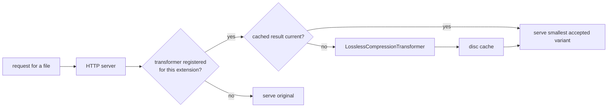

# SysWeaver.HttpTransformer.Compress

[⬆ SysWeaver overview](../README.md)

> File transformer for the SysWeaver web server that pre-compresses compressible served files at the highest compression level (Brotli, Zstandard and Deflate by default), caching the results on disc.

| | |
|---|---|
| **Layer** | Web platform |
| **Kind** | Plug-in (cached file transformer) |

## Purpose

On-the-fly HTTP compression has to trade ratio for speed. This transformer compresses each served file once, in the background, with the best (slowest) level of each configured content encoding and caches the results on disc. Later requests get the smallest variant the client accepts (`Accept-Encoding`); the content itself is unchanged.

## How it fits into SysWeaver



The transformer derives from `CachedTransformer` in [SysWeaver.HttpServer](../SysWeaver.HttpServer/README.md), which implements the server's transformer-service interface; the HTTP server service attaches it automatically when it is registered. Transformers only apply to non-dynamic responses with an ETag, and a query string starting with `raw` bypasses them.

## Key features

- Registers itself for every file extension marked as compressible in the MIME type map.
- Configurable encodings (`Methods`, default `br`, `zstd`, `deflate`); encodings without a registered codec are skipped unless `ThrowOnMissing` is set.
- Builds deferred in the background by default (`BuildDirect` builds on the first request); the original is served until the variants exist.

## Key components

- [`LosslessCompressionTransformer`](LosslessCompressionTransformer.cs) — the transformer
- [`LosslessCompressionTransformerParams`](LosslessCompressionTransformerParams.cs) — encodings and build options

## Using it

```json
{ "Type": "SysWeaver.HttpTransformer.LosslessCompressionTransformer, SysWeaver.HttpTransformer.Compress" }
```

## Limitations and considerations

- `zstd` is only produced when a Zstandard codec plug-in such as [SysWeaver.Compression.ZstdSharp](../Compression/SysWeaver.Compression.ZstdSharp/README.md) is registered.
- Compressing at the best level is CPU intensive for large files (paid once per file version).
- The disc cache grows with the number of distinct files and versions; files not accessed for `RemoveAfterDays` (default 30) are removed.

## Relationships

- **Project:** [`SysWeaver.HttpTransformer.Compress.csproj`](SysWeaver.HttpTransformer.Compress.csproj)
- **Builds on:** [SysWeaver.HttpServer](../SysWeaver.HttpServer/README.md)
- **Used by:** [SwServerManager](https://github.com/dosh1974/SysWeaver.Services/blob/main/SwServerManager/README.md)
