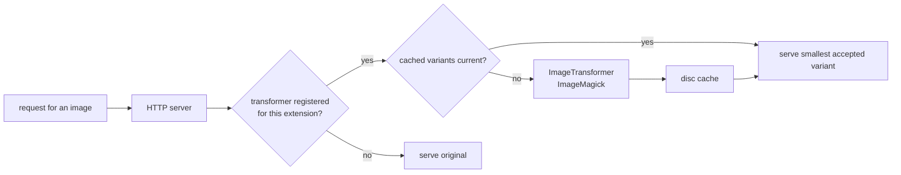

# SysWeaver.HttpTransformer.Image

[⬆ SysWeaver overview](../README.md)

> File transformer for the SysWeaver web server that converts served images into smaller or browser-supported formats (AVIF, WebP, PNG, JPEG) with ImageMagick, caching the results on disc.

| | |
|---|---|
| **Layer** | Media |
| **Kind** | Plug-in (cached file transformer) |

## Purpose

Serve images in the best format each browser accepts without preparing variants in advance. The transformer converts a served image once into a set of alternative formats, caches them on disc and lets every request pick the smallest variant the client accepts. It also makes image formats that browsers can't display (PSD, TGA, DDS, EXR, ...) viewable by converting them.

## How it fits into SysWeaver



The transformer derives from `CachedTransformer` in [SysWeaver.HttpServer](../SysWeaver.HttpServer/README.md), which implements the server's transformer-service interface; the HTTP server service attaches it automatically when it is registered. Transformers only apply to non-dynamic responses with an ETag, and a query string starting with `raw` bypasses them.

## Key features

- **Optimize** (default on): PNG, BMP, TIFF and JPEG files get AVIF / WebP (and PNG / JPEG) variants, built in the background; the original is served until they exist.
- **SupportNew** (default on): WebP and AVIF files get fall-backs (AVIF / WebP, PNG, JPEG) for clients that don't accept the original format.
- **Support**: formats browsers can't display (default `psd`, `tga`, `dds`, `exr`, `jp2`, `jxl`, `pcx`, `pict`) are converted on the first request.
- AVIF and WebP variants are only served to clients that list them in the `Accept` header.

## Key components

- [`ImageTransformer`](ImageTransformer.cs) — registers the conversions per file extension
- [`ImageHandler`](ImageHandler.cs) — builds and validates the cached variants with ImageMagick

## Using it

```json
{ "Type": "SysWeaver.HttpTransformer.ImageTransformer, SysWeaver.HttpTransformer.Image" }
```

## Limitations and considerations

- Conversions are registered by file extension (`png`, `bmp`, `tiff`, `jpeg`, `pjpeg`, `webp`, `avif` and the `Support` list), so files with other extensions for the same format (e.g. `.jpg`, `.tif`) are not transformed.
- Converting large images is CPU and memory intensive (paid once per file version); unsupported or corrupt files are served as is.
- The disc cache grows with the number of distinct files and versions; files not accessed for `RemoveAfterDays` (default 30) are removed.

## Relationships

- **Project:** [`SysWeaver.HttpTransformer.Image.csproj`](SysWeaver.HttpTransformer.Image.csproj)
- **Builds on:** [SysWeaver.HttpServer](../SysWeaver.HttpServer/README.md)
- **Used by:** [SwServerManager](https://github.com/dosh1974/SysWeaver.Services/blob/main/SwServerManager/README.md)
- **Third-party:** Magick.NET (ImageMagick)
