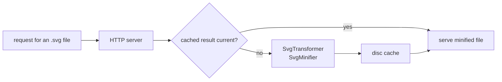

# SysWeaver.HttpTransformer.Svg

[⬆ SysWeaver overview](../README.md)

> File transformer for the SysWeaver web server that minifies served SVG files with SysWeaver.Minifier.Svg, caching the results on disc.

| | |
|---|---|
| **Layer** | Media |
| **Kind** | Plug-in (cached file transformer) |

## Purpose

Serve smaller SVG files without preparing them in advance. Each served SVG file is minified once with [SysWeaver.Minifier.Svg](../SysWeaver.Minifier.Svg/README.md), stored Brotli-compressed on disc and served instead of the original when it is smaller.

## How it fits into SysWeaver



The transformer derives from `CachedTransformer` in [SysWeaver.HttpServer](../SysWeaver.HttpServer/README.md), which implements the server's transformer-service interface; the HTTP server service attaches it automatically when it is registered. Transformers only apply to non-dynamic responses with an ETag, and a query string starting with `raw` bypasses them.

## Key features

- Registered for the `svg` extension; minifier options are configurable (`Svg`, default: at most one decimal, no bitmap validation).
- Builds on the first request by default (`BuildDirect`), so the first visitor already gets the minified file.
- The cached file name includes `SvgMinifierParams.CacheKey` (starting with `SvgMinifier.Version`), so a new minifier version or other options build new files instead of serving outputs of the previous version.

## Key components

- [`SvgTransformer`](SvgTransformer.cs) — the transformer
- [`SvgTransformerParams`](SvgTransformerParams.cs) — minifier and build options

## Using it

```json
{ "Type": "SysWeaver.HttpTransformer.SvgTransformer, SysWeaver.HttpTransformer.Svg" }
```

## Limitations and considerations

- SVG files only; files served pre-compressed (e.g. `.svg.br` resources) are not minified.
- Minification rounds numbers (to one decimal by default), which can visibly alter small or finely detailed drawings; raise `Svg.MaxDecimals` if needed.
- Ids are renamed by default, which breaks references from outside the file (e.g. `sprite.svg#icon` or CSS in a page); set `Svg.RenameIds` to false for such files.
- The disc cache grows with the number of distinct files and versions; files not accessed for `RemoveAfterDays` (default 30) are removed.

## Relationships

- **Project:** [`SysWeaver.HttpTransformer.Svg.csproj`](SysWeaver.HttpTransformer.Svg.csproj)
- **Builds on:** [SysWeaver.HttpServer](../SysWeaver.HttpServer/README.md), [SysWeaver.Minifier.Svg](../SysWeaver.Minifier.Svg/README.md)
