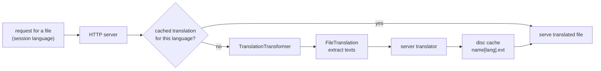

# SysWeaver.HttpTransformer.Translate

[⬆ SysWeaver overview](../README.md)

> File transformer for the SysWeaver web server that translates served text files (e.g. HTML, JavaScript) into the session language with SysWeaver.FileTranslation, caching the results on disc.

| | |
|---|---|
| **Layer** | Translation |
| **Kind** | Plug-in (cached file transformer) |

## Purpose

Localise web files that are not templates without maintaining translated copies. [SysWeaver.FileTranslation](../SysWeaver.FileTranslation/README.md) extracts the translatable texts of a served file, the server's translator translates them from English into the request language, and the rebuilt file is cached on disc per language.

## How it fits into SysWeaver



The transformer derives from `CachedTransformer` in [SysWeaver.HttpServer](../SysWeaver.HttpServer/README.md), which implements the server's transformer-service interface; the HTTP server service attaches it automatically when it is registered. Transformers only apply to non-dynamic responses with an ETag, and a query string starting with `raw` bypasses them.

## Key features

- Registered for `.html`, `.htm` and `.js` files (the handlers of SysWeaver.FileTranslation, which it registers globally; this also enables the server's own in-memory language templates for these extensions).
- Builds on the first request per file version and language (the request waits for the translation).
- Only the generated text variables and `${Session.Lang}` are replaced; other `${...}` tokens such as JavaScript template literals are kept.

## Key components

- [`TranslationTransformer`](TranslationTransformer.cs) — the transformer and its per-extension handlers

## Using it

```json
{ "Type": "SysWeaver.HttpTransformer.TranslationTransformer, SysWeaver.HttpTransformer.Translate" }
```

## Limitations and considerations

- Source texts are assumed to be English.
- Uses the translator of the HTTP server (see the server's translator parameters); without one the texts are kept as is. Translation quality and cost depend on that translator.
- Requests without a language are served untranslated.
- The disc cache grows with the number of distinct files, versions and languages; files not accessed for `RemoveAfterDays` (default 30) are removed.

## Relationships

- **Project:** [`SysWeaver.HttpTransformer.Translate.csproj`](SysWeaver.HttpTransformer.Translate.csproj)
- **Builds on:** [SysWeaver.FileTranslation](../SysWeaver.FileTranslation/README.md), [SysWeaver.HttpServer](../SysWeaver.HttpServer/README.md)
