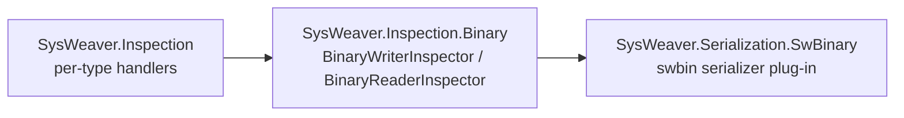

# SysWeaver.Inspection.Binary

[⬆ SysWeaver overview](../README.md)

> Binary reader and writer inspectors: the concrete wire format for SysWeaver's binary serializer.

| | |
|---|---|
| **Layer** | Foundation |
| **Kind** | Library |

## Purpose

Implements the inspector contracts from [SysWeaver.Inspection](../SysWeaver.Inspection/README.md) against binary streams, producing a compact SysWeaver-specific encoding. It is wrapped as a regular serializer plug-in by [SysWeaver.Serialization.SwBinary](../Serialization/SysWeaver.Serialization.SwBinary/README.md).

## How it fits into SysWeaver



## Key features

- Little endian values; strings are UTF-16 by default (any `Encoding` can be passed, the reader must use the same).
- Objects and strings written more than once are written once, then as a back reference, so shared references and cycles survive a round trip.
- Values are written as their declared type; a type name is only written when the runtime type differs (polymorphic members, values written as an object).
- Each object carries its type version, so older data can be read by newer code (see [SysWeaver.Inspection](../SysWeaver.Inspection/README.md)).
- `ParentField<T>` / `ParentProp<T>` let a type being read find its closest parent object of type T.
- Static helpers `BinaryWriterInspector.Write(value, stream, ...)` / `BinaryReaderInspector.Read<T>(stream, ...)` do a whole round in one call (and can add context values for `IDescribable` implementations).

## Key components

- [`BinaryWriterInspector`](BinaryWriterInspector.cs) — writes objects in the binary format
- [`BinaryReaderInspector`](BinaryReaderInspector.cs) — reads them back

## Using it

```csharp
using (var w = new BinaryWriterInspector(stream, leaveOpen: true))
    w.Write(value);                 // written as its declared type
stream.Position = 0;
using var r = new BinaryReaderInspector(stream, leaveOpen: true);
var back = r.Read<MyType>();        // read as the same type (or Read<Object>() if written with saveAsObject: true)
```

## Limitations and considerations

- The format is only readable by SysWeaver; use the JSON, MessagePack or Protobuf plug-ins for interoperability.
- `Write(x)` writes x as its declared type, read it with `Read<T>()`; `Write(x, true)` writes it as an object, read it with `Read<Object>()`.
- Type names in the data are resolved with `TypeFinder.GetForData`: the `DataTypePolicy` applies and the type must be assignable to the declared type (else `DataTypeNotAllowedException`), unknown types throw `InvalidDataException`.
- Truncated or corrupt data throws (`EndOfStreamException`, `InvalidDataException`, `ArgumentOutOfRangeException` or `OverflowException`).
- Objects are always created when reading (the existing value of a member is replaced, not updated).
- Writing never modifies the written objects or collections, several writers may write the same objects at the same time.
- The readers / writers themselves are not thread safe.

## Relationships

- **Project:** [`SysWeaver.Inspection.Binary.csproj`](SysWeaver.Inspection.Binary.csproj)
- **Builds on:** [SysWeaver.Inspection](../SysWeaver.Inspection/README.md)
- **Used by:** [SysWeaver.Serialization.SwBinary](../Serialization/SysWeaver.Serialization.SwBinary/README.md)
