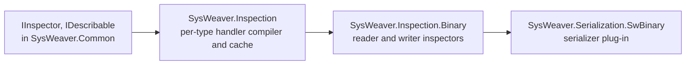

# SysWeaver.Inspection

[⬆ SysWeaver overview](../README.md)

> A reflection-driven "inspection" engine that compiles, per type, the code needed to walk an object's data in a versioned way — the foundation of SysWeaver's own binary serialization.

| | |
|---|---|
| **Layer** | Foundation |
| **Kind** | Library |

## Purpose

Instead of hand-writing read/write code, a type is *inspected*: fields are visited through an `IInspector`, which can be a reader, a writer or anything else (copy, compare, describe). This project builds and caches the per-type handlers (as compiled expression trees) that drive an inspector over an object.

## How it fits into SysWeaver

## Key features

- Handlers generated once per (declared type, runtime type) and cached (`TypeHandlerCache<T>`, thread safe, never released).
- Types are handled as (first match): values with a typed `IInspector.Field` overload (primitives, `string`, dates and times, `Guid`), `IDescribable` types (the type describes itself, the most-derived `Describe` is used), arrays of any rank (`byte[]` as one block), enums, `Nullable<U>`, `KeyValuePair<K, V>`, lists and collections, and finally all other types as their instance fields (including private and inherited, except readonly fields).
- Versioning: `IDescribable` types get their version from `[DescVersion(n)]` (1 without it). Data written by an older version is read with `Describe(i, version)`, data from a newer version is rejected with an `InvalidDataException`.
- When reading, instances are created with an `(IInspector, int version[, bool isLatestVersion])` constructor if present, else a parameterless constructor of any accessibility; interfaces and abstract types are always handled through the runtime type (whose name is written).
- Type name handling with configurable qualification (`TypenameQualifications`: `Simple` = full name, `Assembly` = full name + assembly name, `Full` = assembly qualified name), all resolvable by `TypeFinder`.
- Unmanaged memory blocks (`StaticTypeHandler.HandleUnmanagedMemory`) are inspected as a byte array.

## Key components

- [`TypeHandler<T>`](TypeHandler.cs) — the compiled code that inspects one runtime type
- [`TypeHandlerCache<T>`](TypeHandlerCache.cs) — the handler cache
- [`StaticTypeHandler`](StaticTypeHandler.cs) — helpers used by the generated code (type names, versions, unmanaged memory)
- [`TypenameQualifications`](TypenameQualifications.cs) — how type names are written

## Limitations and considerations

- An internal building block; application code normally uses a serializer rather than inspectors directly.
- The binary format produced through it is SysWeaver specific (not interoperable with other ecosystems).
- Readonly fields are skipped silently, so get-only and init-only auto properties are not round tripped.
- Collections are created with their parameterless constructor: a custom comparer of a `HashSet` / `Dictionary` is lost. Read-only `ICollection<E>` implementations can be written, reading one throws.
- Writing (with an `IWriteInspector`) only reads the collections, so several threads may write the same collection at the same time.
- The handlers are compiled expression trees: the first use of a type is slow, and every type used stays in memory.

## Relationships

- **Project:** [`SysWeaver.Inspection.csproj`](SysWeaver.Inspection.csproj)
- **Builds on:** [SysWeaver.Common](../SysWeaver.Common/README.md)
- **Used by:** [SysWeaver.Inspection.Binary](../SysWeaver.Inspection.Binary/README.md)
